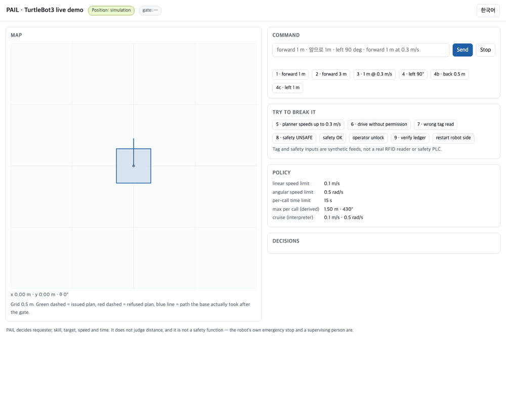

# PAIL — Physical Action Identity Layer

> This is the Korean edition. The canonical document is
> [`README.md`](README.md) (English).

**LLM 플래너가 `forward 30 m` 를 환각한다. 아무도 등록하지 않은 노드가 `/cmd_vel` 에
명령을 내보내기 시작한다. 베이스 앞에 PAIL 이 있으면 두 명령 모두 액추에이터에 닿지
않는다 — 이슈어는 첫 요청을 거부하며 어긴 한계의 이름을 적고(`ERR_ENVELOPE_EXCEEDED`),
게이트는 두 번째를 막으며(`ERR_NO_TOKEN`), 누가 요청했고 무엇이 허용되고 무엇이 거부됐는지의
서명된 해시 체인 기록이 응답을 읽기도 전에 존재한다.**

> **PAIL 은 브레이크나 안전 펜스가 아니다.** AI 가 내린 물리 명령의 권한을 확인하는
> 출입국 관리소이고, 사고가 났을 때 무슨 일이 있었는지 기록하는 블랙박스다.

AI 가 로봇에게 시키는 모든 물리적 행동에 대한 권한의 증명 — 움직이기 전에 서명되고,
응답이 돌아가기 전에 기록되며, 누구든 나중에 검증할 수 있다. 로봇이 "앞으로 가라"는
명령을 받았을 때 PAIL 이 묻는 것은 하나다 — *이 행동을 할 권한이 서명으로 증명되는가.*
증명되지 않으면 명령은 통과하지 않고, 통과하든 통과하지 않든 **그 사실이 먼저 기록된다.**

스펙 판: **`PAIL-CORE-2026.1`** · 테스트 벡터: `spec/vectors/canon/MANIFEST.sha256`
(`set_sha256 bbddff16…`). 이 두 값이 적합성 주장의 단위다 — [`spec/CONFORMANCE.ko.md`](spec/CONFORMANCE.ko.md).

PAIL Core 는 **Apache-2.0** 소스다: 로봇 게이트웨이, ROS 2 게이트와 모션 브리지, 어댑터,
SDK/프로토콜, 저널 라이브러리, 독립 검증기 둘. TurtleBot3(소프트웨어·바퀴 띄운 실물),
Jetson Orin Nano Super(네이티브 CPU), L40S 위의 Isaac Sim(amd64)에서 측정했고, 수치와 한계는
[무엇을 측정했는가](#무엇을-측정했는가) 에 있다.

---

## 로봇 없이 바로 써 보기

Docker 가 있는 노트북에서 명령 세 줄이다. 이슈어·게이트·모션 브리지는 실제 구성 요소이고,
시뮬레이션인 것은 TurtleBot3 베이스와 태그 리더, 안전 피드뿐이다. 호스트 ROS 도, 계정도,
하드웨어도 필요 없다. 평가 꾸러미는 [0.2.0 release 페이지](https://github.com/glowfly-ai/pail/releases/tag/0.2.0)에서
아키텍처에 맞는 것을 받아 그 디렉터리에서 아래를 실행한다.

```sh
python3 evaluation.py load                               # 제공된 이미지 아카이브
python3 evaluation.py tb3 --state /tmp/pail-tb3-live     # CONSOLE=http://127.0.0.1:8765/ 를 찍는다
python3 evaluation.py stop-tb3 --state /tmp/pail-tb3-live
```



콘솔에 `forward 1 m` 를 치면 서명된 한계가 적힌 `ISSUED`, 이어 `PERMIT OK`, 베이스가 약 1 m
를 간다. `forward 3 m` 를 치면 `REFUSED ERR_ENVELOPE_EXCEEDED · step.max_duration_s 30 > 15`,
아무것도 움직이지 않고, 요청은 한계에 맞춰 깎이지 않는다. **6 · drive without permission** 을
누르면 플래너가 토큰 없이 `/cmd_vel` 에 내보내고 게이트는 `BLOCK ERR_NO_TOKEN` 으로 답한다.
**9 · verify ledger** 로 그 전부를 기록한 서명 체인을 검증한다. 장면마다의 설명과 데모가
아닌 것은 [안내](examples/tb3/DEMO.ko.md)에, 모든 장면의 자동 판정은
`python3 examples/tb3/demo_scenes.py` 에 있다. 화면은 영어 기본·한국어 선택이다.

`evaluation.py` 와 이미지 아카이브는 release 페이지의 평가 꾸러미 안에 있다([TRY_IT.ko.md](TRY_IT.ko.md)에 호스트 전제).
Core 소스만으로는 이슈어가 없다 — 이슈어는 별도 조건의 평가 실행본으로 제공되기
때문이다([라이선스](#라이선스)). 아카이브를 불러두고 데모 이미지가 이미 빌드된 Apple Silicon
Mac 에서 `tb3` 는 기동 7 s 뒤에 콘솔과 모든 역할이 준비됐다. 맨 처음 실행은 데모
이미지도 빌드하므로 몇 분이 걸린다.

## 왜 PAIL 인가

AI 플래너, LLM 에이전트, 원격 콘솔이 이제 물리 명령을 낸다. 로봇은 보통 명령 토픽에
도착하는 것을 그대로 실행하고, 사고 뒤에는 누가 무엇을 인가했는지 아무도 증명하지 못한다.
PAIL 은 결정과 액추에이터 사이에 서명되고 범위가 정해진 **행동 토큰**을 두고, 발급 응답이
나가기도 전에 그 결정을 해시 체인 저널에 쓴다.

```
 플래너 / 콘솔 ──계획──▶ 이슈어 ──서명된 행동 토큰──▶ 로봇 게이트 ──permit──▶ 모션 브리지 ──▶ 액추에이터
                         │ 저널이 먼저                 │ 원문 바이트를 검증;
                         │ (해시 체인, 외부 앵커)      │ 토큰 없으면 움직임 없음(fail-closed)
                         └──── 누구든 저널을 오프라인으로 재검증 (pail-verify, pail-recompute) ◀──┘
```

달라지는 것:

- **인가되지 않은 명령은 게이트가 지키는 명령 경로를 통과하지 않는다.** 게이트가 로봇 위에서 서명 바이트를
  검증한다. 만료·소비·범위 밖·위조 토큰은 이유가 적힌 거부이지, 깎아서 통과시킨 명령이 아니다.
  게이트를 우회하는 경로를 막는 것은 통합자의 몫이다(`G-DEL-L05`).
- **모든 결정이 내가 쓰지 않은 기록으로 남는다.** 발급·거부·허가·대체가 각각 저널에 들어가고,
  해시 체인 저널의 머리를 외부 앵커에 고정할 수 있으므로 과거를 들키지 않고 고칠 수 없다.
- **서명·저널·벡터는 우리를 믿지 않고도 확인할 수 있다.** 고정된 테스트 벡터, 생산자와 코드를 공유하지
  않는 오프라인 검증기, 측정 행렬이 안에 들어 있는 평가 꾸러미.

### SROS2 와 같은 층이 아니다

경력 있는 ROS 2 엔지니어가 가장 먼저 묻는 질문이다. SROS2(DDS Security)는 *어느 참가자가
어느 토픽에 발행·구독해도 되는가* 에 답한다. 특정 명령 하나가 무엇까지 해도 되는지, 누가
그것을 인가했는지, 한 번만·정해진 시간·정해진 속도 안에서 인가된 것인지는 모른다. PAIL 은
그 질문에 답하고, **자기가 답할 수 없는 것은 SROS2 에 맡긴다**: 전송로 위 permit 하트비트의
진본성은 SROS2 Enforce 에 위임돼 있고(`G-DEL-03`), 접근 제어 없는 토픽 remap 은 우회를 막는
벽이 아니다.

| 질문 | SROS2 | PAIL |
|---|---|---|
| 이 노드가 `/cmd_vel` 에 말해도 되는가? | 예 — 참가자·토픽별 permissions | 아니오 — 이 부분은 SROS2 를 믿는다 |
| *이* 명령이 인가된 범위 안인가 — 속도·시간·대상·이 한 스텝? | 아니오 | 예 — 게이트가 서명된 토큰의 한계를 명령마다 대조한다 |
| 누가 요청했고 누가 서명했고 무엇이 어떤 순서로 거부됐는가? | 아니오 | 예 — 발급 응답 전에 저널에 기록되고 오프라인으로 재생된다 |
| 운영자를 믿지 않는 사람이 나중에 결정을 다시 읽을 수 있는가? | 아니오 | 예 — 해시 체인·외부 앵커·독립 검증기 둘 |

## 누구를 위한 것인가

| 당신은 | PAIL 이 주는 것 | 시작 |
|---|---|---|
| **로봇 개발자** | 베이스 앞에 두는 ROS 2 게이트와 모션 브리지, 그 밖의 모든 것에 쓰는 C ABI 어댑터 계약, 어댑터 적합성 하네스, 호스트에 ROS 없이 Docker 로 도는 TurtleBot3 참조 | [로봇 없이 바로 써 보기](#로봇-없이-바로-써-보기) → [통합에 드는 비용](#통합에-드는-비용) |
| **연구자** | 고정 벡터가 있는 정규 바이트 형식, 독립 오프라인 검증기, 릴리스마다 측정 행렬이 들어 있는 재현 가능한 평가 꾸러미, 우회·수명주기 시험 행렬이 있는 Isaac Sim 경로 | [두 번째 구현을 만든다면](#두-번째-구현을-만든다면) → [증거를 직접 검증하기](#증거를-직접-검증하기) |
| **OEM·통합사** | 설계상 fail-closed, 문서화된 위임(SROS2 전송, 키 보관), 코드에서 생성되는 신뢰 경계와 위협 모델, 별도 조건의 평가용 이슈어, 라이선스에 어떤 특허권이 따라오는지에 대한 평이한 설명 | [무엇이 아닌가](#무엇이-아닌가) → [오픈 코어 너머](#오픈-코어-너머) → [배치하기 전에 읽을 것](#배치하기-전에-읽을-것) |

## 더 돌려 볼 경로

실제 발급·데모는 같은 판의 평가 묶음을 사용합니다. `evaluation.py`가 있는 디렉터리에서
이미지를 불러온 뒤 아래 명령을 실행합니다. Core 자체 시험에는 이슈어가 필요하지 않습니다.

[설치·결과 확인 안내(영문)](TRY_IT.md)에 OS별 전제, Windows/WSL 한계,
CLI/관측 화면 구분, 실행별 증거와 선택적 관측 화면 절차가 있다.
로봇이나 Anchor SaaS 계정 없이 소프트웨어 시험이 가능하다. 포함된 관측 UI는 영어 기본·한국어 선택을 제공한다.

### TurtleBot3 베이스 참조

**게이트 → 모션 브리지 → 베이스 명령 수신기** 전체 메시지 경로는 다음으로 확인합니다.

```sh
python3 evaluation.py test-tb3 --state /tmp/pail-tb3-reference
```

준비 조건·로컬 키 생성·증거 보존·별도 실물 연결 범위는 [영문 TB3 안내](examples/tb3/README.md)에 있습니다.
기본값은 합성 입력을 쓰는 격리된 개발 참조이며 모터 시험이 아닙니다. 서비스 가입은 필요하지 않습니다.
v5 스킬 등재부를 명시적으로 선택하고, 원본 관측과 기계 판정 데이터를 함께 보존합니다.

### 첫 시험 경로 선택

같은 ZIP에서 공통 PAIL Core를 사용하는 두 경로를 선택합니다.

| 목적 | 명령 | 실물 필요 여부 |
|---|---|---|
| **PAIL의 판정을 브라우저에서 직접 보기** | `python3 evaluation.py tb3 --state /tmp/pail-tb3-first` 뒤 출력된 `CONSOLE=` URL을 연다 — [따라 하기](examples/tb3/DEMO.ko.md) | 없음. 시뮬레이션 TurtleBot3 베이스 |
| ROS2/TB3 인가·브리지 | `python3 evaluation.py test-tb3 --state /tmp/pail-tb3-test` | 없음. 기본값은 명령 관측용 모의 베이스 |
| Microduck 정상 데모 | `python3 evaluation.py test-microduck --state /tmp/pail-duck-first` | 없음. 공식 fake, 호스트 ROS 불필요 |
| **Microduck 라이브 데모 + 대시보드** | `python3 evaluation.py microduck --state /tmp/pail-duck-live` 뒤 출력된 `CONSOLE=`·`DASHBOARD=` URL 을 연다 — [따라 하기](examples/microduck/DEMO.ko.md) | 없음. 공식 `robotd --fake`, ROS 불필요 |
| Microduck 장애·권한 검사 | `python3 evaluation.py test-conformance --state /tmp/pail-duck-suite` | 없음. 알려진 SKIP는 별도 표시 |

소스 밖의 새 state 경로를 사용합니다. [설치·이 릴리스의 범위](TRY_IT.ko.md)를 먼저 확인하세요.

## 무엇을 측정했는가

아래 수치는 모두 측정 보고서에서 옮긴 것이고, 그 보고서가 정의한 만큼만 뜻한다.
소프트웨어 PASS 는 실물 인증이 아니고, 바퀴를 띄운 실물 판정은 바닥 주행이 아니다.

| 플랫폼 | 범위 | 최근 측정 결과 | 보고서 |
|---|---|---|---|
| 소프트웨어 꾸러미(Docker, Linux arm64·amd64) | Microduck 프리뷰, 시뮬레이션 TurtleBot3 베이스, fleet, 어댑터 적합성, 수명주기, 계획 대체 | Microduck 15/15 · TurtleBot3 13/13 · fleet 27/27(dev·mTLS) · 게이트 CTest 37/37 · 수명주기 21/21 · 대체 8/8 | 각 평가 꾸러미 안에 든 측정 검증 보고서(VALIDATION); [TRY_IT.ko.md](TRY_IT.ko.md) |
|<!-- hw-measurements:begin hardware_row --> TurtleBot3 실물(바퀴 띄움) | 엔코더 관측·수락 판정기 | 최신 독립 실물 근거: 최종 0.2.0-preview.45 꾸러미에서13/13 장면 x3. 해당 빌드의 근거이며 이 릴리스의 실물 수락 주장이 아님 | [examples/tb3/HARDWARE.ko.md](examples/tb3/HARDWARE.ko.md) §8 <!-- hw-measurements:end hardware_row -->|
| Jetson Orin Nano Super(네이티브 arm64, CPU) | 실제 게이트·브리지를 쓰는 역할 격리 합성 참조 | 7/7 시나리오; 8시간 분할 반복: exercise/cancel 752회, 결함 주입 22회, 정리 전부 PASS | [examples/nvidia/README.ko.md](examples/nvidia/README.ko.md) |
| L40S VM 1대 위의 Isaac Sim 6.0.1(Linux amd64) | 같은 게이트 뒤의 실제 SDK endpoint; BS-01~12·BP-01~12 우회·수명주기 행렬 | 14 케이스 전부 릴리스 실행의 새 상태 반복 2회 PASS, 28/28 완료(BP-11 양성 대조는 DETECTED); 같은 이미지의 이전 실행 1회는 INCONCLUSIVE 1건을 기록했고 release 페이지와 ISAAC.ko.md 에 공개했다; 정지는 physics step 당 위치 변화로 판정하고 SDK 보고 velocity 는 증거로 보존 | [examples/nvidia/ISAAC.ko.md](examples/nvidia/ISAAC.ko.md) |

전달된 아카이브의 수령자 경로는 발행자의 작업 트리를 공유하지 않는 평가 실행이 재현했다:
이 분할 꾸러미 계열의 모든 빌드를 Apple Silicon Mac 에서, 변경이 amd64 경로에 닿은 빌드를
그 L40S VM 에서, 첫 빌드를 Linux ARM64 VM 에서. 이 릴리스가 세 경로 중 어느 재현을
가지는지, 그리고 amd64 이미지를 어떤 호스트에서 빌드했는지는 그 VALIDATION 과 함께
전달되는 검증 보고서가 적는다. 측정하지 않은
것: 다른 로봇, 다른 GPU·SDK 버전, 바닥 주행, 기능안전 인증. 배치 전에
[TRUST_BOUNDARY.md](TRUST_BOUNDARY.md) 를 읽는다.

### 측정한 시간과 아직 측정하지 않은 시간

| 양 | 어디서 | 측정값 | 출처 |
|---|---|---|---|
|<!-- hw-measurements:begin deadline_row --> 정상 이동 중 게이트의 스텝 기한 초과 거부 | Raspberry Pi 3 위 TurtleBot3, 바퀴 띄움 | 모든 판정기에서 0건: 0.2.0-preview.22 꾸러미의 독립 3회와 0.2.0-preview.19 빌드의 발행자 3회 | [HARDWARE.ko.md](examples/tb3/HARDWARE.ko.md) §8 <!-- hw-measurements:end deadline_row -->|
|<!-- hw-measurements:begin restart_row --> 게이트 재시작 입출력 준비 | TurtleBot3 실물 | DDS 인증 정체 미해결; 독립 집단 29회 중 1회 및 별도 117회 중 1회. 고정 실패율 아님, 수동 복구만 지원 | [KNOWN_ISSUES.ko.md](KNOWN_ISSUES.ko.md) <!-- hw-measurements:end restart_row -->|
| Isaac Sim endpoint 가 `READY_LOCKED` 에 이르기까지 | L40S VM, 새 상태 vs 시드된 셰이더 캐시 | 약 9–10분 vs 40–60 s | [ISAAC.ko.md](examples/nvidia/ISAAC.ko.md) |
| `/cmd_vel` 입력부터 `/drive_cmd_vel` 출력까지, 직접 구독자 대비 추가되는 명령 지연 | Jetson Orin Nano Super, 25 W, 참조 리그, 10 / 20 / 50 Hz | p50 3.8–4.3 ms, p99 5.4–7.0 ms, 971건 중 손실 0, 출력 간격 지터 p99 ≤ 3.6 ms | [tools/latency](examples/tb3/tools/latency/README.md) |
| 같은 값, 실물 TurtleBot3 | Raspberry Pi 3B+, 벤더 드라이버 구동, 바퀴 띄움, 10 / 20 Hz | p50 14.3–14.7 ms, p99 21.9–23.4 ms, 181건 중 손실 0, 지터 p99 ≤ 12.8 ms — 상한: Python 프로브가 Pi 의 CPU 를 나눠 썼다 | 같음 |

지연 행은 2026-10-16 에 같은 게이트·브리지의 이전 빌드, SROS2 `Enforce` 켜짐, 보드당 1 세션,
첫 허가 명령 뒤 정상 상태에서 쟀다. 그 뒤의 게이트 변경(세션 치명 래치, 치명 보고
워커 스레드, 그 뒤의 래치 대체 경로) 뒤에는 다시 재지 않았다 — 그 변경은 명령 경로를
건드리지 않았지만 그것은 코드 읽기이지 측정이 아니다. 이 값은 속도 명령 **토픽**이 드라이버 노드에 도착할
때까지의 시간이다. 그 아래의 드라이버·펌웨어·모터 제어 루프(TurtleBot3 의 OpenCR 20 ms
모터 루프, ros2_control 의 `update_rate` 루프)는 포함하지 않으며 PAIL 은 그 층에 손대지
않는다. 새 계획의 첫 명령은 토큰을 기다린다(게이트가 토큰을 쥘 때까지 `ERR_NO_TOKEN`);
Jetson 에서는 그 뒤 한 번 0.2–0.4 s 의 방출 버스트가 있었다. 비교하자면 Nav2 제어기의
기본 주기는 20 Hz 이고 흔한 명령 타임아웃은 0.5–1 s 다. Jetson 위 CPU 비용은 **아직
공개하지 않았다**. 이 페이지의 어떤 문장도 지연 보증이 아니다.

## 무엇인가

- **인가 계층.** 행동 토큰을 발급자가 Ed25519 로 서명하고, 로봇 위의 게이트가
  원문 바이트 그대로 검증한다. 검증에 실패한 명령은 액추에이터에 도달하지 않는다.
- **증빙 계층.** 인가 레코드는 **발급 응답보다 먼저** 해시 체인 저널에 들어간다.
  "발급했는데 기록이 없다"는 상태가 설계상 존재하지 않는다.
- **외부 기준점.** 저널의 머리는 주기적으로 외부 앵커에 고정된다. 과거를 고쳐 쓰려면
  우리 손이 닿지 않는 곳에 있는 값까지 고쳐야 한다.

## 무엇이 아닌가

**여기부터 먼저 읽는 것을 권한다.** 아래는 요약이고, 정본은
[`TRUST_BOUNDARY.md`](TRUST_BOUNDARY.md) 다.

- **로봇의 안전 계통이 아니다.** 최종 물리 정지는 로봇 하드웨어가 소유한다. PAIL 은
  권한과 증거의 계층이다.
- **전송 계층 보안을 대신하지 않는다.** permit 메시지의 진정성은 SROS2 에 위임된다.
  SROS2 없이 배치하면 **permit 을 위조할 수 있다** — 위임 항목 `G-DEL-03`.
- **키 관리 시스템이 아니다.** 키 재료의 물리적 보호는 배치 조직의 것이다.
- **AI 의 판단을 검증하지 않는다.** PAIL 은 AI 가 요청한 행동에 권한이 있었는지를
  묻지, 그 행동이 옳았는지를 묻지 않는다.

## PAIL 연결하기

세 경로 모두 같은 Core 와 같은 평가용 이슈어를 쓴다.

### 통합에 드는 비용

PAIL 은 콜백을 감싸라고 하지 않는다. 플래너 프로세스 안의 데코레이터는 자기가 검사해야
할 바로 그 프로세스가 집행하는 셈이라, 게이트는 토픽 경로 위에 놓인 별도 노드이고 플래너는
그대로다:

```
 내 플래너 ──/cmd_vel──▶ pail_pep_gate ──/safe_cmd_vel──▶ pail_motion_bridge ──/drive_cmd_vel──▶ 베이스 드라이버
  (무변경)                Twist 마다 서명된 토큰의             permit 하트비트가 살아 있는            (SROS2 enclave /driver,
                          한계와 대조                           동안만 전달                            입력 remap)
```

ROS 2 로봇에서 바뀌는 것은 셋이고, 플래너 안에는 없다:

1. **베이스 드라이버가 `/cmd_vel` 대신 `/drive_cmd_vel` 을 읽는다.** 드라이버 launch 의
   remap 한 줄 — [`examples/tb3/tb3_base_driver.launch.py`](examples/tb3/tb3_base_driver.launch.py):

   ```python
   remappings=[('/cmd_vel', '/drive_cmd_vel')]
   ```

2. **게이트와 브리지가 드라이버 옆에서 돈다.** 로봇의 keyring·정책·SROS2 enclave 와 함께 —
   [TurtleBot3 참조](examples/tb3/README.ko.md)가 그대로 돌아가는 완전한 형태다.
3. **한계는 코드가 아니라 이슈어의 정책에 산다.** 한계를 넘는 스텝은 거부되고 거부는 한계의
   이름을 적는다. 맞춰 깎는 일은 없다:

   ```yaml
   guardrails:
     common:                      # 절대 상한
       sls.linear_mps: 1.0
       sls.angular_rps: 1.0
       step.max_duration_s: 30
     zones:                       # 더 조일 수만 있다
       z7:
         sls.linear_mps: 0.5
   ```

   어휘와 규칙은 [`spec/SITE_MODEL.ko.md`](spec/SITE_MODEL.ko.md)에 있다.

ROS 가 없는 로봇은 [C ABI 어댑터 계약](spec/ADAPTER_CONTRACT.md)으로 붙고
[적합성 하네스](pvs-public/conformance/)로 측정한다.

### 내 로봇에 연결하기

[어댑터 계약](spec/ADAPTER_CONTRACT.md), [스킬 등재부](spec/SKILLS.md),
[어댑터 상태표](spec/ADAPTERS.tsv), [적합성 하네스](pvs-public/conformance/)를 참고하세요.
fake 시험은 실제 로봇 인증이 아니며 별도 어댑터 전체 소스가 동봉됐다는 뜻도 아닙니다.

네이티브 독립 검증기를 빌드하려면 Go 1.27.3 이상이 필요합니다. Go가 없는 호스트는
`golang:1.27.3` 이미지를 받은 뒤 검증기 자체는 네트워크 차단 상태의 Docker 로 돌릴 수 있습니다
(최초 이미지 다운로드만 네트워크가 필요합니다):

```sh
docker run --rm --network none -v "$PWD":/src:ro -w /src/cmd/pail-verify \
  -e GOCACHE=/tmp/gc -e GOPATH=/tmp/gp golang:1.27.3 go test ./...
```

릴리스 식별: [VERSION](VERSION), 변경: [CHANGELOG.md](CHANGELOG.md),
배포물 확인: [RELEASE.md](RELEASE.md), 지원: [SUPPORT.md](SUPPORT.md).

### ROS 2·실물·시뮬레이션

- **ROS 2 / TurtleBot3:** [TurtleBot3 참조](examples/tb3/README.md)는 생성 키와 SROS2 Enforce 를
  갖춘 게이트 → 모션 브리지 → 베이스 전체 경로이고, [HARDWARE.md](examples/tb3/HARDWARE.md)는
  같은 콘솔과 판정기를 실물 베이스에 적용한 절차와 측정 결과다.
- **Isaac Sim(amd64 꾸러미):** [ISAAC.ko.md](examples/nvidia/ISAAC.ko.md)는 같은 게이트 뒤에서
  실제 Isaac Sim 6.0.1 endpoint 를 새 상태마다 한 번의 인가된 exercise 로 돌리며 BS/BP 행렬
  드라이버를 제공한다. PAIL 은 이미지 파생 레시피와 자산 레시피를 배포하지 NVIDIA 이미지나
  변환 자산을 배포하지 않는다.
- **Jetson(arm64 꾸러미):** [examples/nvidia/README.ko.md](examples/nvidia/README.ko.md)에 Orin
  Nano Super 에서 측정한 네이티브 CPU 프로필과 결함 스위트가 있다. GPU 워크로드와 Isaac ROS 는
  측정 범위 밖이다.

### 두 번째 구현을 만든다면

| 스펙 | 무엇을 정하는가 |
|---|---|
| [`spec/CANON.md`](spec/CANON.md) | 서명·해시에 들어가는 **정규문**. 접두어별 유도식과 조립 규칙 |
| [`spec/KNOWN_DEV_KEYS.md`](spec/KNOWN_DEV_KEYS.md) | 기동 게이트 `S8` 이 읽는 **지문 목록의 포맷** |
| [`spec/SITE_MODEL.md`](spec/SITE_MODEL.md) | `PAIL_SITE_MODEL` 로 적재하는 **사이트 모델 YAML**. 키 전건과 필수성, 그리고 각 키가 무엇에 영향을 주고 **주지 않는지** |
| [`spec/API_SURFACES.md`](spec/API_SURFACES.md) | 우리 내부를 읽지 않고 붙는 **네 표면**. 거부·증거·안전상태·운영자면 — 그리고 §6 의 선택적 운영·관리 인터페이스: 어느 리스너가 무엇을 나르고 얼마나 안정적인가 |
| [`spec/VERIFICATION_INPUTS.md`](spec/VERIFICATION_INPUTS.md) | 독립 검증기가 먹는 **입력 세 형식** — 서명된 체크포인트 노트·포함 증명 응답·일관성 증명 응답. 그리고 체크포인트의 바이트를 쓰기 전에 통과해야 하는 **두 관문** |
| [`spec/MERKLE_VECTORS.md`](spec/MERKLE_VECTORS.md) | 그 바이트 **위의 로그 산술**. RFC 6962 해싱·루트·포함/일관성 증명, 그리고 트리 크기 0..9 **전수** 적합성 벡터 세트 |
| [`spec/SUBGRAPH_HASH.md`](spec/SUBGRAPH_HASH.md) | **토큰이 발급된 세계 조각.** `subgraph_snapshot_hash`(토큰 필드 61)가 컨텍스트 그래프를 어떻게 고르고·적고·해시하는지, 사이트 선언이 그 세계로 어떻게 컴파일·변이되는지, 그리고 독립 검증기가 재계산하는 동결 벡터 세트 |
| [`spec/TRUST_ROOT.md`](spec/TRUST_ROOT.md) | **누구의 서명을 받아들일 것인가.** 신뢰근의 정의, 대역외 취득 경로, 회전의 기록 방식, 그리고 벡터와 함께 실린 vkey 가 왜 신뢰근이 아닌지 |

이 문서들의 유도식과 포맷 기술은 **손으로 쓰였지만 손으로 검증되지 않는다.** 인용된
바이트는 `spec/vectors/` 의 동결 벡터(뿌리를 따로 가진 세트는 `spec/proof-vectors/` 와
`spec/merkle-vectors/`)와 실린 파일의 **부분문자열이어야 하고**, 트리에 있는
`spec/tools/spec_*_check.py` **전부**가 매 CI 마다 그것을 잰다. 목록은 이 README 의
문장이 아니라 디렉터리다 — 검사기 없이 새 문서만 도착할 수 없다는 뜻이다.
문서만 고치면 붉어지고, 벡터만 고쳐도 붉어진다.

`VERIFICATION_INPUTS.md` 은 우리 없이 가장 세게 검증할 수 있는 문서다. 그 검사기는
ed25519 와 RFC 6962 를 **자기가 직접** 구현해 들고 다닌다 — 벡터를 만들어 낸
라이브러리를 불러 쓰면 일치는 증거가 아니라 항등식이기 때문이다. 매 CI 마다 실린
검증키로 동결 체크포인트를 열고, **그렇게 인증한 루트**에 대해서만 동결 증명 다섯을
전부 재유도한다. 서명이 맞지 않으면 인증되지 않은 루트로 재유도하는 쪽으로 물러서지
않고 **왜 멈췄는지를 인쇄한다.** 그것이 이 문서의 요지다.

`SITE_MODEL.md` 은 방향이 하나 더 있다. 어휘를 컴파일러 소스**와** 실린 예제 양쪽에
대조하므로, 파서에 키가 늘었는데 문서가 말하지 않으면 CI 가 실패하고, 예제가 둘
모두에서 멀어져도 실패한다.

### 로그를 직접 감사하기

규격서는 그것만 보고 구현할 수 있을 때만 충분하다. 그것은 우리가 스스로 할 수 있는
주장이 아니라서 증거를 함께 싣는다. [`cmd/pail-verify/`](cmd/pail-verify/) 는 위
문서들만 보고 쓴 오프라인 검증기다. 자체 Go 모듈이고 표준 라이브러리만 쓴다 —
바이트를 만든 서비스와 코드를 하나도 공유하지 않는다. 생산자와 일치하는 검증기는
증거가 아니라 항등이기 때문이다.

<!-- verifier-vectors: 81 -->
<!-- verifier-exits: 0,1,2 -->

```
cd cmd/pail-verify && go test ./...          # 적합성 벡터 81건 + 음성 대조군
go build -o pail-verify . && ./pail-verify   # 사용법
```

두 번째 도구 [`cmd/pail-recompute/`](cmd/pail-recompute/) 는 다른 질문에 답한다.
모든 토큰에 서명돼 들어가는 **세계 조각 해시**(`subgraph_snapshot_hash`, 토큰 필드
61)가 [`spec/SUBGRAPH_HASH.md`](spec/SUBGRAPH_HASH.md) 가 내는 값인가? 발급자가
적재한 사이트 선언과 저널 디렉터리를 주면, `GRAPH_MUTATION` 레코드로 각 토큰의
발급 에폭 시점 세계를 다시 세우고, 토큰의 로봇과 표적으로 조각을 골라 해시해 서명된
바이트와 대조한다. 발급자와 코드를 공유하지 않으며(자체 모듈, 의존은 `yaml.v3` 와
`x/text` 뿐), `vectors` 모드는 `spec/subgraph-vectors/` 에 대한 자가시험이다. 종료
상태 셋은 같다.

```
cd cmd/pail-recompute && go test ./...                              # 동결 세트 + 발급자가 쓴 픽스처 + 음성 대조군
go run . vectors -dir ../../spec/subgraph-vectors                    # 자가시험
go run . ledger -site /etc/pail/site_model.yaml -journal /var/lib/pail/blackbox -v
```

신뢰근에는 기본값이 없다. `-vkey` 와 `-origin` 은 감사 대상 바깥에서 와야 한다 —
둘 중 하나라도 감사하는 자료에서 읽으면 피감사자에게 자기 답안을 채점하게 하는
것이다. 종료 코드는 `0` 검증됨 · `1` 발견 · `2` 검증 불가로 **둘이 아니라 셋**이다.
"이 로그가 무엇인지 확정하지 못했다" 가 "서명이 맞았다" 와 같은 얼굴로 도착하면 안
되기 때문이다. 실린 세트는 체크포인트 노트를 하나만 동결하므로 `consistency` 는
실린 증명에 대해 흉내 내지 않고 `2` 로 멈춘다. 같은 산술은 두 뿌리를 함께 지는
`spec/merkle-vectors/` 로 끝까지 실측된다.

테스트를 함께 싣는 것은 의도다. 초록은 그 자체로 증거가 아니므로 먼저 읽어야 할 것은
이 도구가 **무엇을 거부하는가**다 — 위조된 서명, 다른 로그의 노트, 서명된 루트와
어긋나는 메아리 루트, 체크포인트가 덮지 않는 트리 크기의 증명.

읽는 순서는 `TRUST_BOUNDARY.md` → `spec/CANON.md` 다. 정규문을 먼저 읽으면 무엇을
계산하는지는 알지만 **무엇이 보장되지 않는지**를 모른 채 구현하게 된다.

### 선택형 Microduck 소프트웨어 프리뷰

[ROS2/TB3 참조](examples/tb3/README.md) 또는 [Microduck 프리뷰](examples/microduck/README.ko.md)를
선택할 수 있습니다. 공통 PAIL Core를 사용하되 Microduck 실행에 ROS 설치를 요구하지 않습니다.
실물 Microduck은 미검증입니다. [호환 정보](adapters/microduck/compatibility.json)의 실제 시험 환경과
제약을 확인하십시오. 이 추가는 모든 로봇/펌웨어의 지원을 의미하지 않습니다.

Microduck 경로에도 라이브 데모가 있습니다: `python3 evaluation.py microduck --state /tmp/pail-duck-live` 은 공식
`robotd --fake`·이슈어·로봇 에이전트·`pail-duckd` 와 TurtleBot3 와 같은 콘솔, 그리고 이 실행의
원장 미러를 읽는 공개 관측 대시보드를 띄웁니다. TurtleBot3 가 보여 줄 수 없는 장면 셋 — PAIL 이
허가했지만 fake 가 거절하는 스킬(`wave`), 안전 피드 소실, 이슈어 링크 끊김 — 이 더해집니다.
[Microduck 따라 하기](examples/microduck/DEMO.ko.md)(영어 원문 [`DEMO.md`](examples/microduck/DEMO.md))를
보십시오. 위치는 fake 가 적용했다고 보고한 속도의 적분이고, 이 로봇 클래스는 실시간 판정 피드를
보내지 않으므로 대시보드는 실시간 표가 아니라 원장을 보여 줍니다.

## 증거를 직접 검증하기

스펙이 충분한지는 누군가 그것만 보고 구현할 수 있을 때 성립한다. 그래서 트리에
[`cmd/pail-verify/`](cmd/pail-verify/)(저널·체크포인트·포함/일관성 증명의 오프라인 검증기)와
[`cmd/pail-recompute/`](cmd/pail-recompute/)(토큰에 서명된 world-slice 해시 재계산기)가 실린다.
둘 다 생산자와 코드를 공유하지 않는 독립 Go 모듈이며 종료 코드는 `0` 검증됨 · `1` 발견 ·
`2` 검증 불가 세 상태다. 명령과 벡터 수는 [영문 README](README.md#verify-the-evidence-yourself)를
따른다. 네이티브 빌드에는 Go 1.27.3 이상이 필요하고, Go 가 없는 호스트는 영문 README 의 Docker
명령을 쓴다. 먼저 읽을 것은 초록이 아니라 도구가 **무엇을 거부하는가**다.

## 로봇 운영 계약 (실험적, 선택 활성화)

트리에는 한 이슈어 아래 여러 로봇을 운영하기 위한 **계약**도 실린다 — 소유된
인가 보류(hold), 정비 잠금 대장, 역할이 분리된 서명 승인, 읽기 전용 결속 프로브, 정제된 운영
projection. 해당 설정을 주지 않으면 전부 비활성이며, pre-1.0 계약이지 플릿 매니저가 아니다.
이것을 구동하는 계획·승인·적용·복구 오케스트레이터는 Glowfly 가 별도로 제공한다([오픈 코어 너머](#오픈-코어-너머)).
여기 실리는 것은 와이어 계약(`sdk/proto/robot_ops_service.proto`), 검증 라이브러리,
이슈어·로봇 종단, 오프라인 검사기 둘, 실행 가능한 예제다.
[`spec/ROBOT_OPERATIONS.md`](spec/ROBOT_OPERATIONS.ko.md) 를 먼저 읽고
[`examples/robotops/`](examples/robotops/README.ko.md) 를 돌려 본다. hold 나 확인된
quiescence 는 소프트웨어 관측이지 물리 정지가 아니다.

## 배치하기 전에 읽을 것

| 문서 | 언제 읽는가 |
|---|---|
| [`TRUST_BOUNDARY.md`](TRUST_BOUNDARY.md) | **배치 전.** 우리가 지키는 것 넷, 지키지 않는 것 다섯, 설계는 있으나 코드에 없는 것 |
| [`spec/ROBOT_OPERATIONS.md`](spec/ROBOT_OPERATIONS.ko.md) | `PAIL_OPS_*`·`PAIL_LOTO_*`·`PAIL_ROBOTOPS_*` 변수를 하나라도 주기 전. 각 변수가 무엇을 켜고 어느 리스너를 열며 무엇이 기동을 거부하는지, 그리고 무엇이 포함되지 않았는지 |
| [`THREAT_MODEL.md`](THREAT_MODEL.md) | 그와 나란히. 위 경계가 가정하는 공격자·자산·공격면, 그리고 위임마다 **누구에게 넘기는가** |
| [`SECURITY.md`](SECURITY.md) | 결함을 발견한 뒤. 신고 창구와 취약점 판정선 |
| [`KNOWN_ISSUES.md`](KNOWN_ISSUES.md) | 이 저장소가 하지 않는 일 — 보증 레지스트리와 시험 프로파일에서 기계로 생성된다 |
| [`CONTRIBUTING.md`](CONTRIBUTING.md) | 기여하기 전 |
| [`spec/CONFORMANCE.ko.md`](spec/CONFORMANCE.ko.md) | "PAIL 호환"을 표방하기 전 |

> `TRUST_BOUNDARY.md` §3(위임)과 §6(기동 거부 게이트)은 **손으로 쓰이지 않는다.**
> 보증 레지스트리와 소스 스캔에서 생성되고 CI 가 바이트를 대조한다. 문서가 손으로
> 편집 가능하면 그것은 문서가 아니라 주장이다.
>
> 그 생성은 우리 쪽에서 일어나고, 당신의 손에서 생성된 문서와 손으로 쓴 문서는 같은
> 바이트다. 그래서 당신이 직접 잴 수 있는 몫이 트리와 함께 실린다 —
> `spec/tools/spec_threat_model_check.py` 는 **당신이 받은 소스**를 다시 스캔해 두
> 문서와 대조한다. §6 표의 `implemented` 는 당신이 가진 파일에 그 id 가 선언되어
> 있다는 뜻이지, 우리만 볼 수 있는 어딘가에 있다는 뜻이 아니다.

## 개발 프로파일: 전체 경로를 Docker 로

Docker(compose 플러그인 v2 이상)와 `python3` 가 있으면 명령 하나다.

```bash
bash e2e/run_e2e.sh
```

발급자와 ROS 2 게이트, 컨테이너 둘을 세우고 전 경로를 걷는다. **매 단계가 자기가
읽은 식별자를 인쇄한다** — 식별자를 못 읽은 단계는 「아마 괜찮다」가 아니라 실패다.

```
PASS [1] northbound up (get_active_token answered over mTLS)
PASS [2] plan accepted (status=ACCEPTED chain_id=7264740c-… token_id=cc8e821e-…)
...
PASS [8] gate up under SROS2 Enforce (config seal v3 digest=<run-specific SHA-256>)
PASS [11] command refused with no authorization (state=BLOCK reason=ERR_NO_TOKEN x30)
PASS [12] repeated operation id answered with history only (chain_id=7264740c-… tokens=0), no token refresh
PASS [13] gate permitted under the issued token (active_token_id=d4819fb4-… x10)
PASS [14] motion reached /safe_cmd_vel under the permit (10 message(s))
PASS [15] no motion passed during the BLOCK window (observer proven live afterwards)
```

판정 12 는 통신 계약이 일하는 자리다. 발급자를 재시작한 뒤 A 단계의 작업 id 를 다시
제출하면 그 작업의 이력 영수증(원래 사슬, 토큰 목록 없음, `operation_outcome=HISTORICAL_ONLY`)이
돌아온다 — 영수증은 증거일 뿐 토큰 갱신이 아니다. 움직임은 그 다음 새 작업 id 로 인가받는다.

두 번 읽을 값어치가 있는 것은 판정 15 다. 토픽의 침묵은 증거가 아니다 — 죽은
구독자도 같은 침묵을 낸다. 그 부재는 **같은 관측자가 그 뒤에 트래픽을 받는 것이
증명된 다음에만** 채택된다.

| 플래그 | 바뀌는 것 |
|---|---|
| *(없음)* | 두 단계 전부 — 클라우드 보관사슬, 그 다음 게이트 집행 |
| `--a-only` | 클라우드 사슬만. ROS 게이트도, 그 컨테이너도 세우지 않는다 |
| `--vault` | 발급자가 로컬 키 파일 대신 Vault Transit 으로 서명한다. `--a-only` 를 함의 |
| `--keyring bundle` | 신뢰가 서명 없는 개발 파일이 아니라 **루트가 서명한 키링 번들**로 도착한다 |

이미지 다운로드를 포함한 첫 빌드는 10~20분 이상 걸릴 수 있다. 캐시가 있으면 수 분으로 줄 수 있으며 CPU·네트워크에 따라 다르다.
다음 실행부터는 재사용한다.

`--robot` 은 `config/site_model.example.yaml` 의 `robots:` 에 선언돼 있어야 한다.
없는 로봇은 `REJECTED · context violation: AGENT_NOT_IN_MODEL` 로 떨어진다.

**사이트 모델과 world context가 있으면 대상 선언을 확인합니다.**
미선언 대상은 기본 `ERR_TARGET_UNKNOWN`으로 거부합니다.
`policy.unverified_targets: allow`를 명시한 경우와 모델/컨텍스트가 없는 경우에는
미검증 상태를 기록합니다. 이는 실행 시 센서 증거의 대상 신원을 대조하는 것과 별도입니다.

### 이 프로파일에서 앵커가 무엇인가

실행은 `STATE=...`로 새 상태 폴더를 알리고 그 아래 `anchor/`에 앵커를 남긴다.
기존 실행은 보존하며 비어 있지 않은 `PAIL_E2E_STATE`를 재사용하면 거부한다. 그것은
**로컬 파일 앵커**이고, 같은 호스트의 파일은 [「무엇인가」](#무엇인가) 가 말하는
「외부 기준점」이 아니다 — 저널을 고쳐 쓸 수 있는 자는 같은 손으로 이 파일도 고쳐
쓴다. 이것이 있는 이유는 앵커링 경로가 끝까지 돌고 **관측되게** 하기 위해서다.
머리를 자기 손 밖의 무언가에 묶는 것은 배치 결정이지, 이 저장소가 대신 정해 줄 수
있는 기본값이 아니다.

### 금고에서 서명하기 (`--vault`)

`--vault` 는 HashiCorp Vault 를 dev 모드로 띄우고 발급을 Transit 엔진 위로 옮긴다.
개인키는 그 안에서 생성되고 **밖으로 나오지 않는다.** 판정 둘이 붙는데, 둘 다 음성
대조다.

- 같은 저널이 로컬 개발 키로는 **검증되지 않아야** 한다 — 아니면 「금고가
  서명했다」와 「파일이 서명했다」가 구분되지 않는다;
- 금고를 세우면 발급이 **거부된다** — 조용히 로컬에서 다시 서명하지 않는다.

라이선스 한 줄. 반대로 넘겨짚기 쉬워서 적는다: Vault Community 는
**BUSL-1.1 이고 OSI 승인 오픈소스 라이선스가 아니다.** 그것이 배치에 걸림돌이라면
[OpenBao](https://openbao.org) 가 같은 Transit API 를 내는 MPL-2.0 포크이고, 이
저장소의 트랜스포트는 Vault 고유의 무언가가 아니라 **그 API** 에 대고 말한다. 여기
dev 금고는 키를 **메모리에** 들고 있다 — 재시작하면 키가 사라진다. 데모로는 맞고
그 밖의 무엇으로도 실격이다.

### 신뢰를 서명된 번들로 (`--keyring bundle`)

기본값에서 서비스는 `config/keys/keyring.json` 을 읽는다. 아무도 서명하지 않은
파일이다 — 개발 프로파일이 자기 자신에 대해 정직한 것이다. `--keyring bundle` 은
대신 진짜 신뢰 경로를 쓴다: **컨테이너가 마운트하는 트리 밖에서 만든 루트 키**가
키링 페이로드에 서명하고, 발급자와 게이트는 그 루트가 보증한 것만 싣는다.

```bash
bash e2e/run_e2e.sh --keyring bundle
```

판정 둘이 더 붙고, 그 둘보다 중요한 하나가 붙는다.

- 발급자와 게이트가 각자 **자기가 실은 모드를 이름으로 말한다** —
  `keyring trust path: mode=bundle keys=5` 와 `mode=bundle keys=2 revoked=0`.
  「떴다」는 「번들을 썼다」가 아니다: 서명 없는 파일로도 떴을 것이고 실행 화면은
  똑같았을 것이다. 게이트의 수가 작은 것은 의도다 — 신뢰 닻은 `issuer` 항목에만
  건다;
- **다른 루트**가 서명한 번들은 기동에서 거부되고, 그 거부가 **서명을 이름으로
  말한다** — `root signature verification failed (forged, tampered, or wrong root key)`.
  종료는 판정이 아니다: 없는 파일도, 틀린 포트도, 경로 오타도 다 종료한다.

번들 모드는 환경값 다섯을 요구하고, 그중 어느 것도 짐작으로 채워지지 않는다. 둘은
따로 적어 둔다 — 없으면 폴백이 아니라 기동 거부이기 때문이다.
`PAIL_KEYRING_MAX_LIFETIME_SEC` 는 신뢰가 얼마나 낡을 수 있는지를 묶고,
`PAIL_KEYRING_POLL_SEC` 는 폐기가 얼마나 늦게 도착할 수 있는지를 묶는다. 폐기
도달거리는 그 둘의 **합**이므로, 한쪽을 비워 두면 아무도 고르지 않은 한계를
주장하게 된다. 당김을 일부러 끄려면 `PAIL_KEYRING_POLL_SEC=0` 을 준다 — 이 데모가
그렇게 하고, 그렇다고 적어 둔다.

CLI 는 `keyring-sign`(`cloud/cmd/pail_keyring_sign`) 이다. `gen-root` 가 루트 키쌍을
만들고, `sign` 이 그것으로 키링 페이로드에 서명하고, `verify`·`inspect` 가 번들을
되읽는다. 루트 개인키는 서비스가 마운트하는 디렉터리 **밖**에 둔다 — 스크립트가
그렇게 하고, 그래서 스크립트가 만드는 위조가 바이트 하나 뒤집기가 아니라 두 번째
루트를 필요로 한다.

### 부록: 네이티브 통합의 범위

이 판의 이슈어는 컨테이너 이미지로 제공하며 네이티브 설치 경로를 별도로 검증하지 않았습니다.
아래는 통합 전제의 설명이지 소스 빌드 빠른 시작이 아닙니다. Core는 소스로 빌드합니다.

이 경로는 OS 공통 빠른 시작이 아니다. Linux + ROS 2 Humble/SROS2 환경,
protobuf 생성, 쓰기 가능한 원장 경로와 명시적 키링·레지스트리·gRPC 보안 설정이 필요하다.
Go 코어 자체가 ROS를 요구하는 것은 아니지만 이 배치의 provisioning 도구는 ROS가 필요하다.
기존 `/etc/pail`에 개발 설정을 덮어쓰지 않는다. 처음에는 위 Docker 경로를 사용하고,
네이티브 관측 도구는 [실행 안내](TRY_IT.md)를 따른다. 기동 거부를 없애기 위해 검증을 끄지 않는다.

클라이언트 스텁은 `sdk/grpc_client_go` 에 소스로만 있다(생성물은 커밋하지 않는다).
생성 절차는 그 디렉터리의 `README.md` 에 있고, 붙일 때는 서버를
`PAIL_GRPC_TLS=off` 로 올려야 한다 — 예제가 평문으로 접속하기 때문이다.

```
status=ACCEPTED chain_id=248561ae-… rejected= tokens=1
```

## 오픈 코어 너머

로봇 한 대로 시작해 함대로 키운다. Core 는 Apache-2.0 이고 앞으로도 그렇다. Glowfly 는
이 저장소와 별도로 다음을 제공한다:

- **생산용 이슈어** — 꾸러미의 평가 실행본은 내부 연구·개발·CI 를 위한 것이고, 생산 운용은
  별도 라이선스다([ISSUER_EVALUATION.md](ISSUER_EVALUATION.md)).
- **Anchor SaaS** — 저널 머리를 위한 호스팅 외부 증인. 앵커가 운영자의 손 밖에 놓인다. 평가의
  로컬 파일 앵커는 같은 경로를 돌려 보는 것이지 독립 증인이 아니다.
- **함대 운영** — [`spec/ROBOT_OPERATIONS.md`](spec/ROBOT_OPERATIONS.md) 에 실린 계약을 구동하는
  로봇 운영 오케스트레이터(계획·승인·적용·복구). 여기의 fleet 프리뷰는 27/27 로 측정됐다.
- **복제 이슈어와 다중 사이트 운영** — [`SECURITY.md`](SECURITY.md) §4.2 의 단일 노드 내구성
  구간을 받아들일 수 없는 배치를 위한 것.

사고 뒤 저널은 조사관·보험사·규제 기관이 가장 먼저 묻는 것 — 누가 이 움직임을 인가했고,
어떤 한계 안에서, 게이트는 무엇을 했고, 어떤 순서였는가 — 에 운영자가 들키지 않고 고칠 수 없는
바이트로 답한다. PAIL 은 어떤 규정이나 기능안전 표준에 대한 적합성도 주장하지 않는다. 그런
심사가 소비하는 증거를 만들 뿐이다. 위 항목의 평가는 [www.glowfly.ai](https://www.glowfly.ai)
로 문의한다. 이 저장소에 대한 질문은 GitHub Issues 로, 취약점 의심은 공개 이슈가 아니라
[SECURITY.md](SECURITY.md) 의 주소로 보낸다([SUPPORT.md](SUPPORT.md)).

## 라이선스

이 소스 배포물은 **PAIL Core, Apache-2.0** 입니다. 게이트·어댑터·로봇 게이트웨이의
전체 소스(위임 창·보고 재전송·재연결·센서스), SDK·프로토콜, 범용 Blackbox 라이브러리와
독립 검증 도구를 포함합니다. [`LICENSE`](LICENSE)와 [`NOTICE`](NOTICE)를 따르며
상업적 사용·수정·재배포가 가능합니다. 로컬 증거의 검증에 이슈어나 Anchor SaaS는 필요하지 않습니다.

**PAIL Issuer는 소스 없이 별도 평가 실행본으로 제공합니다.** 실제 단일 노드 정책 판단,
토큰 발급, 원장 기록·복원을 수행합니다. 실행본의 별도 평가 조건은 내부 비생산 연구·개발·CI를
허용하며, 생산 운용과 외부 재배포는 별도 계약 대상입니다. 이 조건은 Core의 Apache 권리를
제한하지 않고, 이전 배포물에 이미 부여된 권리도 소급하여 바꾸지 않습니다.

두 아키텍처의 파일 이름·검증 절차는 [`RELEASE.md`](RELEASE.md)에 있습니다. 제3자 구성요소에는 각각의
라이선스가 적용됩니다. 이 평가는 소프트웨어 시험이며 실물 검증이나 기능 안전 인증을 대신하지 않습니다.

### 평가 이슈어의 범위

평가 이슈어는 단일 노드입니다. `PAIL_HA_*` 복제 설정이 있으면 단일 노드로 조용히 도는
대신 기동을 거부하며, 단일 노드의 내구성 구간은 [`SECURITY.md`](SECURITY.md) §4.2 에
있습니다. 로봇 운영 계약은 이슈어·로봇 종단, 오프라인 검사기 둘, 실행 가능한 예제와 함께
실립니다([`spec/ROBOT_OPERATIONS.md`](spec/ROBOT_OPERATIONS.ko.md) §1). 그것을 구동하는
오케스트레이터는 별도로 제공합니다([오픈 코어 너머](#오픈-코어-너머)).

### Anchor SaaS와 이 배포물의 범위

**Anchor SaaS 서버는 이 배포물의 일부가 아니며 이 배포를 통해 Apache-2.0 으로 제공하지
않습니다.** 호스팅된 Anchor SaaS 서비스 이용 또는 서버 소프트웨어의 별도 라이선스에는
해당 별도 계약이 적용됩니다.

이 배포물에 포함된 Anchor 클라이언트·인터페이스 규격·테스트 벡터·검증 도구에는
각 파일에 표시된 라이선스가 그대로 적용됩니다. 서버 제외는 배포 자료에 이미 부여된
권리를 행사하기 위해 Anchor SaaS를 구매하거나, 특정 서비스 제공자를 이용하거나,
추가 허가를 받아야 한다는 조건이 아닙니다.

### 특허권과 이름 사용

Apache 로 제공된 자료에 관한 특허권은 **[`LICENSE`](LICENSE) 제3조**가 부여하는
것이 전부입니다. 이 저장소의 어떤 문서도 거기에 더하거나 제한하지 않으며, 그 허여가
포괄하는 실시에 별도 실시료나 추가 허가는 필요하지 않습니다. Anchor SaaS 서버 제외와
이슈어 실행본의 별도 조건은 여기에 무엇을 배포하는지에 대한 설명이지 그 허여의 예외가
아닙니다. Apache-2.0 은 제6조에 규정된 경우 외에 상표권을 부여하지 않습니다. 호환
주장이 무엇을 적어야 하는지는 [`spec/CONFORMANCE.ko.md`](spec/CONFORMANCE.ko.md)에
있습니다. 이 문단은 설명 자료이며 [`LICENSE`](LICENSE)를 변경하지 않습니다.
