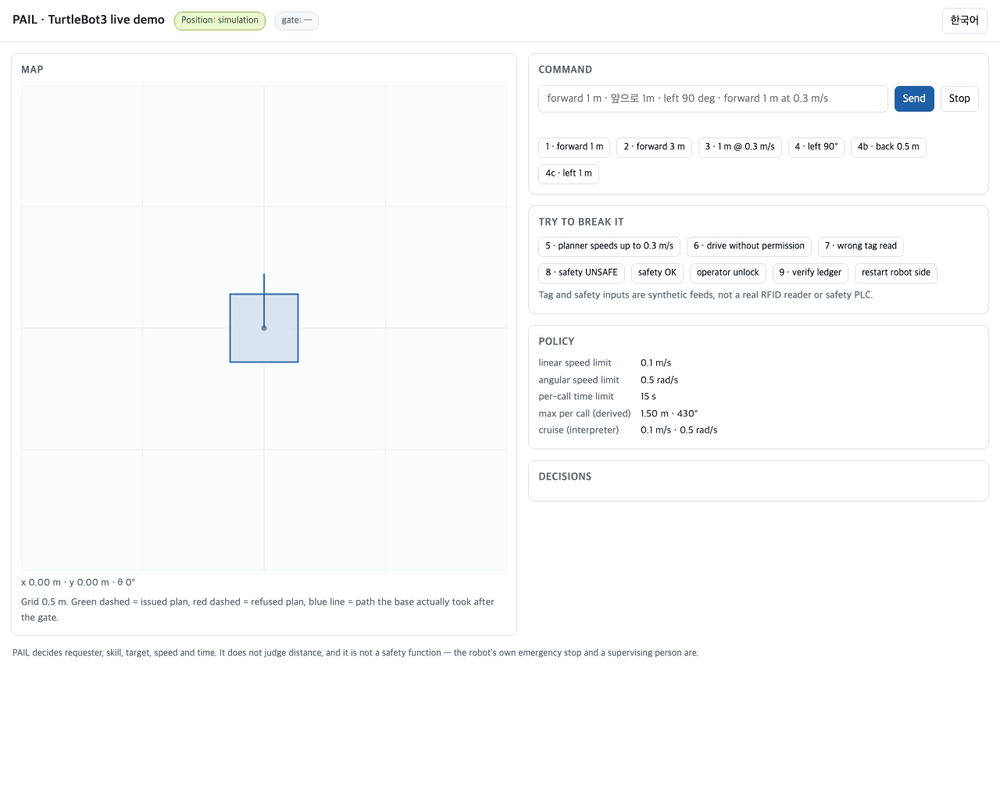

# PAIL — Physical Action Identity Layer

**An LLM planner hallucinates `forward 30 m`. A node nobody registered starts
publishing to `/cmd_vel`. With PAIL in front of the base, neither command reaches
the actuators: the issuer refuses the first request and names the bound it broke
(`ERR_ENVELOPE_EXCEEDED`), the gate blocks the second (`ERR_NO_TOKEN`), and a
signed, hash-chained record of who asked, what was allowed and what was refused
exists before anyone reads the answer.**

> **PAIL is not a brake and not a safety fence.** It is the border post that
> checks whether the physical command an AI issued is authorized, and the
> flight recorder that records what happened when something goes wrong.

Proof of authority for every physical action an AI asks a robot to take: signed
before it moves, recorded before the answer is returned, verifiable by anyone
afterwards. When a robot receives the command "move forward", PAIL asks exactly
one question — *is the authority to perform this action proven by a signature.*
If it is not proven, the command does not pass; and whether it passes or not,
**that fact is recorded first.**

Spec edition: **`PAIL-CORE-2026.1`** · test vectors:
`spec/vectors/canon/MANIFEST.sha256` (`set_sha256 bbddff16…`). These two
values are the unit of any conformance claim — [`spec/CONFORMANCE.md`](spec/CONFORMANCE.md).

> 한국어판: [`README.ko.md`](README.ko.md). The English document is canonical;
> if the two diverge, the English text governs.

PAIL Core is **Apache-2.0** source: the robot gateway, the ROS 2 gate and motion
bridge, adapters, SDK/protocol, journal libraries and two independent verifiers.
It has been measured on a TurtleBot3 (software and raised-wheel hardware), a
Jetson Orin Nano Super (native CPU) and Isaac Sim on an L40S (amd64); the
numbers and their limits are in [What has been measured](#what-has-been-measured).

---

## Try it without a robot

Three commands on a laptop with Docker. The issuer, the gate and the motion bridge
are the real components; only the TurtleBot3 base, its tag reader and its safety
feed are simulated. No ROS on the host, no account, no hardware. Download the
evaluation bundle for your architecture from the
[0.2.0 release page](https://github.com/glowfly-ai/pail/releases/tag/0.2.0) and run
these from its directory:

```sh
python3 evaluation.py load                               # the supplied image archives
python3 evaluation.py tb3 --state /tmp/pail-tb3-live     # prints CONSOLE=http://127.0.0.1:8765/
python3 evaluation.py stop-tb3 --state /tmp/pail-tb3-live
```



In the console, type `forward 1 m`: `ISSUED` with the signed bounds, then `PERMIT OK`,
and the base drives about one metre. Type `forward 3 m`: `REFUSED ERR_ENVELOPE_EXCEEDED ·
step.max_duration_s 30 > 15`, nothing moves, and the request is not trimmed to fit.
Press **6 · drive without permission**: the planner publishes to `/cmd_vel` with no
token and the gate answers `BLOCK ERR_NO_TOKEN`. Press **9 · verify ledger** to check
the signed chain that recorded all of it. [The walkthrough](examples/tb3/DEMO.md)
explains each scene and what the demo is not; `python3 examples/tb3/demo_scenes.py`
judges every scene automatically.

`evaluation.py` and the image archives are inside the evaluation bundle on the release
page ([TRY_IT.md](TRY_IT.md) lists the host prerequisites); the Core source alone has no
issuer, because the issuer is supplied as an evaluation executable under separate terms
([License](#license)).
With the archives loaded and the demo image already built, `tb3` had the console up
and every role ready 7 s after launch on an Apple Silicon Mac; the very first
run also builds the demo image, which takes minutes.

## Why PAIL

AI planners, LLM agents and remote consoles now emit physical commands. A robot
usually executes whatever arrives on its command topic, and after an incident
nobody can prove who authorized what. PAIL places a signed, scoped **action
token** between the decision and the actuator, and writes the decision into a
hash-chained journal before the issuance is even acknowledged.

```
 planner / console ──plan──▶ Issuer ──signed action token──▶ robot gate ──permit──▶ motion bridge ──▶ actuators
                              │ journal first                 │ verifies the original bytes;
                              │ (hash chain, anchored)        │ no token, no motion (fail-closed)
                              └──── any verifier replays the journal offline (pail-verify, pail-recompute) ◀──┘
```

What changes for you:

- **Unauthorized commands never pass the gate on the command path it guards.** The
  gate verifies the signed bytes on the robot; an expired, consumed, out-of-scope or
  forged token is a refusal with a named reason, not a trimmed command. Paths that
  bypass the gate are the integrator's to close (`G-DEL-L05`).
- **Every decision is a record you did not write yourself.** Issued, refused,
  permitted, superseded: each lands in a hash-chained journal whose head can be
  pinned to an external anchor, so the past cannot be edited without detection.
- **You can check the signatures, the journal and the vectors without trusting us.** Frozen test vectors, an
  offline verifier that shares no code with the producer, and evaluation
  bundles whose measured matrix ships inside the archive.

### Not the same layer as SROS2

Senior ROS 2 engineers ask this first. SROS2 (DDS Security) answers *which
participant may publish or subscribe to which topic*. It does not know what one
particular command is allowed to do, who authorized it, or that it was authorized
once, for a bounded time, at a bounded speed. PAIL answers those questions and
**relies on SROS2 for the ones it cannot**: the authenticity of the permit heartbeat
on the wire is delegated to SROS2 Enforce (`G-DEL-03`), and a topic remap without
access control is not a bypass barrier.

| Question | SROS2 | PAIL |
|---|---|---|
| May this node talk on `/cmd_vel` at all? | yes — permissions per participant and topic | no — it trusts SROS2 for this |
| Is *this* command within what was authorized — speed, duration, target, this one step? | no | yes — the gate checks the signed token's bounds against every command |
| Who asked, who signed, what was refused, in what order? | no | yes — journaled before the issuance is acknowledged, replayable offline |
| Can someone who does not trust the operator read the decision back later? | no | yes — hash chain, external anchor, two independent verifiers |

## Who it is for

| You are | What PAIL gives you | Start |
|---|---|---|
| **A robot developer** | A ROS 2 gate and motion bridge you put in front of your base, a C ABI adapter contract for everything else, a conformance harness for your adapter, and a TurtleBot3 reference that runs in Docker with no ROS on the host | [Try it without a robot](#try-it-without-a-robot) → [What integration costs](#what-integration-costs) |
| **A researcher** | A canonical byte format with frozen vectors, an independent offline verifier, reproducible evaluation bundles with a measured matrix per release, and an Isaac Sim path with a bypass and lifecycle test matrix | [Build a second implementation](#build-a-second-implementation) → [Verify the evidence yourself](#verify-the-evidence-yourself) |
| **An OEM or integrator** | Fail-closed by construction, delegations written down (SROS2 transport, key custody), a trust boundary and threat model generated from the code, an evaluation Issuer under separate terms, a plain statement of what patent rights come with the license | [What it is not](#what-it-is-not) → [Beyond the open core](#beyond-the-open-core) → [Read before deploying](#read-before-deploying) |

## More ways to run it

Read [TRY_IT.md](TRY_IT.md) for host prerequisites, Windows/WSL limitations,
CLI versus observation-UI scope, per-run evidence, and the optional local observation UI.
No TB3 or Anchor SaaS account is needed for the software tests. The included observation UI defaults to English with a Korean language option.

### TurtleBot3 base reference

For the complete **gate → motion bridge → base-command sink** path, start here:

```sh
python3 evaluation.py test-tb3 --state /tmp/pail-tb3-reference
```

See [the TurtleBot3 guide](examples/tb3/README.md) for prerequisites, generated keys,
retained evidence and the separate hardware-integration boundary. The default is an
isolated development reference with synthetic inputs, not a motor test. No service
account is required. It explicitly selects the v5 skill registry and retains raw
observations alongside machine-readable verdicts.

### Choose your first test

For dynamic issuance, first load the matching evaluation bundle as explained in
[TRY_IT.md](TRY_IT.md). Run this table from the directory containing `evaluation.py`.

| Goal | Start here | Robot required? |
|---|---|---|
| **See PAIL decide, live, in a browser** | `python3 evaluation.py tb3 --state /tmp/pail-tb3-first`, then open the printed `CONSOLE=` URL — [walkthrough](examples/tb3/DEMO.md) | No; simulated TurtleBot3 base |
| ROS2/TB3 authorization and bridge | `python3 evaluation.py test-tb3 --state /tmp/pail-tb3-test` | No; the default uses a base-command sink |
| Microduck preview | `python3 evaluation.py test-microduck --state /tmp/pail-duck-first` | No; pinned upstream fake, no host ROS install |
| **Microduck live demo with the dashboard** | `python3 evaluation.py microduck --state /tmp/pail-duck-live`, then open the printed `CONSOLE=` and `DASHBOARD=` URLs — [walkthrough](examples/microduck/DEMO.md) | No; official `robotd --fake`, no ROS |
| Microduck fault/permission checks | `python3 evaluation.py test-conformance --state /tmp/pail-duck-suite` | No; known limitations are reported, not counted as passes |

Use new state paths outside the checkout. Read [TRY_IT.md](TRY_IT.md) for prerequisites,
test order and the boundaries of this release. Both paths use the same public Core and the Issuer evaluation executable.

## What has been measured

Every number below is copied from a measured report and means exactly what
that report defines — nothing more. A software PASS is not a physical
certification; a hardware judge with raised wheels is not floor driving.

| Platform | Scope | Latest measured result | Report |
|---|---|---|---|
| Software bundles (Docker, Linux arm64 and amd64) | Microduck preview, simulated TurtleBot3 base, fleet, adapter conformance, lifecycle, plan supersede | Microduck 15/15 · TurtleBot3 13/13 · fleet 27/27 (dev and mTLS) · gate CTest 37/37 · lifecycle 21/21 · supersede 8/8 | the measured validation report (VALIDATION) shipped inside each evaluation bundle; [TRY_IT.md](TRY_IT.md) |
|<!-- hw-measurements:begin hardware_row --> TurtleBot3 hardware (wheels raised) | Encoder-based observation and acceptance judge | Latest independent hardware evidence: 13/13 scenes x3 on the final 0.2.0-preview.45 bundle; evidence is scoped to that build and is not a hardware acceptance claim for this release | [examples/tb3/HARDWARE.md](examples/tb3/HARDWARE.md) §8 <!-- hw-measurements:end hardware_row -->|
| Jetson Orin Nano Super (native arm64, CPU only) | role-isolated synthetic reference with the real gate and bridge | 7/7 scenarios; 8-hour segmented soak: 752 exercise/cancel cycles, 22 injected faults, every cleanup PASS | [examples/nvidia/README.md](examples/nvidia/README.md) |
| Isaac Sim 6.0.1 on one L40S VM (Linux amd64) | the actual SDK endpoint behind the same gate; BS-01..12 / BP-01..12 bypass and lifecycle matrix | 14 of 14 cases PASS in two fresh-state repeats of the release run, 28 of 28 runs complete (the BP-11 positive control is DETECTED); one earlier run of the same images recorded one INCONCLUSIVE, disclosed on the release page and in ISAAC.md; rest is judged on position change per physics step, with the SDK-reported velocities kept as evidence | [examples/nvidia/ISAAC.md](examples/nvidia/ISAAC.md) |

The recipient path of the delivered archives has been reproduced by an evaluation
run that did not share the publisher's working tree: on an Apple Silicon Mac for every
build of this split-bundle line, on the L40S VM for the builds whose change
touched the amd64 path, and on a Linux ARM64 VM for the first of them. Which of the
three replays this release carries, and on what host its amd64 images were
built, is stated in its VALIDATION and the delivery report that accompanies the
archives. Not measured:
other robots, other GPUs or SDK versions, floor driving, functional-safety
certification. Read [TRUST_BOUNDARY.md](TRUST_BOUNDARY.md) before deploying.

### Timing that has been measured, and timing that has not

| Quantity | Where | Measured | Source |
|---|---|---|---|
|<!-- hw-measurements:begin deadline_row --> Step-deadline refusals at the gate during normal motion | TurtleBot3 on a Raspberry Pi 3, wheels raised | 0 in every judge: 3 independent runs of the 0.2.0-preview.22 bundle and 3 publisher runs of the 0.2.0-preview.19 build | [HARDWARE.md](examples/tb3/HARDWARE.md) §8 <!-- hw-measurements:end deadline_row -->|
|<!-- hw-measurements:begin restart_row --> Gate restart IO readiness | TurtleBot3 hardware | Unresolved DDS authentication stall; independent cohorts: 1/29 and separately 1/117, not a guaranteed rate. Manual recovery only | [KNOWN_ISSUES.md](KNOWN_ISSUES.md) <!-- hw-measurements:end restart_row -->|
| Isaac Sim endpoint to `READY_LOCKED` | L40S VM, fresh state vs seeded shader cache | about 9–10 min vs 40–60 s | [ISAAC.md](examples/nvidia/ISAAC.md) |
| Added command latency, `/cmd_vel` in to `/drive_cmd_vel` out, versus a direct subscriber | Jetson Orin Nano Super, 25 W, reference rig, 10 / 20 / 50 Hz | p50 3.8–4.3 ms, p99 5.4–7.0 ms, 0 of 971 commands lost, drive-side period jitter p99 ≤ 3.6 ms | [tools/latency](examples/tb3/tools/latency/README.md) |
| Same, on a real TurtleBot3 | Raspberry Pi 3B+, vendor driver running, wheels raised, 10 / 20 Hz | p50 14.3–14.7 ms, p99 21.9–23.4 ms, 0 of 181 lost, jitter p99 ≤ 12.8 ms — an upper bound: the Python probe shared the Pi's CPU | same |

The latency rows were measured on 2026-10-16 with an earlier build of the same gate
and bridge, SROS2 `Enforce` on, one session per board, steady state after the first
permitted command. They have not been re-measured since the gate changed (the
session fatal latch, the fatal-report worker thread and the latch fallback that
followed); those changes left the command path itself untouched, but that is a code
reading, not a measurement. They are the time for the velocity command **topic** to reach the driver
node. They do not include, and PAIL does not touch, the driver, firmware or motor
control loop below it (on a TurtleBot3 the OpenCR 20 ms motor loop; under
ros2_control the `update_rate` loop). The first command after a new plan waits for
the token (`ERR_NO_TOKEN` until the gate holds it); on the Jetson a one-time
0.2–0.4 s release burst followed. For scale, Nav2's controller runs at 20 Hz by
default and common command timeouts are 0.5–1 s. CPU cost on Jetson is **not
published yet**. Nothing on this page is a latency guarantee.

## What it is

- **An authorization layer.** Action tokens are signed by an issuer with
  Ed25519, and the gate on the robot verifies the original bytes as-is.
  A command that fails verification never reaches the actuators.
- **An evidence layer.** The authorization record enters a hash-chained
  journal **before the issuance response is returned.** The state
  "issued, but no record of it" does not exist by construction.
- **An external reference point.** The head of the journal is periodically
  pinned to an external anchor. Rewriting the past would require also
  rewriting a value that is out of our reach.

## What it is not

**We recommend starting here.** The list below is a summary; the canonical
text is [`TRUST_BOUNDARY.md`](TRUST_BOUNDARY.md).

- **It is not the robot's safety system.** The final physical stop is owned
  by the robot hardware. PAIL is a layer of authority and evidence.
- **It does not replace transport-layer security.** The authenticity of
  permit messages is delegated to SROS2. Deploy without SROS2 and
  **permits can be forged** — delegation item `G-DEL-03`.
- **It is not a key management system.** Physical protection of key material
  belongs to the deploying organization.
- **It does not validate the AI's judgment.** PAIL asks whether the action
  the AI requested was authorized — not whether the action was right.

## Integrate PAIL

Three routes, all on the same Core and the same evaluation Issuer.

### What integration costs

PAIL does not ask you to wrap your callbacks. A decorator inside the planner process
would be enforced by the very process it is meant to check, so the gate is a separate
node placed on the topic path, and the planner stays as it is:

```
 your planner ──/cmd_vel──▶ pail_pep_gate ──/safe_cmd_vel──▶ pail_motion_bridge ──/drive_cmd_vel──▶ base driver
  (unchanged)                checks every Twist against         forwards only while the permit         (SROS2 enclave /driver,
                             the signed token's bounds          heartbeat is live                      input remapped)
```

Three things change on a ROS 2 robot, none of them in the planner:

1. **The base driver reads `/drive_cmd_vel` instead of `/cmd_vel`.** One remap in the
   driver launch, as in [`examples/tb3/tb3_base_driver.launch.py`](examples/tb3/tb3_base_driver.launch.py):

   ```python
   remappings=[('/cmd_vel', '/drive_cmd_vel')]
   ```

2. **The gate and the bridge run beside the driver** with the robot's keyring, policy
   and SROS2 enclave — the [TurtleBot3 reference](examples/tb3/README.md) is the
   complete, runnable shape.
3. **The limits live in the issuer's policy, not in your code.** A step above a bound
   is refused and the refusal names the bound; nothing is shortened to fit:

   ```yaml
   guardrails:
     common:                      # absolute ceilings
       sls.linear_mps: 1.0
       sls.angular_rps: 1.0
       step.max_duration_s: 30
     zones:                       # may only tighten
       z7:
         sls.linear_mps: 0.5
   ```

   The vocabulary and the rules are in [`spec/SITE_MODEL.md`](spec/SITE_MODEL.md).

Robots without ROS attach through the [C ABI adapter contract](spec/ADAPTER_CONTRACT.md)
and are measured by the [conformance harness](pvs-public/conformance/).

### Attach it to your robot

Start with [the adapter contract](spec/ADAPTER_CONTRACT.md), then
[the skill registry](spec/SKILLS.md) and [adapter status table](spec/ADAPTERS.tsv).
The [conformance harness](pvs-public/conformance/) measures a configured adapter;
fake conformance is not physical-hardware certification. This release includes
the ROS2/TB3 reference and the optional Microduck software preview; Viam is not bundled.

### ROS 2, hardware and simulation

- **ROS 2 / TurtleBot3:** the [TurtleBot3 reference](examples/tb3/README.md) is
  the complete gate → motion bridge → base path with generated keys and SROS2
  Enforce; [HARDWARE.md](examples/tb3/HARDWARE.md) is the same console and judge
  on a physical base, with the maintainers' measured results.
- **Isaac Sim (amd64 bundle):** [ISAAC.md](examples/nvidia/ISAAC.md) runs an
  actual Isaac Sim 6.0.1 endpoint behind the same gate, one authorized exercise
  per fresh state, with a BS/BP matrix driver. PAIL ships the image derivation
  recipe and the asset recipe, never the NVIDIA image or converted assets.
- **Jetson (arm64 bundle):** [examples/nvidia/README.md](examples/nvidia/README.md)
  carries the native CPU profiles and the fault suite measured on an Orin Nano Super.
  GPU workloads and Isaac ROS are outside the measured scope.

### Build a second implementation

| Spec | What it defines |
|---|---|
| [`spec/CANON.md`](spec/CANON.md) | The **canonical strings** that go into signatures and hashes. Derivation rules and assembly rules per prefix |
| [`spec/KNOWN_DEV_KEYS.md`](spec/KNOWN_DEV_KEYS.md) | The **format of the fingerprint list** read by the startup gate `S8` |
| [`spec/SITE_MODEL.md`](spec/SITE_MODEL.md) | The **site model YAML** an operator loads with `PAIL_SITE_MODEL`: every key, what is required, and what each one does and does not affect |
| [`spec/API_SURFACES.md`](spec/API_SURFACES.md) | The **four surfaces** you attach to without reading our internals: denial, evidence, safety state, and the operator surface — and, in §6, the optional operations and management interfaces, which listener carries each and how stable they are |
| [`spec/VERIFICATION_INPUTS.md`](spec/VERIFICATION_INPUTS.md) | The **three inputs an independent verifier consumes**: the signed checkpoint note, the inclusion response, and the consistency response — and the two gates a checkpoint must pass before any of its bytes are used |
| [`spec/MERKLE_VECTORS.md`](spec/MERKLE_VECTORS.md) | The **log arithmetic** over those bytes: RFC 6962 hashing, roots, inclusion and consistency proofs, with an exhaustive conformance vector set for every tree size 0..9 |
| [`spec/SUBGRAPH_HASH.md`](spec/SUBGRAPH_HASH.md) | The **world slice a token was issued against**: how `subgraph_snapshot_hash` (token field 61) selects, encodes and hashes the context graph, how a site declaration compiles and mutates into that world, and a frozen vector set an independent verifier recomputes |
| [`spec/TRUST_ROOT.md`](spec/TRUST_ROOT.md) | **Whose signature to accept** — what a trust root is, how to obtain one out of band, how rotation is recorded, and why the vkey shipped with the vectors is not one |

The derivations and format descriptions in these documents are
**written by hand but not verified by hand.** Every quoted byte must be a
**substring** of the frozen vectors under `spec/vectors/` (or, for the sets that
own a separate root, of `spec/proof-vectors/` and `spec/merkle-vectors/`) or of
the shipped file. Every `spec/tools/spec_*_check.py` in the tree measures
exactly that on every CI run — the list is a directory, not a sentence in this
README, so a new document cannot arrive without a checker arriving with it.
Edit only the document and it goes red; edit only the vectors and it also goes
red.

`VERIFICATION_INPUTS.md` is the one you can check hardest without us. Its
checker carries its **own** ed25519 and its **own** RFC 6962 — it does not call
the library that produced the vectors, because agreement with that library
would be an identity, not evidence. On every CI run it opens the frozen
checkpoint against the shipped verification key, then re-derives all five
frozen proofs against the root it just authenticated. If the signature does not
verify, it does not fall back to re-deriving against an unauthenticated root:
it prints why it stopped. That is the whole point of the document.

`SITE_MODEL.md` is measured in a third direction as well: its vocabulary is
compared against the compiler source **and** against the shipped example, so a
key added to the parser with no mention in the document is a CI failure, and so
is an example that drifts away from both.

### Optional Microduck software preview

Use [ROS2/TB3](examples/tb3/README.md) for the ROS reference, or choose the
[Microduck software-only preview](examples/microduck/README.md). Both use PAIL Core;
Microduck does not require a ROS installation and is not built by the default Core path.
No physical Microduck validation has been performed.

The Microduck path has its own live demo: `python3 evaluation.py microduck --state /tmp/pail-duck-live` starts
the official `robotd --fake`, the issuer, the robot agent and `pail-duckd`, a console like
the TurtleBot3 one, and the public observation dashboard reading a mirror of this run's
ledger. It adds three scenes the TurtleBot3 cannot show: a skill (`wave`) that PAIL
permits and the fake declines, the safety feed going stale, and the issuer link going
down. Read [the Microduck walkthrough](examples/microduck/DEMO.md) (한국어: [`DEMO.ko.md`](examples/microduck/DEMO.ko.md)).
Positions are the integral of the velocity
the fake reports as applied; this robot class sends no live decision feed, so the dashboard
shows the ledger, not a live table. The [compatibility record](adapters/microduck/compatibility.json)
lists tested source snapshots, environments and limitations. This optional preview does not
mean every ROS robot or every Microduck firmware is supported.

## Verify the evidence yourself

A specification is only sufficient if someone can implement against it. That is
not a claim we can make on our own behalf, so the tree carries the evidence:
[`cmd/pail-verify/`](cmd/pail-verify/) is an offline verifier written against
the documents above and nothing else. It is its own Go module and imports only
the standard library — it shares no code with the service that produced the
bytes, because a verifier that agreed with the producer would be an identity.

<!-- verifier-vectors: 81 -->
<!-- verifier-exits: 0,1,2 -->

```
cd cmd/pail-verify && go test ./...          # 81 conformance vectors + the negative controls
go build -o pail-verify . && ./pail-verify   # usage
```

Native verifier builds require Go 1.27.3 or newer. Alternatively, after obtaining a
`golang:1.27.3` image, use Docker without network access for the verifier itself:

```sh
docker run --rm --network none -v "$PWD":/src:ro -w /src/cmd/pail-verify \
  -e GOCACHE=/tmp/gc -e GOPATH=/tmp/gp golang:1.27.3 go test ./...
```

The second tool, [`cmd/pail-recompute/`](cmd/pail-recompute/), answers a
different question: is the **world-slice hash** signed into every token
(`subgraph_snapshot_hash`, token field 61) the value that
[`spec/SUBGRAPH_HASH.md`](spec/SUBGRAPH_HASH.md) yields? Given the site
declaration the issuer loaded and its journal directory, it rebuilds the world
at each token's issuance epoch from the `GRAPH_MUTATION` records, selects the
slice for the token's robot and target, hashes it, and compares with the signed
bytes. It shares no code with the issuer (its own module; `yaml.v3` and
`x/text` are its only dependencies), and its `vectors` mode is the self-test
against `spec/subgraph-vectors/`. Same three exit states.

```
cd cmd/pail-recompute && go test ./...                              # frozen set + an issuer-written fixture + negative controls
go run . vectors -dir ../../spec/subgraph-vectors                    # self-test
go run . ledger -site /etc/pail/site_model.yaml -journal /var/lib/pail/blackbox -v
```

Initial Docker image download still needs network access. The trust root has no default. `-vkey` and `-origin` must reach the tool out of
band; reading either from the material being audited asks the subject to grade
its own paper. Exit status is `0` verified, `1` finding, `2` cannot verify —
three states, not two, so "we never established what this log is" cannot arrive
looking like "the signature checked out." The shipped set freezes one checkpoint
note, so `consistency` against the frozen proofs exits `2` rather than pretending;
the same arithmetic is exercised end to end against `spec/merkle-vectors/`,
which carries both roots.

The tests ship with it on purpose. Green is not evidence by itself, so what you
should read first is what the tool **refuses**: a forged signature, a note from
a different log, an echoed root that contradicts the signed one, a proof for a
tree size the checkpoint does not cover.

Read `TRUST_BOUNDARY.md` first, then `spec/CANON.md`. If you read the
canonical strings first, you will know what to compute — but you will
implement without knowing **what is not guaranteed.**

## Robot operations contracts (experimental, opt-in)

The tree also carries the **contracts** for operating more than one
robot under one issuer: owned admission holds, a maintenance lockout register,
role-separated signed approvals, read-only binding probes and a sanitized
operations projection. They are disabled unless their settings are set, and
they are a pre-1.0 contract, not a fleet manager. The planning, approval, apply
and recovery orchestrator that drives them is offered separately by Glowfly
([Beyond the open core](#beyond-the-open-core)); what ships here is the wire contract
(`sdk/proto/robot_ops_service.proto`), the verification library, the issuer and
robot endpoints, two offline checkers and a runnable example. Read
[`spec/ROBOT_OPERATIONS.md`](spec/ROBOT_OPERATIONS.md) first, then run
[`examples/robotops/`](examples/robotops/README.md). A hold or a confirmed
quiescence is a software observation, not a physical stop.

## Read before deploying

| Document | When to read it |
|---|---|
| [`TRUST_BOUNDARY.md`](TRUST_BOUNDARY.md) | **Before deploying.** The four things we protect, the five we do not, and what exists in design but not in code |
| [`spec/ROBOT_OPERATIONS.md`](spec/ROBOT_OPERATIONS.md) | Before setting any `PAIL_OPS_*`, `PAIL_LOTO_*` or `PAIL_ROBOTOPS_*` variable. What each one enables, which listener it opens, what refuses startup, and what is not included |
| [`THREAT_MODEL.md`](THREAT_MODEL.md) | Alongside it. The attackers, assets and surfaces the boundary above assumes — and, per delegation, **which attacker it hands over to** |
| [`SECURITY.md`](SECURITY.md) | After finding a defect. Reporting channel and the line that decides what counts as a vulnerability |
| [`KNOWN_ISSUES.md`](KNOWN_ISSUES.md) | What this repository does not do — machine-generated from the guarantee registry and the test profile |
| [`CONTRIBUTING.md`](CONTRIBUTING.md) | Before contributing |
| [`spec/CONFORMANCE.md`](spec/CONFORMANCE.md) | Before claiming "PAIL-compatible" |

> `TRUST_BOUNDARY.md` §3 (delegations) and §6 (startup refusal gates) are
> **not written by hand.** They are generated from the guarantee registry
> and a source scan, and CI compares the bytes. A document that can be
> edited by hand is not a document — it is a claim.
>
> That generation happens on our side, and in your hands a generated
> document is byte-identical to a hand-written one. So the part you can
> check yourself ships with the tree: `spec/tools/spec_threat_model_check.py`
> re-scans **the source you received** and compares it against both
> documents. `implemented` in the §6 table means the id is declared in a file
> you have — not somewhere we can see and you cannot.

### Engineering overview

Read [spec/ARCHITECTURE.md](spec/ARCHITECTURE.md) for component responsibilities,
source layout, verification boundaries and public test prerequisites. No private
design documents or original development conversations are required.

## Developer profile: the whole path in Docker

Requires Docker with the compose plugin v2 or newer and `python3`. One command:

```bash
bash e2e/run_e2e.sh
```

After the evaluation images have been loaded, it uses the pinned issuer and ROS 2 gate images and walks the
whole path. **Every step prints the identifier it read**, and a step that
cannot read its identifier is a failure, not a "probably fine":

```
PASS [1] northbound up (get_active_token answered over mTLS)
PASS [2] plan accepted (status=ACCEPTED chain_id=7264740c-… token_id=cc8e821e-…)
...
PASS [8] gate up under SROS2 Enforce (config seal v3 digest=<run-specific SHA-256>)
PASS [11] command refused with no authorization (state=BLOCK reason=ERR_NO_TOKEN x30)
PASS [12] repeated operation id answered with history only (chain_id=7264740c-… tokens=0), no token refresh
PASS [13] gate permitted under the issued token (active_token_id=d4819fb4-… x10)
PASS [14] motion reached /safe_cmd_vel under the permit (10 message(s))
PASS [15] no motion passed during the BLOCK window (observer proven live afterwards)
```

Judgment 12 is the communication contract at work: after the issuer restart,
re-submitting stage A's operation id returns its historical receipt (the
original chain, no token list, `operation_outcome=HISTORICAL_ONLY`) — a receipt
is evidence, never a token refresh. Motion is then authorized as a new operation
under its own id.

Judgment 15 is the one worth reading twice. Silence on a topic is not
evidence — it is also what a dead subscriber produces. That absence is
accepted only after **the same observer is shown to receive traffic
afterwards.**

| Flag | What it changes |
|---|---|
| *(none)* | Both stages: the cloud custody chain, then enforcement at the gate |
| `--a-only` | Cloud chain only — no ROS gate, no container for it |
| `--vault` | The issuer signs through Vault Transit instead of a local key file. Implies `--a-only` |
| `--keyring bundle` | Trust reaches both services as a **root-signed keyring bundle** instead of the unsigned dev file |

A cold build including image downloads can take 10–20 minutes or longer.
Cached images/layers can reduce this to a few minutes; CPU and network matter.

`--robot` must be declared under `robots:` in
`config/site_model.example.yaml`. An undeclared robot is rejected with
`REJECTED · context violation: AGENT_NOT_IN_MODEL`.

**Target declarations are checked when a site model and world context are available.**
An undeclared target is refused by default with `ERR_TARGET_UNKNOWN`.
`policy.unverified_targets: allow` explicitly permits issuance while recording
`target_unverified=true`; a missing model/context is recorded as unverified too.
This is different from matching observed target evidence at execution time.

### What the anchor is in this profile

The run prints `STATE=...`; anchor records are under that new directory’s `anchor/`.
Existing runs are preserved; a nonempty `PAIL_E2E_STATE` is refused. That is a
**local file anchor**, and a file on the same host is not the property
["An external reference point"](#what-it-is) describes: whoever can rewrite
the journal can rewrite this file in the same breath. It exists so the
anchoring path is exercised and observable end to end. Binding the head to
something out of your own reach is a deployment decision, not a default this
repository can make for you.

### Signing in a vault (`--vault`)

`--vault` starts HashiCorp Vault in dev mode and moves issuance onto its
Transit engine, where the private key is generated and **never leaves.** It
adds two judgments, and both are negative controls:

- the same journal must **not** verify against the local dev key — otherwise
  "the vault signed it" would be indistinguishable from "the file did";
- with the vault stopped, issuance is **refused** rather than quietly
  re-signed locally.

A licensing note, because it is easy to assume otherwise: Vault Community is
**BUSL-1.1, not an OSI-approved open-source license.** If that is a problem
for your deployment, [OpenBao](https://openbao.org) is an MPL-2.0 fork that
exposes the same Transit API, and the transport in this repository speaks to
that API rather than to anything Vault-specific. The dev vault here keeps its
keys **in memory** — restart it and the key is gone. That is correct for a
demo and disqualifying for anything else.

### Trust as a signed bundle (`--keyring bundle`)

By default the services read `config/keys/keyring.json`, which nothing signs.
That is the dev profile being honest about itself. `--keyring bundle` uses the
real trust path instead: a **root key minted outside the tree the containers
mount** signs a keyring payload, and both the issuer and the gate load only
what that root vouches for.

```bash
bash e2e/run_e2e.sh --keyring bundle
```

Two extra judgments, plus one that matters more than either:

- the issuer and the gate each **name the mode they loaded** —
  `keyring trust path: mode=bundle keys=5` and `mode=bundle keys=2 revoked=0`.
  "It started" is not "it used the bundle": it would have started on the
  unsigned file too, and the run would have looked identical. The gate's count
  is lower on purpose — it anchors trust only on `issuer` entries;
- a bundle signed by a **different root** is refused at startup, and the
  refusal **names the signature** —
  `root signature verification failed (forged, tampered, or wrong root key)`.
  Exiting is not the judgment: a missing file, a bad port and a typo in a path
  all exit too.

Bundle mode requires five environment values, and none of them defaults to a
guess. Two of them are worth stating outright, because their absence is a
startup refusal rather than a fallback: `PAIL_KEYRING_MAX_LIFETIME_SEC` bounds
how stale trust may get, and `PAIL_KEYRING_POLL_SEC` bounds how late a
revocation may land. Revocation reach is the **sum** of those two, so leaving
either unset would let a bound be claimed that nobody chose. Set
`PAIL_KEYRING_POLL_SEC=0` to declare pulling off deliberately — which is what
this demo does, and it says so.

The CLI is `keyring-sign` (`cloud/cmd/pail_keyring_sign`):
`gen-root` mints a root key pair, `sign` signs a keyring payload with it,
`verify` and `inspect` read a bundle back. Keep the root private key out of
the directory the services mount — the script does, and that is why the
forgery it builds needs a second root rather than a flipped byte.

### Appendix: native integration boundary

This release supplies the Issuer as a container image, not native source or a
separately validated native installation. The following describes integration
prerequisites, not an alternative source-build quickstart. Core remains source-buildable.

This is **not a cross-platform quickstart**. Native deployment requires a prepared
Linux + ROS 2 Humble/SROS2 environment, protobuf code generation, a writable journal
location and explicitly configured keyring, registry and gRPC security. The Go core
itself does not require ROS, but this deployment recipe's provisioning tools do.
Do not copy generated development config over an existing `/etc/pail` installation.
Use the tested Docker paths above for first use; see [TRY_IT.md](TRY_IT.md) for the
separate native observation-tool recipe. Production startup refusals are intentional,
not instructions to disable validation.

The client stub lives in `sdk/grpc_client_go` as source only (generated code
is never committed). The generation procedure is in that directory's
`README.md`, and to connect the example you must start the server with
`PAIL_GRPC_TLS=off` — the example dials in plaintext.

```
status=ACCEPTED chain_id=248561ae-… rejected= tokens=1
```

## Beyond the open core

Start with one robot, grow into a fleet: the Core is Apache-2.0 and stays that way.
Glowfly offers, separately from this repository:

- **Issuer for production** — the evaluation executable in the bundle covers internal
  research, development and CI; production operation is licensed separately
  ([ISSUER_EVALUATION.md](ISSUER_EVALUATION.md)).
- **Anchor SaaS** — a hosted external witness for journal heads, so the anchor is out
  of the operator's reach. The local file anchor in the evaluation exercises the same
  path and is not an independent witness.
- **Fleet operations** — the robot-operations orchestrator (planning, approval, apply,
  recovery) that drives the contracts shipped in
  [`spec/ROBOT_OPERATIONS.md`](spec/ROBOT_OPERATIONS.md); the fleet preview here is
  measured 27/27.
- **Replicated issuer and multi-site operation** — for deployments that cannot accept
  the single-node durability window stated in [`SECURITY.md`](SECURITY.md) §4.2.

After an incident the journal answers the questions an investigator, an insurer or
a regulator asks first — who authorized this motion, within what bounds, what did the
gate do, in what order — from bytes the operator could not rewrite without detection.
PAIL does not claim conformity with any regulation or functional safety standard; it
produces the evidence such a review consumes. To evaluate any of these, contact Glowfly
through [www.glowfly.ai](https://www.glowfly.ai). Questions about this repository go to
its GitHub Issues; suspected vulnerabilities go to the address in
[SECURITY.md](SECURITY.md), never to a public issue ([SUPPORT.md](SUPPORT.md)).

## License

This source distribution is **PAIL Core, Apache-2.0**. It includes the complete
robot gateway (delegated windows, reports, reconnect and census), gates,
adapters, SDK/protocol, generic Blackbox libraries and independent verification.
See [`LICENSE`](LICENSE), [`NOTICE`](NOTICE) and each file's attribution notices.
You may use, modify and redistribute Core commercially under Apache-2.0.
Verification of local PAIL evidence does not require the Issuer or Anchor SaaS.

**PAIL Issuer is supplied separately as an evaluation executable, not source.**
The evaluator performs real single-node policy judgment, token issuance and
journal/replay. Its separate evaluation terms permit internal non-production
research, development and CI; production or external redistribution needs a
separate agreement. Core's Apache rights are not restricted by those terms.
Earlier distribution licenses are not retroactively changed.

The artifact names for both architectures and the verification commands are in [`RELEASE.md`](RELEASE.md).
Third-party runtime components retain their own licenses. The evaluation bundle is
software-only: not hardware certification and not a safety-system replacement.

### Scope of the evaluation issuer

The evaluation issuer is a single node. It refuses to start under any `PAIL_HA_*`
replication setting rather than run as a single node under a configuration that
asked for a fence; the single-node durability window is stated in
[`SECURITY.md`](SECURITY.md) §4.2. The robot-operations contracts ship with their
issuer and robot endpoints, two offline checkers and a runnable example
([`spec/ROBOT_OPERATIONS.md`](spec/ROBOT_OPERATIONS.md) §1); the orchestrator that
drives them is offered separately ([Beyond the open core](#beyond-the-open-core)).

### Anchor SaaS and this distribution

**The Anchor SaaS server is not part of this distribution and is not offered under
Apache-2.0 by it.** Access to the hosted Anchor SaaS service, or a separate license
to its server software, is governed by the applicable separate agreement.

Any Anchor clients, interface specifications, test vectors and verification
tools included in this distribution remain licensed as indicated in those files.
The server's exclusion does not impose a requirement to purchase Anchor SaaS,
use a particular service provider or obtain additional permission to exercise
rights already granted in the distributed materials.

### Patent rights and names

Patent rights in the Apache-licensed materials are the ones granted by
**Section 3 of [`LICENSE`](LICENSE)**; nothing in this repository adds to or
limits them, and no fee or further permission is required for acts covered by
that grant. The exclusion of the Anchor SaaS server and the separate terms of the
Issuer executable describe what is distributed here, not exceptions to that
grant. Apache-2.0 grants no trademark rights except as stated in its Section 6;
what a compatibility claim must name is in
[`spec/CONFORMANCE.md`](spec/CONFORMANCE.md). This paragraph is explanatory and
does not modify [`LICENSE`](LICENSE).

Release identity: [VERSION](VERSION). Changes: [CHANGELOG.md](CHANGELOG.md).
Artifact verification: [RELEASE.md](RELEASE.md). Support: [SUPPORT.md](SUPPORT.md).
