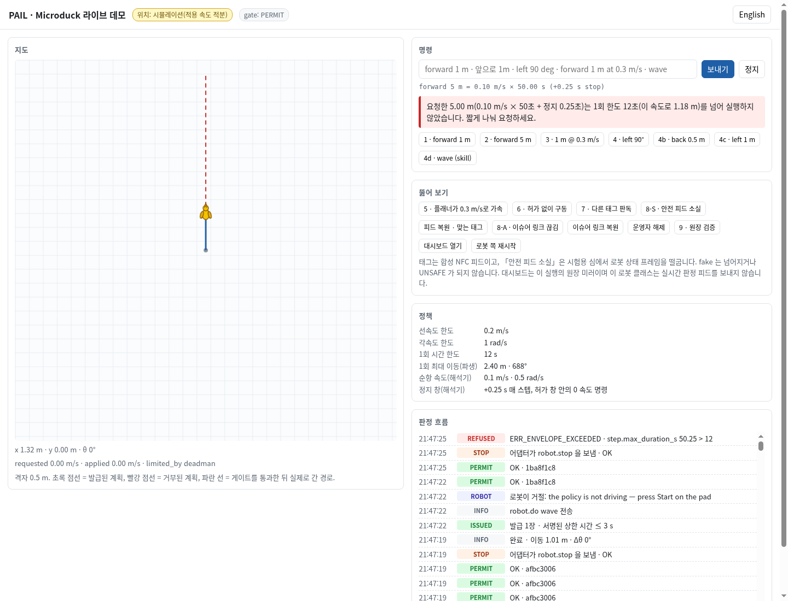
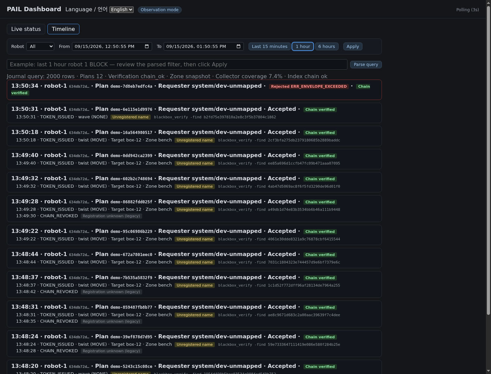

# Microduck 라이브 데모 — 따라 하기 (한국어 안내)

> **0.2 평가 묶음:** 먼저 평가 디렉터리에서 `python3 evaluation.py load`를 실행합니다.
> 이슈어 소스는 포함하지 않습니다. 아래의 저수준 명령은 그 뒤 `pail-core/`에서 사용합니다.
> 처음에는 `evaluation.py` 실행 도구를 권합니다.


**「앞으로 1 m」라고 치면, 정책 안이면 (시뮬레이션) 오리가 걷고, 넘으면 아무것도 움직이지
않으면서 어느 한도를 넘었는지 화면이 알려 준다. 모든 판정은 서명된 원장에 남고, 공개 관측
대시보드가 보여 주는 것도 바로 그 원장이다.**

[TurtleBot3 따라 하기](../tb3/DEMO.ko.md)의 Microduck 판이다. 공식 상류 `robotd --fake` 위에서
Docker 로 내 컴퓨터에서 돈다: 로봇도, 계정도, ROS 도 필요 없다. 이슈어·로봇 에이전트·
`pail-duckd` 어댑터(`libpail_gate` 포함)는 실제 구성 요소다. 로봇만 fake 이고, 그 신원 판독과
안전 피드는 합성이다. **실물 Microduck 은 검증된 적이 없다.**

> 영어 원문 [`DEMO.md`](DEMO.md)가 정본이며, 두 문서가 다르면 영어 원문을 따른다. 이 예제의
> 참조 자료(프리뷰 러너·적합성 검사·권한·경계)는 [`README.md`](README.md)(한국어:
> [`README.ko.md`](README.ko.md))에 있다.

## 지금 보고 있는 것

```
 사용자 ── 「앞으로 1 m」 입력 ──▶ 콘솔  (AI 요청자 역할; PAIL 은 콘솔을 신뢰하지 않는다)
                                    │  허가 요청(사설망의 평문 gRPC)
                                    ▼
                                 이슈어 ── 정책을 넘는가? ──▶ 거부, 아무것도 움직이지 않음
                                    │  안이면: 토큰에 서명                 │
                                    ▼                                    ▼
   플래너 ──robot.move──▶ pail-duckd ──▶ robotd --fake ──▶ 적분 위치 ──▶ 지도
   (공개 소켓)            맞는 서명 토큰이 살아 있을 때만 PERMIT,          │
                          아니면 BLOCK                                    ▼
                                              서명·해시 사슬 원장 ──▶ 대시보드
```

눈여겨볼 것 셋은 TurtleBot3 와 같다:

- **이슈어는 거부하지, 줄여 주지 않는다.** 한도를 넘는 요청은 거부되고, 넘은 한도가 이름으로
  돌아온다.
- **어댑터는 첫 명령만이 아니라 매 명령을 본다.** 0.2 m/s 를 허가받은 플래너가 0.3 m/s 를
  보내면 모든 메시지가 막히고, 어댑터가 로봇에 정지를 보낸다.
- **「안 움직였다」를 침묵으로 판정하지 않는다.** 모든 거부 뒤에는 같은 관측자가 허가된 이동을
  봐야 한다.

이 로봇에서만 보이는 것 둘:

- **PAIL 이 허가한 스킬을 로봇이 거절할 수 있다.** `wave` 는 PAIL 이 허가하지만 `robotd --fake`
  는 구동 중인 정책이 없다며 거절한다. 층이 둘, 답도 둘.
- **대시보드는 원장이지 실시간 피드가 아니다.** 이 로봇 클래스는 실시간 판정 패킷을 보내지
  않는다; 대시보드의 타임라인은 이 실행의 저널 미러에서 만들어진다.

## 1. 시작하기 전에

| 필요한 것 | 비고 |
|---|---|
| Docker Engine 또는 Desktop, compose 플러그인 v2 이상 | 리눅스 컨테이너 |
| Python 3.9+ | 호스트에 그 밖의 것은 없다; ROS 도, Go 도 |
| macOS, Linux, 또는 Windows 의 WSL2 | 네이티브 Windows PowerShell/CMD 는 지원하지 않는다 |
| 시간 | 첫 빌드 10~20분 이상(Rust·Go·상류 Microduck 소스); 이후 시작은 1~2분 |
| 빈 로컬 포트 둘 | 콘솔 `127.0.0.1:8767`, 대시보드 `127.0.0.1:18092`; `--port`·`--dashboard-port` 로 바꾼다 |

실행마다 새 키가 만들어져 Docker 볼륨과 소스 트리 밖의 상태 디렉터리에 놓인다. 상태
디렉터리의 `private/` 마운트 지점이나 키는 공유하지 말 것; `evidence/` 에서 검토한 파일만
공유한다.

## 2. 데모 띄우기

`build`는 격리된 소프트웨어 작업 창임을 명시적으로 확인한 뒤 실행합니다. 전용 Buildx 빌더는
2 CPU·3 GiB, 빌드 병렬 상한 2를 사용하고 기존 기본 builder를 바꾸지 않습니다.
`start`와 별칭 `up`은 **빌드하지 않습니다**. 준비된 이미지 digest/대시보드 산출물이 없거나
소스가 바뀌면 `BUILD_REQUIRED`로 끝납니다. 다시 `build`하세요. 준비 기록은 기본적으로
`~/.cache/pail-demo/<종류>/prepared.json`이며 `--build-record PATH`로 지정할 수 있습니다.
`up --build --build-window-confirmed`는 명시적으로 빌드한 뒤 시작하는 단축형입니다.
`--skip-build`는 호환 별칭이며 더 이상 빌드 생략을 위해 필수는 아닙니다.


압축을 푼 소스 트리의 루트에서:

```sh
python3 examples/microduck/demo.py build --build-window-confirmed
python3 examples/microduck/demo.py start
```

터미널에 이 순서로 찍힌다:

```
STATE=/tmp/pail-duck-demo-xxxxxxxx
DASHBOARD=http://127.0.0.1:18092/dashboard/?tab=timeline&preset=1h (ledger mirror of this run; no live decision feed on this robot class)
CONSOLE=http://127.0.0.1:8767/
```

콘솔의 신뢰 줄은 `unsigned-dev`를 보인다: 이 데모는 서명 신뢰로 판정하지 않는 개발용 신뢰
위에서 돌며 번들 만료가 적용되지 않는다. 만료 없는 번들이 아니라 번들 자체가 없는 것이고,
production 기동은 이 모드를 거부한다. 운영자 프로파일(`--trust-profile`)을 주면 매니페스트의
같은 모드를 보고한다.

묶음(compose 프로젝트)과 컨테이너 이름은 `pail-duck-demo-<release>-<id>` 다 — 실행을 시작한
릴리스(점을 `-`로 바꾼 것, 예 `0-2-0-preview-43`)와 실행마다 다른 값. `docker ps -a --filter
"name=pail-duck-demo-<release>-"`로 한 릴리스의 실행만 거를 수 있고, `evidence/console.json`에
같은 프로젝트와 릴리스 ID 원문이 적힌다.

같은 컴퓨터의 브라우저로 `CONSOLE` URL 을 연다. 터미널은 열어 둔다. **Ctrl-C 가 스택 전체를
내리고** 상태 디렉터리는 디스크에 남긴다.

옵션: `--state /절대경로/새/빈/디렉터리`; `--skip-build --image pail/microduck-preview:local-<id>`
는 이전 실행의 이미지를 다시 쓴다(콘솔이 「이 트리의 새 빌드가 아님」을 알린다);
`--dashboard-binary PATH` 는 앞서 빌드한 대시보드 바이너리를 다시 쓴다; `--no-dashboard` 는
콘솔만 띄운다.

## 3. 콘솔 화면



| 패널 | 보여 주는 것 |
|---|---|
| 상단 배지 | `위치: 시뮬레이션(적용 속도 적분)`, 그리고 어댑터의 마지막 판정 `gate: PERMIT` / `gate: BLOCK · 사유`. 오른쪽 버튼으로 영어/한국어를 바꾼다. |
| **지도** | 격자 0.5 m. 오리가 로봇이고 부리가 진행 방향이다. 초록 점선 = 이슈어가 서명한 계획; 빨강 점선 = 거부한 계획; 파란 선 = `robotd --fake` 가 *적용했다*고 보고한 속도를 적분한 위치. 아래에 마지막 `requested`·`applied` 속도와 fake 가 보고한 `limited_by` 이름. |
| **명령** | 자유 입력과 장면 1~4d 버튼. 칸 아래에 해석 결과, 거부됐으면 빨간 상자. |
| **뚫어 보기** | 합성 태그가 틀리거나 안전 피드가 떨궈지는 동안에는 `피드 복원 · 맞는 태그` 를 누를 때까지 빨간 안내가 여기 남는다; `로봇 쪽 재시작` 도 두 입력을 되돌린다. 장면 5~9: 어긋나는 플래너, 허가 없는 구동, 다른 태그, 안전 피드 소실, 이슈어 링크 끊김, 원장 검증, 그리고 `피드 복원 · 맞는 태그`, `운영자 해제`, `로봇 쪽 재시작`, `대시보드 열기`. |
| **정책** | 적용 중인 한도와 파생된 1회 최대치. |
| **판정 흐름** | 최신이 위. `ISSUED`/`REFUSED` 는 이슈어; `PERMIT`/`BLOCK` 은 어댑터; `STOP` 은 어댑터 자신이 `robot.stop` 을 보낸 것; `ROBOT` 은 fake 가 스킬 호출에 답한 것; `OK`/`INFO` 는 콘솔 메모. |

명령 칸은 `forward 1 m`, `back 0.5 m`, `left 90 deg`, `left 1 m`, `forward 1 m at 0.3 m/s`,
`wave`, `stop` 과 한국어 `앞으로 1m`, `왼쪽으로 90도`, `손 흔들어`, `정지` 를 알아듣는다.
해석기는 속도를 지정하지 않으면 순항 속도(0.1 m/s, 0.5 rad/s)로 계획하고, 요청을 줄이려고
속도를 올리지 않는다.

## 4. 장면별 따라 하기

데모 정책은 **0.2 m/s**, **1.0 rad/s**, **1회 12 s** 를 허용한다. 순항 0.1 m/s 에서 「1 m」는
10 s 의 이동이고, 해석기는 10.25 s 를 요청한다. 플래너가 모든 허가 창의 마지막 0.25 s 를 0 속도
명령에 쓰기 때문이다. `robotd` 는 플래너가 그냥 조용해지면 마지막 명령을 약 0.5초 더 붙들고
있다가 멈추는데(deadman), 이 정지 창이 없던 때는 그 침묵이 90° 회전을 102° 로 넘기게 했다.
정지는 침묵이 아니라 명령이고, 허가 창 안에서 일어나야 한다. PAIL 은 요청자·스킬·대상·속도·
시간을 판정하고 거리는 속도 × 시간에서 생긴다.

### 장면 1 — 앞으로 1 m (허가)

`forward 1 m`(또는 `앞으로 1m`)를 치거나 **1** 을 누른다.

- 칸 아래: `forward 1 m = 0.10 m/s × 10.00 s (+0.25 s stop)`.
- 판정 흐름: `ISSUED 발급 1장 · 서명된 상한 각속도 ≤ 1 rad/s · 선속도 ≤ 0.2 m/s · 시간 ≤ 10.25 s`, 이어서 `PERMIT OK · <토큰 id>`.
- 지도의 파란 선이 약 10초 동안 늘어난다. 위치가 멈추면 `INFO 완료 · 이동 1.00 m · Δθ 0°`.

fake 는 적용 속도를 몇 십분의 일 초에 걸쳐 올리고 내린다. 올릴 때 잃는 것과 내릴 때 얻는
것이 거의 상쇄돼 적분 거리는 요청값에 가깝게 떨어진다.

### 장면 2 — 앞으로 5 m (거부: 한 번에 너무 길다)

**2** 를 누른다(버튼은 1회 최대치를 넘는 거리를 이름에 단다).

- 판정 흐름: `REFUSED ERR_ENVELOPE_EXCEEDED · step.max_duration_s 50.25 > 12`.
- 빨간 상자: *요청한 5.00 m(0.10 m/s × 50초 + 정지 0.25초)는 1회 한도 12초(이 속도로 1.18 m)를 넘어 실행하지 않았습니다. 짧게 나눠 요청하세요.*
- 지도: 빨강 점선 계획. fake 에는 아무것도 닿지 않는다.

### 장면 3 — 0.3 m/s 로 1 m (거부: 너무 빠르다)

- 판정 흐름: `REFUSED ERR_ENVELOPE_EXCEEDED · sls.linear_mps 0.3 > 0.2`.

### 장면 4, 4b, 4c — 회전, 후진, 「옆으로」

- `left 90 deg`(**4**): 토큰 한 장, `turn left 90° = 0.50 rad/s × 3.14 s (+0.25 s stop)`; 제자리 회전. **약 90° 를 기대하라 — 이 프리뷰의 실측은 89–92° 다.** 이 밴드는 관측된 실행의 서술이고(macOS·Linux 세 번의 독립 평가에서 89.8–91.8°) 아무것도 강제하지 않는다: 판정기는 `60° < Δθ < 100°` 를 받으므로 PASS 는 「밴드 안에 있었다」가 아니라 「대략 직각만큼 왼쪽으로 돌았다」를 뜻한다. 계획은 정확히 90° 만큼 회전을 명령한다; 0.25 s 정지 창의 0 속도 명령 동안 `robotd --fake` 가 허가 안에서 감속하고, 플래너는 첫 허가된 명령의 **보낸** 시각에 스텝 시계를 시작하므로 움직임은 계획이 말한 곳에서 끝난다. 화면의 수는 가짜가 적용했다고 보고한 값이지 보정값이 아니다. (2026-09-16 이전에는 플래너 시계가 그 명령의 *응답* 시각에 시작해 왕복 시간만큼 늦었고 회전은 92–94° 로 읽혔다; 정지 창이 없던 때는 102° 였다.)
- `back 0.5 m`(**4b**): 토큰 한 장; 어댑터는 속도의 크기를 재므로 후진 한도는 전진과 같다.
- `left 1 m`(**4c**): 토큰 **두 장**, 90° 회전 뒤 1 m 전진. Microduck 은 옆걸음(`vy`)이 되지만 이 데모는 두 콘솔이 같은 문장을 읽도록 TurtleBot3 문법을 그대로 둔다. 두 번째 스텝의 첫 명령은 첫 스텝의 마감 뒤에 보내진다; 판정 흐름에 토큰 id 가 다른 `PERMIT` 두 줄이 보인다.

### 장면 4d — 손 흔들기: PAIL 은 허가, 로봇은 거절

`wave`(또는 `손 흔들어`)를 치거나 **4d** 를 누른다.

- 판정 흐름: 스킬이 `wave` 인 토큰으로 `ISSUED 발급 1장 …`, 이어서 `robot.do` 호출에 `PERMIT OK · <토큰 id>`, 이어서 `ROBOT 로봇이 거절: the policy is not driving — press Start on the pad`.

PAIL 은 자기가 묻는 유일한 질문에 답했다: 이 요청자가 지금 이 로봇에서 이 스킬을 돌려도
되는가. fake 는 자기 사정(`--no-policy` 라 보행 정책이 없음)으로 거절했다. 정책이 구동 중인
실물 Microduck 에서는 같은 허가된 호출이 실제로 손을 흔들게 한다. 등재부가 모르는 스킬
(`dance`)은 게이트에 묻기도 전에 어댑터가 거부한다: `BLOCK ERR_ACTION_UNMAPPED`.

### 장면 5 — 플래너가 허가를 넘어선다

**5 · 플래너가 0.3 m/s로 가속** 을 누른다. 콘솔이 `forward 1 m` 를 보내고, 약 2.5초 뒤
플래너가 0.3 m/s 를 보내기 시작한다.

- 판정 흐름: `INFO 플래너가 허가와 다른 속도로 보냄: 0.3 m/s`, `BLOCK ERR_CONSTRAINT · <토큰>` 연속(상세 `sls.linear_mps=0.3 outside [-,0.2]`), 그리고 `STOP 어댑터가 robot.stop 을 보냄` 한 줄. (같은 사유에 상세가 `step.max_duration_s: now=… deadline=… overrun_ms=…` 이면 다른 일이다: 스텝의 허가가 끝난 뒤 도착한 명령. 제대로 된 플래너는 이것을 만들지 않는다 — 8절 참조.)
- fake 가 멈춘다. 토큰은 아직 유효하다; 새 명령을 보내면 허가된 속도로 돈다.

### 장면 6 — 허가 없이 구동

**6 · 허가 없이 구동** 을 누른다: 계획 없이 플래너가 0.1 m/s 를 4초 동안 보낸다.

- 판정 흐름: `INFO 허가 없이 구동 시도: 0.1 m/s × 4 s`, 이어서 `BLOCK ERR_NO_TOKEN`. fake 에 아무것도 닿지 않는다. 이어서 장면 1 로 같은 관측자가 움직임을 보고하는지 본다.

### 장면 7 — 다른 태그가 읽힌다

**7 · 다른 태그 판독** 을 누르고 `forward 0.5 m` 를 보낸다.

- 판정 흐름: `INFO 판독 태그 → other-box`, `ISSUED …`(토큰은 대상 `box-12` 를 지목), 이어서 매 명령마다 `BLOCK ERR_TARGET_MISMATCH`.
- **피드 복원 · 맞는 태그** 를 누른다: 합성 판독이 `box-12` 로 돌아오고 같은 계획이 자기 토큰 안에서 이어진다.

신원 판독은 어댑터의 evidence 소켓에 넣는 합성 NFC 피드이지 리더가 아니다.

### 장면 8-S — 주행 중 안전 피드 소실

`forward 1 m` 를 보내고 움직이는 동안 **8-S · 안전 피드 소실** 을 누른다. 어댑터와 fake
사이의 시험용 심이 로봇의 상태 프레임을 떨구기 시작해 어댑터의 안전 피드가 낡는다.

- 판정 흐름: `BLOCK ERR_SAFETY_STALE`, `STOP 어댑터가 robot.stop 을 보냄`. fake 가 멈춘다.
- **피드 복원 · 맞는 태그** 를 누른다: 프레임이 다시 흐르고 아직 유효한 토큰 안에서 이동이 재개된다. 운영자는 필요 없다: 치명 사건이 보고된 것이 아니라 피드가 없었을 뿐이다.

fake 는 넘어지거나 UNSAFE 가 되지 못하므로 이 데모는 비상 정지를 보여 줄 수 없다. 그 경로
(fallen / limp / 저전압 → ESTOP → 달리던 계획의 권한 철회; 운영자 잠금 자체는 위조 토큰 보고에만 걸린다)는 실물 작업이다.

### 장면 8-A — 주행 중 이슈어 링크 끊김

`forward 1 m` 를 보내고 움직이는 동안 **8-A · 이슈어 링크 끊김** 을 누른다. 로봇 에이전트
컨테이너가 정지된다.

- 판정 흐름: 약 2초 뒤 `BLOCK ERR_REPORT_UNAVAILABLE`(issuer-first: 판정을 보고할 수 없으면 어댑터는 명령을 전달하지 않는다), 이어서 `BLOCK ERR_ISSUER_UNREACHABLE`, 그리고 `STOP 어댑터가 robot.stop 을 보냄`.
- **이슈어 링크 복원** 을 누른다. 그때쯤이면 보통 스텝 창이 만료돼 있다; 새 명령을 보내면 새 토큰으로 돈다.

### 장면 S — 주행 중 정지

`forward 1 m` 를 보내고 움직이는 동안 **정지** 를 누른다.

- 판정 흐름: `INFO 정지 · 이슈어가 계획을 취소함 · 남은 허가 없음`, 이어서 약 0.1초 안에 `BLOCK ERR_NO_TOKEN` 과 `STOP 어댑터가 robot.stop 을 보냄`.

취소는 로봇 에이전트의 비콘 스트림을 통해 어댑터에 닿는다 — 프리뷰의 이슈어가 `pail_cloud`
인 이유다. 다음 명령은 자기 토큰으로 돈다.

RC19 정지 장면에서는 정지 확인 뒤 fake의 `applied` 속도가 0에 이르기까지
**약 1.5초**가 관측됐습니다(외부 평가 4회: 1.459–1.491초). 이는 시뮬레이터의
적용 속도 감쇠이며 **물리 정지시간**, 보장 상한, 위에서 설명한 정상 이동의 램프
추정값이 아닙니다. 늦은 요청의 판정은 `requested`를 기준으로 하며, `applied`는
별도로 보고하고 마지막 관측 표본도 0이어야 합니다.

**정지 관측은 물리 정지시간 보장이 아닙니다.** 파일 전달·스케줄·로그 전달은 플래너 주기 하나로 제한되지 않습니다. 정지 요청마다 고유 id를 두어 지시와 확인을 연결합니다. `stop_ack_after_s`는 같은 콘솔 단조 시계로 잰 요청→확인 로그 수신 상한이며 로그 전달을 포함합니다. 옛 교차 시계 차이는 `raw_cross_clock_ack_delta_s`라는 진단값으로만 남습니다.

관측기는 새 `robot.state`마다 `requested`(요청 속도)와 `applied`(적용 속도)를 함께 기록합니다. **이는 상태 표본 수이며 RPC 명령 전송 건수가 아닙니다.** 정지 확인 뒤 요청값에 대한 기존 유예 0.1 s는 유지합니다. 취소 응답 전에 도착한 표본을 먼저 버리지 않습니다. `requested_nonzero_samples_after_ack`는 유예 뒤 비영 요청 상태 표본 수입니다. `applied_nonzero_samples_after_ack`는 적용값의 비영 표본을 별도로 기록합니다(가짜 로봇은 감속 램프가 있을 수 있습니다). 마지막 표본의 요청값과 적용값은 모두 0이어야 합니다. 속도의 0 비교 허용값은 기존과 같은 1e-8입니다. 자세의 정지 허용값(1e-4)과 다르므로 두 확인 시각이 같을 필요는 없습니다.

확인 이후 1초 이상의 관측, 표본 사이 최대 0.25 s, 연속된 stream/sequence가 필요합니다. 관측 중단·재접속·잘못된 벡터·비교 불가능한 시계를 0 또는 합격으로 만들지 않습니다. 기록된 시계 점프는 해당 장면의 시간 전제조건 실패로 구분하며, 곧바로 어댑터의 권한 집행 실패라고 부르지 않습니다.

`ack_to_zero_requested_state_s`, `ack_to_zero_applied_state_s`, 플래너의 0속도 발행은 별개 관측입니다. 로봇 시계의 게시 표식이 없으면 `publication_to_ack_s`는 사유와 함께 미측정으로 남습니다. 정지 자세 확인도 값이 없으면 이유를 기록합니다. 이 자세는 가짜 속도의 적분이지 실물 엔코더나 인증된 물리 정지시간이 아닙니다.

### 장면 9 — 원장 검증, 그리고 대시보드 열기

**9 · 원장 검증** 을 누른다.

- 판정 흐름: `OK 원장 검증 OK · CLASSES: legitimate=… illegitimate=… · 대시보드 원장 조회 OK`.

이어서 **대시보드 열기** 를 누른다. 관측 UI(`pail_telemetryd`, 배포물이 멈춘 E2E 저널용으로
싣는 바로 그 도구)가 이 실행의 타임라인을 연다 — 이슈어 저널의 미러를 1초마다 갱신하고
2초마다 색인한 것이다. 방금 일으킨 발급·거부가 거기 있다; 조회 응답의 `verify: chain_ok`
는 미러의 해시 사슬이 검증됐다는 뜻이다.



대시보드의 *실시간* 표는 이 로봇에서 비어 있다: `pail-duckd` 는 실시간 판정 패킷을 보내지
않는다(ROS 2 게이트만 보낸다). 이 부재는 숨기지 않고 콘솔에 적어 둔다.

## 5. 판정기로 모든 장면 돌리기

콘솔을 띄운 채 두 번째 터미널에서:

```sh
python3 examples/microduck/demo_scenes.py            # 포트를 옮겼으면 --url http://127.0.0.1:8768
```

장면 6, 1, 2, 3, 4, 4b, 4c, 4d, 5, 7, 8-S, 8-A, S, R(로봇 쪽 재시작), 9 를 몰고, 장면마다
`PASS`/`FAIL` 한 줄을 찍은 뒤 이렇게 끝난다:

```
RESULT=PASS 15/15 OUT=demo-scenes-results.json
```

종료 코드는 전 장면 통과 `0`, 하나라도 실패 `1`, 콘솔에 닿지 못하면 `2`. 결과 파일에는
장면마다 무엇을 요청했는지, 어댑터가 어느 토큰 id 아래서 허가했는지(이슈어가 방금 서명한
것이어야 한다), 적분 위치가 얼마나 움직였는지, 그리고 위치가 무엇인지 밝히는 `scope` 줄이
남는다.

## 6. 내리기, 그리고 무엇을 남길지

`demo.py` 터미널에서 Ctrl-C. 찍힌 `STATE` 디렉터리 안:

| 경로 | 무엇인가 | 공유? |
|---|---|---|
| `evidence/console.json`, `run.json` | 콘솔·대시보드 URL, 프로젝트 이름, 이미지 id, 이미지가 이 소스 트리와 일치했는지 | 예 |
| `evidence/runtime/demo-*.jsonl` | 모든 관측: 토큰 id 가 붙은 어댑터 판정, 적분 위치, 플래너 동작, 태그 피드, 미러 통계 | 예 |
| `evidence/demo-access.json` | 접근 probe: 플래너 uid 는 자기 기록에 덧붙일 수 있고 raw 소켓 디렉터리는 볼 수 없다 | 예 |
| `evidence/ledger/` | 이슈어 저널의 미러(대시보드가 읽은 것) | 검토 후 예 |
| `evidence/*.log`, `dashboard/` | 빌드·준비·기동·서비스·대시보드 로그; 대시보드의 색인 | 검토 후 |
| `private/` 마운트 지점, Docker 볼륨 `<project>_private` | 개인 키와 원본 저널 | **아니오** |

## 7. 이 데모가 아닌 것

- **위치는 적분값이다.** `robotd --fake` 는 물리 시뮬레이터가 아니다; 관측기는 그것이 적용했다고 보고한 속도를 적분한다. 엔코더도 바닥도 없다.
- **태그는 합성이고 안전 피드는 fake 자신의 상태다.** 「안전 피드 소실」은 시험용 심에서 프레임을 떨구는 것이고, fake 는 절대 넘어지지 않는다.
- **요청자 신원은 검증하지 않는다.** 프리뷰의 제어 전송은 요청자 목록 없는 평문 개발용 gRPC 다; `TRY_IT.md` 와 프리뷰 README 가 이 경계를 적는다.
- **대시보드는 원장 화면이다.** 이 로봇 클래스의 실시간 판정 피드는 아직 없다.
- **어떤 것도 Microduck 검증이 아니다.** 보드 설치·펌웨어·NFC 접근·실제 동작은 별도 작업이며, 이 데모를 실물에 대고 돌리지 말 것.
- **이것은 로봇 한 대다.** 다중 로봇 운영 계약 — 인가 보류, 정비 잠금 대장, 결속 프로브 — 은 별도의
  선택 활성화 통합 안내 [`spec/ROBOT_OPERATIONS.md`](../../spec/ROBOT_OPERATIONS.ko.md) 에 있고, 이
  데모의 어떤 것도 그것을 켜지 않는다.

## 8. 이상해 보일 때

| 증상 | 뜻 / 조치 |
|---|---|
| `REFUSED: Use the public source snapshot` | 다른 체크아웃이 아니라 압축을 푼 공개 소스 트리에서 돌린다. |
| `access contract failed` | 상태 디렉터리를 호스트와 컨테이너 사용자가 제대로 나눠 쓰지 못했다; 로컬 리눅스 파일시스템의 새 디렉터리를 쓴다(WSL 의 `/mnt/c` 는 안 된다). |
| `adapter/issuer did not become ready` | `evidence/services.log` 를 읽는다: 기동 거부는 관문 이름(`S39` 등재부, `S27` raw 소켓, …)을 적는다. |
| 모든 명령이 `BLOCK ERR_NO_EVIDENCE` | 합성 태그 피드가 어댑터에 닿지 않는다; `evidence/runtime/demo-evidence.jsonl` 에 `connected` 가 있는지 본다. |
| 계획 직후 `BLOCK ERR_EXPIRED` | 게이트가 명령을 판정하기 전에 토큰의 유효 기간이 끝났다(게이트는 서명된 바이트의 `not_after` 로 판정한다). 명령을 다시 보낸다: 게이트웨이는 토큰이 만료된 창을 붙들지 않고 다음 읽기에서 현재 계획의 토큰을 가져온다. 계속 반복되면 로봇 쪽 시계가 Issuer 보다 앞서 있거나, 계획을 명령보다 너무 일찍 보내고 있는 것이다. 타임아웃된 계획은 콘솔이 스스로 취소한다. |
| 상세가 `step.max_duration_s: now=… deadline=… overrun_ms=…` 인 `BLOCK ERR_CONSTRAINT` | 스텝의 허가가 끝난 뒤 명령이 어댑터에 닿았다(수치는 얼마나 늦었는지). 이 데모의 플래너는 한 주기 일찍 멈추고 재시작은 모든 액터를 기다리므로 정상 실행에서는 나오지 않는다; 나오면 `evidence/runtime/demo-planner.jsonl` 에서 0.1 을 넘는 `reply_lag_s` 나 계획 중 재접속을 찾는다. |
| 판정기가 실행마다 다른 장면에서 `control moved 0.38 m, want 0.30 ± 0.05`, 과회전, `requested velocity stayed nonzero after stop acknowledgement` 로 실패 | 호스트가 명령을 수백 밀리초 늦게 전달했고 그동안 fake 가 마지막 속도를 유지했다. swap 이 소진되고 다른 컨테이너가 많은 Docker Desktop VM 에서 관측했고, 한가한 리눅스 VM 에서도 fleet 재시작 뒤 `0.359 m` 가 한 번 보고됐다(2026-10-09). 한가한 호스트는 확률을 낮출 뿐 보장이 아니다. 0.2.0-preview.3 부터 관측자는 로봇 자신의 샘플 시계로 자세를 적분하므로 관측자 자체의 지연은 수치를 바꾸지 않는다. 판정 허용 오차는 일부러 넓히지 않는다. 다시 돌리고 실패한 실행의 출력(`--out`, `.events.jsonl` 포함)은 보존한다. |
| 어느 장면부터 전부 `not observed … first motion` 으로 실패하고, 판정기 요약에 `the gate refused N commands with ERR_CLOCK_DRIFT` 가 붙는다 | 어댑터가 자기 벽시계가 튀는 것을 봤다. 게이트는 벽시계와 단조시계의 차이가 어댑터 기동 이후 누적 500 ms 를 넘으면 설계대로 모든 명령을 `ERR_CLOCK_DRIFT` 로 거부한다(정책 거부가 아니다). 흔한 원인은 게스트 시계를 **계단식으로** 맞추는 VM 시간 동기화 에이전트다 — Lima 의 `lima-guestagent` 는 약 20 초마다 100 ms 안팎을 점프시켜 몇 분이면 한계를 넘는다. 시계가 조용해진 뒤 `로봇 쪽 재시작`(장면 R, 콘솔 버튼)을 누르면 누적이 0 으로 돌아간다. 시간을 slew 하는 호스트(chrony/systemd-timesyncd)를 쓰고, 평가 런처의 `doctor` 가 `clock` 항목에서 점프와 에이전트를 경고한다. 실물 로봇에서도 NTP step 으로 같은 일이 난다 — 운영 절차에 넣는다. |
| 판정기가 `Console not reachable` | 먼저 `demo.py up` 을 띄우거나, 고른 포트를 `--url` 로 준다. |
| 대시보드에 행이 없다 | 두 틱 기다린 뒤 `evidence/ledger/` 에 세그먼트 파일이 있는지, `evidence/dashboard.log` 를 본다. |

## 9. 실제 Microduck 에서는

위의 어떤 것도 실물 Microduck 에서 돌린 적이 없다. 실물이 오면 같은 콘솔을
[`../../adapters/microduck/deploy/INSTALL.md`](../../adapters/microduck/deploy/INSTALL.md)
의 보드 설치를 거쳐 실제 `robotd` 에 붙일 수 있다; 그때는 위치를 로봇에서(오도메트리든
실측이든) 가져와야 하고, 스킬 장면은 실제 손 흔들기를 보여 주며, fallen/limp/battery 안전
경로를 돌려 볼 수 있다. 그 전까지 이 안내의 모든 숫자는 소프트웨어 결과다.

## 실행별 결과 보존

판정기의 `--out`은 **새 파일**이어야 합니다. 기존 파일은 첫 실패의 증거이므로 덮어쓰지 않고, 네트워크 요청 전에 rc 2로 거부합니다. `--out`을 생략하면 OS 임시 디렉터리의 `pail-demo-results/`에 시각과 고유 run id를 붙여 생성합니다. 시작할 때 경로를 출력하고, 장면마다 중간 결과를 저장합니다. 처리 가능한 중단(SIGINT/SIGTERM)·연결 실패는 이미 확인한 장면을 보존한 실패 결과로 남습니다. 강제 종료(SIGKILL 등) 때는 마지막 중간 결과가 미완료 상태로 남을 수 있으며 통과로 세지 않습니다. 옆의 `.events.jsonl`에는 판정기가 읽은 사건을 보존하고 결과에 사건 수·SHA-256을 기록합니다. 해시는 파일을 연결하는 것이며 발행자 서명이나 출처 인증은 아닙니다. 미완료 체크포인트의 해시는 기록된 사건 수만큼의 접두부에 대한 것입니다. 각 장면의 `scene_event_range`, 정지 판정의 `observation_event_range`는 JSONL의 0부터 시작하는 인덱스 구간(시작 포함·끝 제외)을 가리킵니다. 실행 id·완료 여부·선택한 장면을 함께 읽으세요. 부분 실행이나 미완료 결과를 전체 통과로 세지 마세요.

정지 자세 관측은 0.5초 동안 관측된 변위가 기존 허용값 안에 있어야 하며, 표본 사이 0.25초보다 긴 공백을 정지로 추론하지 않습니다. 값이 없으면 `NO_POSE_SAMPLES`, `INSUFFICIENT_POSE_SPAN`, `POSE_GAPS`, `NO_STATIONARY_INTERVAL_OBSERVED` 등의 사유를 기록합니다. 사유는 관측 조건을 말하며 센서 잡음 같은 근본 원인을 추정하지 않습니다.

## 공유 이슈어 소프트웨어 fleet

호스트 Python의 `PyYAML`이 필요하며 평가 묶음의 실행 도구가 이를 함께 제공합니다.
같은 판의 평가 이미지를 불러온 뒤 새 디렉터리로 실행합니다. 이슈어 소스 덮어쓰기는
없습니다. Core를 직접 빌드할 수 있지만 이슈어 실행본은 별도 이미지 잠금 파일로 결속합니다.

```sh
python3 examples/microduck/demo.py start --fleet examples/microduck/fixtures/fleet.yaml \
  --state /tmp/my-new-software-fleet --image YOUR_BUILT_IMAGE \
  --port 8777 --dashboard-port 18097
```

`YOUR_BUILT_IMAGE`는 명시적 build가 준비한 이미지입니다. 불변 ID는 빌드 기록에서
읽습니다(기본 경로 기준이며, `--build-record`를 지정했다면 그 경로를 씁니다).

```sh
python3 -c "import json,os;print(json.load(open(os.path.expanduser('~/.cache/pail-demo/microduck/prepared.json')))['images']['runtime'])"
```

`up`도 허용하며 `--no-dashboard`는 호스트 대시보드 리스너만 생략합니다.
`--robot-id NAME`은 명시적 단일 로봇 경로이고 `--fleet`과 함께 쓰지 않습니다.
둘 다 없으면 기존 단일 robot-1 사용법을 유지합니다. fleet의 collector는 선택한
이미지에 들어 있는 바이너리를 사용하므로 `--dashboard-binary`는 사용하지 않습니다.

설정의 필수 항목은 schema_version=1, 배치 UUID, profile=software-dev 또는 software-fleet-mtls,
robots[{robot_id,display_name}], budget{cpus,memory_mib,parallelism}입니다.

**설정 2판** (`fixtures/fleet-v2.yaml`): `robots: [{robot_id, display_name, kind?}]`, `budget: {shared: {cpus, memory_mib},
per_robot: {cpus, memory_mib}, parallelism}`. 공용 컨테이너(이슈어 4, 수집기 2, 원장 사본 1)가 `shared` 를 가중치로 나누고,
로봇 한 대의 로봇 쪽 컨테이너(에이전트 3, 어댑터 3, fake·seam·planner·observer·evidence 각 1)가 `per_robot` 을 나눕니다.
**로봇 한 대의 몫은 로봇 수와 무관하게 같고**, 총량은 `shared + per_robot × n` 입니다. 컨테이너 하나의 몫이 CPU 0.05 또는
64 MiB 아래로 내려가는 예산은 거부합니다(`BUDGET_BELOW_MINIMUM`). `kind` 는 `microduck` 이거나 생략이며, 그 밖의 값은
거부합니다(`KIND_UNSUPPORTED`; `tb3` 는 다음 출시). **1판**은 그대로 받습니다(고정 총량 하나를 모든 컨테이너가 나눔).
실행기가 2판이 있다는 안내를 출력합니다.

**용량 확인.** fleet 이 디렉터리·볼륨·컨테이너를 만들기 전에 실행기가 `docker info` 로 호스트의 CPU 수와 메모리를 읽고,
CPU 가 호스트보다 많거나 메모리가 호스트의 80 % 를 넘는 fleet 은 거부합니다(`CAPACITY_EXCEEDED`; 2판 예산이면 이 호스트에
몇 대까지 가능한지를 문구에 넣음). Docker 가 답하지 않으면 넉넉하다고 가정하지 않고 거부합니다(`CAPACITY_UNKNOWN`).
다른 프로젝트가 이미 쓰는 자원은 빼지 않습니다. Docker 가 알려 주지 않기 때문입니다. 통과는 "명백히 크지 않다"이지
"넉넉하다"가 아닙니다. 결과는 `fleet-run.json` 의 `capacity` 에 남습니다.
미지·중복 키, YAML 별칭, 중복 ID, 부적합한 자원 한도는 거부합니다.
입력 상한 16대는 지원 규모 보장이 아니며 기준 검증은 두 fake 로봇입니다.
전체 컨테이너 CPU2/메모리3072MiB·기동 병렬2 이하로 분배합니다.

### 관측 업로드

<a id="the-observation-upload"></a>

수집기가 로봇의 관측 기록을 어떻게 받는지는 2판 필드 `observation_path` 로 정합니다.

- `files` (기본값이며 1판 fleet 의 방식): 각 로봇의 관측자가 기록을 파일에 쓰고 수집기가 그 파일을
  읽습니다. 로봇과 수집기가 한 기계에 있습니다.
- `push`: 로봇이 올립니다. 각 로봇의 관측자가 기록을 네트워크로 수집기에 보냅니다
  (`https://collector:8443/v1/observations/push`), 상호 TLS 로: 관측자는 자기 로봇의 인증서를,
  수집기는 자기 인증서를 내밀고, 둘 다 `prepare` 때 fleet 의 임시 CA 가 서명합니다(CA 키는 남기지
  않으며 `push-enrollment.json` 에는 지문만 있고 개인 자료는 없습니다). **업로드의 로봇은 인증서의
  로봇입니다**: 등록부가 관측자 지문을 그 로봇에 결속하고, 다른 로봇을 적은 본문은 거부됩니다
  (`ROBOT_ID_MISMATCH`). 수집기는 로봇과 파일을 나누지 않습니다. 수집기가 로봇 위에 있지 않은
  실제 배치의 모양입니다.

fleet 은 이를 위해 `uplink` 네트워크를 만듭니다. 구성원은 수집기와 각 로봇의 관측자뿐이고, 이슈어·
에이전트·어댑터는 절대 거기 있지 않습니다(있는 compose 는 토폴로지 검사가 거부, `BINDING_UPLINK_NETWORK`).
관측자는 자기 로봇의 비공개 볼륨에서 인증서 부분만 읽기 전용으로 읽습니다(그 외는
`PRIVATE_VOLUME_EXPOSURE`). 수집기의 `-push-listen`, `-push-ca`, `-push-cert`, `-push-key` 플래그와
관측자의 `PAIL_OBSERVATION_PUSH_URL`, `_CA`, `_CERT`, `_KEY` 변수는 fleet 이 정하며, 인가나 안전의
임계값은 그 안에 없습니다.

**도전값.** 네트워크로 온 기록은 로봇의 시계로 날짜를 매길 수 없고, 수집기는 그러려 하지 않습니다.
수집기의 모든 응답에는 **도전값**이 실립니다: 무작위 16바이트, 10초 동안, 그 로봇·그 생산자에게,
한 번만 쓸 수 있습니다. 관측자는 자기가 만드는 모든 기록에 마지막 응답의 도전값을 찍으므로, 그 기록은
수집기가 도전값을 낸 뒤에만 만들어졌을 수 있습니다. 수집기는 그런 기록을 자기 시계로 판정합니다:
`freshness_basis: challenge_bound`, `age_upper_ms` = 그 도전값을 낸 뒤 흐른 시간. 틀린 도전값의 기록 —
이미 쓴 것, 만료된 것, 모르는 것, 다른 생산자에게 낸 것 — 은 그 이름으로 거부되고 출처의 결함으로
셉니다. 도전값 없는 기록은 `receiver_only` 로, 적힌 대로 현재 또는 재생으로 받습니다. **로봇의 벽시계
시각은 적히지만 무시됩니다**: 시계가 한 시간 틀린 로봇도 맞는 로봇과 똑같이 판정됩니다.

**관측 경로가 끊기면**(네트워크, 수집기, 인증서) 관측자는 도전값을 버리고, 만든 것을 유한한 큐에
두며(가장 오래된 것부터 버리고 세되, 순서를 바꿔 보내지는 않음) `replayed` 로 표시합니다. 수집기가 다시
답하면 큐는 이력으로 올라가고 현재 상태로는 절대 쓰이지 않으며, 새 도전값이 시작됩니다. 로봇의
자기 피드에는 `push_failed` 와 `push_recovered` 가 한 번씩 남습니다. **인가 경로와 로봇의 동작은 관측
경로에 기대지 않습니다**: 업로드가 끊긴 동안에도 로봇은 전처럼 토큰을 받고 허가되고 움직입니다.
화면은 그 로봇을 STALE/UNKNOWN 으로 보여 주며, 그것이 수집기가 아는 것의 진실입니다.

fleet 파일: `fixtures/fleet-v2.yaml` 에 `observation_path: push`. 실제 fleet 에서 무엇이 증명됐고
무엇이 아닌지(실물 로봇 없음; `uplink` 는 Docker 네트워크이지 무선 링크가 아님):
유지보수자의 실제 push 측정과 그 O7-01 결과이며, 이 꾸러미에는 들어 있지 않습니다.

명령 페이지에서 대상을 직접 선택합니다. 재시도는 같은 request_id를 유지하며,
응답을 확정하지 못한 UNKNOWN 요청은 새 계획으로 재제출하지 않습니다.
먼저 기존 계획을 확인해야 합니다. 두 로봇 명령은 각각의 결과이며 원자적 실행이 아닙니다.
이 프로파일은 격리된 평문·합성 등록을 사용하는 소프트웨어 시험입니다.
실물·production mTLS 등록·물리 정지 증명이 아닙니다. collector가 시계 결속을
확인하지 못한 관측은 UNKNOWN으로 유지하고, 콘솔은 마지막 관측임을 표시합니다.

fleet 관측기는 수집기에 자기 보고 두 가지를 더 씁니다(관측 기록 2판).
`liveness` 는 어댑터가 관측기의 `robot.health` 조회에 응답하는 동안 1초에 한 번,
`permit` 은 어댑터가 허가를 보유한 동안 `RECEIVED` 를 1초에 한 번, 끝나면 `EXPIRED` 를 한 번 씁니다.
**생존 신호는 관측기가 살아 있고 어댑터가 응답한다는 뜻입니다. 게이트가 올바르게 판정한다는 뜻이 아닙니다.**
"죽음" 값은 없습니다. 어댑터가 응답하지 않으면 기록이 멈추고, 수집기가 3초 뒤 그 칸을 `STALE` 로 표시합니다.
둘 다 `local_self_report` 이며 서명된 진술이 아닙니다. `examples/common/README.md` 를 보십시오.

fleet은 수집기에 관측기의 시계 결속도 요청합니다(`clock_binding: shared_kernel_monotonic`).
수집기는 기록마다 적힌 시계 이름을 자기 것과 직접 비교합니다. 한 컴퓨터에서는 컨테이너가 커널을 공유하므로,
기록이 1초보다 젊은 동안 움직임·위치 칸이 `FRESH`(`freshness_basis: producer_clock_bound`)가 됩니다.
이름이 다르거나 수집기가 자기 이름을 읽지 못하면 사유와 함께 `UNKNOWN` 으로 남습니다.
바뀌는 것은 관측 화면의 표시뿐이며 게이트·허가 기한·토큰 만료는 그대로입니다.

계획 칸과 원장 칸은 로봇의 보고가 아니라 수집기가 스스로 검증한 원장에서 나옵니다
(출처 종류 `collector_ledger`, 신뢰 `collector_verified`). 원장 칸은 `CHAIN_OK`, `CHAIN_ERROR`(오류 코드 포함),
`VERIFYING`, `UNVERIFIED`, `ABSENT` 중 하나이며 검증된 위치와 이 로봇의 마지막 기록을 함께 보여 줍니다.
계획 칸은 그 로봇의 최신 계획입니다: 진행을 곁들인 `ACCEPTED`, 사유 코드를 곁들인 `REJECTED`, `CANCELLED`, `COMPLETED`.
**`COMPLETED` 는 원장이 단계 수를 말하고 마지막 단계의 완료 기록을 갖고 있을 때만 나옵니다.
그렇지 않으면 계획은 진행과 함께 `ACCEPTED` 로 남습니다.** 체인이 `CHAIN_OK` 가 아닌 동안 계획 칸은 `UNKNOWN` 입니다.
둘은 상태이므로 신선도는 기록의 나이가 아니라 마지막 검증의 나이입니다
(`freshness_basis: verified_frontier`, 30초 동안 `FRESH`).
값은 수집기가 검증을 한 번 끝낼 때 계산하며, 조회 요청은 메모리의 값을 읽을 뿐 원장을 열지 않습니다.

`/v2/observation/robots` 의 로봇 항목에는 `summary` 도 있습니다: 한 단어(`IDLE_READY`, `MOVING`, `ATTENTION`, `UNKNOWN`),
사유 코드, 그 값을 정한 판정표의 줄 번호(`decided_by_rule`, 1~11, 위에서부터 처음 맞는 줄), 그 줄이 읽은 `inputs`.
요약은 기록의 나이가 생산자의 나이일 때만(`producer_clock_bound`) 그 기록을 신선하다고 셉니다.
수집기가 받은 시각만 아는 기록은 세지 않습니다.
**시계 결속이 확인되지 않은 배치에서는 `IDLE_READY` 가 나오지 않고 `UNKNOWN` 이 나옵니다.**
`IDLE_READY` 는 출처가 연결돼 있고, 생존 신호가 신선하고, 움직임 기록이 신선하며 0이고, 보유한 허가가 없고,
지금 검증된 원장에 그 로봇의 진행 중인 계획이 없을 때만 나옵니다.
수락된 계획이 있는데 움직임도 허가도 없는 상태는 10초가 지나야 `ATTENTION` / `PLAN_NOT_PROGRESSING` 이 되며,
그 10초는 마지막 원장 검증 시각까지만 셉니다.
요약은 관측을 읽은 것입니다: `physical_stop_proven` 은 항상 `false` 입니다. 기존 `quality` 항목의 뜻은 그대로입니다.
콘솔의 `PAUSED` 상태는 수집기가 알 수 없습니다.

**관측 탭 (화면).** 로봇 하나가 한 줄입니다. 한 로봇의 여러 출처 가운데 그 종류의 자료를 내는 출처가 해당 칸에
나옵니다. 그 종류로 설정되지 않은 출처는 나오지 않습니다. 칸은 두 줄입니다. 값, 그리고 관측의 품질입니다. 사유,
나이, 출처, 신뢰 수준, 시각은 "근거"를 펼치면 나옵니다. 코드는 기록된 그대로 두고 앞에 풀이를 붙입니다
(`정상 대기 (IDLE_READY)`). 화면은 한국어와 영어로 나옵니다.

- **첫 탭.** 주소에 탭이 있으면(`?tab=`) 그 탭입니다. 없으면 선언된 로봇이 2대 이상일 때 관측 탭, 1대일 때
  현황 탭입니다. 화면이 스스로 고른 탭은 주소에 적지 않습니다.
- **자료 출처가 없는 탭과 열은 그리지 않습니다.** 원천 지도가 원장 출처를 선언한 배치에서 능력 조회
  (`/v2/observation/capabilities`)는 `observation`, `signed_events`, `signed_permit_statements`,
  `management_projection`, `management_observation`, `clock_binding` 을 알립니다. Robot operations 탭은
  `management_projection` 이 있을 때만, 관리 열은 `management_observation` 이 있을 때만 그립니다. 없으면
  관리 자료 출처가 연결되어 있지 않다고 적습니다. 이 항목을 알리지 않는 수집기의 화면은 이전과 같습니다.
- **갱신 표시.** "마지막 갱신"은 화면이 마지막으로 답을 받은 시각이고, "자료 기준"은 수집기의 자료가 가리키는
  시각입니다. 둘이 2초 넘게 차이 나면 표시합니다. 갱신이 실패하면 사유를 보이고, 이전 줄은 회색으로 남기며,
  어떤 상태도 현재형으로 말하지 않습니다. 요약 상태는 `UNKNOWN` 과 마지막 판정을 함께 보입니다. 갱신 없이
  10초가 넘으면 화면 위에 자료가 낡았다는 띠가 나옵니다.
- **검증된 원장에서 읽은 상태**(계획, 원장 기록)는 사건의 3초 기한이 아니라 검증의 나이(30초)로 판정합니다.
- 화면은 수집기에 보고된 것을 보입니다. 로봇이 서버에 닿지 못하는 동안 로봇이 하는 일은 보일 수 없고, 로봇이
  멈춰 있음을 증명하지도 않습니다.

**결정 이력 (현황 탭).** `/v2/observation/decisions` 는 수집기가 검증한 원장의 결정 기록을 로봇별로 냅니다:
게이트 판정(허용·차단·비상정지), 이슈어 비상정지, 체인 철회, 체인 취소, 운영자 개입.
출처 선언에 원장 출처가 있는 배치에서만 제공합니다. 그때 능력 조회 문서가 이 주소를 알리고,
`feeds` 에 서명 이벤트가 이 수집기에 닿는지 적습니다(fleet 에서는 닿지 않습니다. 서명 이벤트는 로봇
에이전트가 로봇 안에서 보내며, 이슈어·에이전트·어댑터는 관측 네트워크에 붙지 않습니다).

- `ledger_verified` 는 체인이 `CHAIN_OK` 이고 검증이 30초보다 새로울 때만 `true` 입니다. 그 밖의 상태에서는
  원장의 검증된 부분만 보이고 체인 상태와 검증된 위치를 함께 적습니다. 그 위치를 넘는 기록은 없습니다.
- 출처 선언에 없는 로봇의 기록은 어느 목록에도 없습니다. 로봇을 지정하지 않은 기록(운영자 개입 등)은
  배치 전체의 목록에 있습니다.
- 행의 시각은 이슈어가 원장에 적은 시각입니다. 로봇에서 일이 일어난 시각이 아닙니다.
- 로봇은 진행 중인 단계의 판정을 1초에 여러 번 보고합니다(움직이는 동안은 허용, 거부되는 동안은 차단).
  같은 단계에 대해 같은 내용으로 이어진 보고는 한 행으로 묶고 횟수(`repeats`)와 처음·마지막 원장 위치를 적습니다.
  다른 판정, 다른 사유, 다른 단계, 단계 완료, 치명 보고는 새 행이 됩니다.
  로봇마다 최근 200행을 두고, 밀려난 오래된 행의 수를 적습니다.
- **목록에 없는 것:** 로봇이 전달하지 못한 차단. 에이전트는 단계 완료 보고를 연결이 돌아오면 다시 보내지만,
  이슈어의 상태를 바꾸지 않는 보고(차단 등)는 전달에 실패하면 다시 보내지 않습니다. 화면은 표 아래에
  "로봇과 서버의 연결이 끊긴 동안의 차단 기록은 이 표에 없을 수 있습니다." 라고 적습니다.
- 허가 표는 행마다 출처를 적습니다: 서명된 진술("서명 검증됨") 또는 로봇 자신의 보고("자기 보고").
  자기 보고는 허용의 증거로 표시하지 않습니다.
- 서명 이벤트가 수집기에 닿지 않는 배치에서는 청취율, 갭 목록, 상태 타일을 그리지 않습니다.
  있지 않은 피드를 설명하게 되기 때문입니다.

Ctrl-C는 이 실행이 소유한 새 서비스만 내리며 원장·키·볼륨을 보존합니다.
기존 state를 암묵적으로 인수하거나 과거 명령을 재생하지 않습니다. 명시적 fleet의 종료·재개는 아래 절을 따릅니다.

### 인증된 소프트웨어 fleet 프로파일

같은 start 명령의 `--fleet`에 `examples/microduck/fixtures/fleet-mtls.yaml`을 주고
**새 state 디렉터리**를 사용합니다. 새 시험 CA와 로봇별 client leaf 지문을 생성해
robot_registry와 requester 권한을 연결합니다. helper→agent, agent→issuer TCP는
실제 mTLS이고, Rust adapter→자기 agent는 권한 제한된 로컬 UDS입니다.

로봇 client/server 키는 분리해 자기 private volume에만 두며, issuer의 서명키·서버키를
로봇에 공유하지 않습니다. CA 개인키는 발급 뒤 폐기합니다. 브라우저에는 키를 보내지
않습니다. 공개 지문·만료 시각은 tls-enrollment.json과 실행 manifest에 기록됩니다.
시험 자격은 7일 유효하며 만료 후 자동 갱신/인수하지 않고 새 시험 배치를 준비합니다.

agent는 원래 호출자의 권한을 먼저 검사하고, issuer는 agent 자격으로 계획 소유권을
다시 검사합니다. 이 프로파일도 개발용 서명키·합성 feed를 사용하는 소프트웨어 시험이며
production PKI·실물 검증·자동 주행 재개 기능은 아닙니다. 기존 software-dev는 유지됩니다.

### fleet 서비스 종료·재개·복구 (RunManifest v2)

명시적인 `--fleet` 또는 `--robot-id` 소프트웨어 배치에 적용합니다. 기존 기본 단일
데모의 up/parse/selftest·Ctrl-C 동작은 유지합니다. 소유권 manifest가 없는 예전 단독
state는 구성을 추측해 이식하지 않고 보존한 뒤 새 명시적 fleet state를 사용합니다.

```sh
python3 examples/microduck/demo.py status --state /tmp/my-new-software-fleet --json
python3 examples/microduck/demo.py stop --state /tmp/my-new-software-fleet
python3 examples/microduck/demo.py resume --state /tmp/my-new-software-fleet --port 8777 --dashboard-port 18097
```

status/inspect는 무결성을 확인한 로컬 기록을 읽습니다. controller_active와
runtime_checked:false를 구분하므로 STOPPED 기록을 현재 물리 정지 관측으로 읽으면
안 됩니다. controller가 죽고 기록이 비종료 상태면 RECOVERY_REQUIRED입니다.

종료는 새 명령을 닫고 진행 중 요청을 기다린 뒤, idle/zero를 지시하고 알려진 계획과
응답 불명 계획을 정리합니다. 새 fake-zero 관측·정리 결과를 확인하지 못하면 완료로
표시하지 않습니다. 자기 서비스만 내리며 키·원장·이력·볼륨은 보존합니다.

재개는 원래 소스/이미지/설정·신원/만료·컨테이너/볼륨·종료 시 명령 이력 hash를
확인합니다. actors 기동 전 빈 단계와 idle을 기록하고 이전 허가를 정리한 뒤 새 연결을
기다립니다. run_id는 유지하고 controller·producer·관측 세대는 새로 만듭니다.
**서비스 재개는 과거 주행 명령의 재개가 아닙니다.** 이미지·빌드·fleet 재지정 인자는
받지 않으며, 원래 소스 스냅숏을 보존해야 합니다.

controller가 강제로 종료됐으면 inspect를 검토한 후 `recover --state DIR`을 사용합니다.
정상 resume가 이를 숨기지 않습니다. 준비 도중 신원 등재가 끝나지 않은 상태는
MANIFEST_INCOMPLETE_RECOVERY_REQUIRED로 거부하고 키를 자동 재생성하지 않습니다.

정형화된 정지 상태의 v1 fleet은 원본 설정과 명시적 확인으로 인수합니다.

```sh
python3 examples/microduck/demo.py adopt --state OLD_DIR --fleet ORIGINAL_FLEET.yaml --confirm-stopped
python3 examples/microduck/demo.py recover --state OLD_DIR --port 8777 --no-dashboard
```

원래 manifest·Compose·SQLite를 먼저 백업하고, 전체 실행 템플릿을 대조합니다.
임의 명령·mount·개발용 binary overlay·모르는 구조는 거부합니다. 인수는 이미지
업그레이드나 기존 소프트웨어 품질 검증이 아니며, v1의 서비스 정지만으로 이전 허가가
철회됐다고 추정하지 않습니다.

manifest/소스/키/이력이 달라지거나 외부 리소스가 발견되면 거부합니다. 이력 삭제,
변조 manifest 재봉인, 전체 orphan 정리로 통과시키지 말고 상태를 보존해 조사하십시오.
봉인은 로컬 HMAC·소유자 전용 파일에 기반하며 공개 인증서 서명이나 악의적인
Docker 관리자에 대한 보안 경계를 의미하지 않습니다.


### 더 쓰지 않는 fleet 제거

`stop`은 `resume`이 대조할 수 있도록 정지한 컨테이너·네트워크·볼륨을 남깁니다. 자동으로
지우는 동작은 없습니다. 배치를 끝냈고 **보존할 증거를 복사했다면**, 그 배치만 자기
프로젝트 이름으로 제거합니다.

```sh
python3 examples/microduck/demo.py status --state /tmp/my-new-software-fleet --json   # "project" 확인
docker compose -p PROJECT_NAME_FROM_STATUS down            # 컨테이너와 네트워크
docker compose -p PROJECT_NAME_FROM_STATUS down --volumes  # 키와 원장까지
```

`status`가 `STOPPED`일 때만 실행합니다. `--volumes`는 그 배치의 키와 원장을 영구
삭제하므로, 남기려면 붙이지 않습니다. 제거는 되돌릴 수 없습니다. state 디렉터리는 더
이상 재개할 수 없고(`CONTAINER_SET_CHANGED`) 기록으로만 남습니다. 프로젝트 이름은 정확히
그대로 씁니다. `--remove-orphans`, `docker system prune`, 이름 패턴은 이 배치 소유가 아닌
컨테이너에 닿을 수 있으므로 쓰지 않습니다.

### 시계·통신 장애 복구 (명시적 fleet)

**fleet 안의 로봇별 콘솔.** fleet 콘솔에는 로봇마다 화면이 하나씩 있고, 로봇 목록은 `/` 에 있습니다.

| 주소 | 내용 |
|---|---|
| `/` | 목록. 로봇마다 요약 상태, 최신 계획, 마지막으로 관측된 위치, 콘솔 링크가 있는 카드. 빠른 명령. 일시 정지된 로봇의 복구 확인 버튼 |
| `/robot/<robot_id>/` | 그 로봇의 콘솔 화면. 단일 로봇 콘솔 화면과 같은 파일입니다 |
| `/robot/<robot_id>/api/…` | 그 로봇의 API. 단일 로봇 API와 같은 형식 |
| `/api/state`, `/api/command`, `/api/recovery` | 기존 fleet API. 그대로입니다 |
| `/api/summary` | 수집기가 판정한 로봇별 요약 상태. 수집기에서 읽으며 콘솔이 계산하지 않습니다 |

- `<robot_id>` 는 fleet 설정에 있는 로봇입니다. `/robot/` 아래의 그 밖의 주소는 없는 주소입니다.
- **요청의 대상 로봇은 주소의 로봇입니다.** 본문이 다른 로봇을 가리키면 거부합니다(`ROBOT_ID_MISMATCH`). 고쳐서 받지 않습니다.
- 명령에는 화면이 만든 요청 ID가 붙습니다. 명령의 결과를 알 수 없을 때 같은 명령을 다시 보내면 같은 ID를 쓰므로
  계획이 하나 더 생기지 않습니다.
- 화면의 버튼은 그 화면의 로봇에만 작용합니다. 플래너 속도 변경, 허가 없는 구동 시도, 합성 입력, 에이전트의 이슈어
  연결, 로봇 쪽 재시작이 그렇습니다. **로봇 쪽 재시작은 그 로봇의 서비스 6개만 다시 시작합니다**(fake, seam,
  adapter, planner, observer, evidence). 이슈어, 원장, 수집기, 그 로봇의 에이전트, 다른 로봇은 계속 돕니다.
  재시작한 로봇은 일시 정지되어 운영자의 확인을 기다립니다.
- 운영자 잠금 해제와 원장 검증은 로봇 화면에서 요청하지만, 로봇들이 함께 쓰는 이슈어에 대한 것입니다.
- 일시 정지된 로봇에는 움직이게 할 수 있는 것을 보내지 않습니다. 그 로봇의 화면에 **복구 확인 (움직임 없음)** 이
  나오며, 다른 로봇 화면에서 한 확인은 이 로봇을 풀지 않습니다.
- 로봇 화면은 그 로봇의 콘솔이 읽거나 만든 이벤트를 보입니다. 다른 로봇을 가리키는 이벤트는 나오지 않습니다.
- 단일 로봇 API의 `/api/plan`, `/api/skill` 은 로봇 주소 아래에 없습니다. 화면이 쓰지 않으며, 스킬은 명령으로
  보냅니다(`wave`).
- 장면 판정기를 한 로봇의 콘솔에 붙일 수 있습니다:
  `python3 examples/microduck/demo_scenes.py --url http://127.0.0.1:8767 --robot-id robot-1`.
  fleet 에서는 이슈어 링크가 복구된 뒤(장면 8-A)와 재시작 뒤(장면 R)에 로봇이 운영자 확인까지
  멈춰 있습니다. 이 모드의 판정기는 페이지의 버튼처럼 확인하고 그 사실을 기록합니다
  (`fleet_recovery_after_restore`, `fleet_recovery_after_restart`).
- 로봇 페이지의 `verify` 는 fleet 의 읽기 다리를 통해 수집기에 그 로봇의 원장 이벤트를 묻고,
  단일 로봇 콘솔과 같은 형태(`ok`, `output`, `dashboard`)로 답합니다.

로봇마다 **사용자 의도(intent)**, **실행(execution)**, **통신 상태(health)**를 따로 표시합니다.
`CONTINUE_REQUESTED`는 사용자의 요청이며 `RESPONDING`은 agent→issuer 읽기 전용 RPC가
응답했다는 뜻입니다. 어느 쪽도 자동 주행 재개 허가가 아닙니다.
통신 실패·프로세스 재시작·시계 불연속을 관측하면 `PAUSED` 또는 `PAUSED_CLOCK`을 유지합니다.
다른 로봇은 독립적으로 운영하되, 불연속이 생긴 시계 영역을 공유하면 함께 멈춥니다.

연결과 새 시계 표본이 안정되면 해당 로봇의 **Confirm recovery to idle (no motion)**을 누릅니다.
기존 수락 계획·결과 불명 계획을 먼저 취소/대조합니다. 시계 장애는 새로운 소프트웨어 0속도
관측 뒤 해당 adapter를 재초기화합니다. 확인되지 않은 단계가 있으면 정지를 유지합니다.
확인 버튼은 이동을 제출하지 않습니다. 이후 **새 명령**을 보내세요. 옛 request ID를 다시 쓰면
저장된 옛 결과만 돌려줍니다. API는 `POST /api/recovery`에
`{ "robot_id": "robot-1", "confirmation": true }`이며 기존 명령 API와 같은 로컬 origin 제한을 적용합니다.

진단은 연결 거절·시간 초과·TLS 검증 실패·DNS·원격 사용 불가·재시작·자원 부족·미상으로
구분합니다. 시간 초과만으로 CPU 부족이라고 추정하지 않으며 인증서 원문·키·헤더를 표시하지
않습니다. 시계 진단은 동일 시계 영역의 진행하는 wall/monotonic 표본만 비교합니다.
과거 재생이나 시계 영역 변경을 시계 점프로 판단하지 않습니다. 이슈어와의 시계 차이를 잰
것이 아니며 호스트 시계·게이트 임계값은 바꾸지 않습니다. 물리 정지 증명이 아닙니다.

기본값은 운영자 확인입니다. **명시적 소프트웨어 aging 시험**만 fleet YAML 최상위에
아래 설정을 추가할 수 있습니다.

```yaml
recovery_policy:
  mode: software-aging
  software_only: true
  cooldown_s: 30
  max_attempts: 2
```

두 소프트웨어 profile에서만 허용합니다. cooldown은 5–300초, 현재 사용자 의도당 최대 시도는
1–3회입니다. 매번 옛 허가 정리 후 새 request/plan ID를 사용합니다. 결과 불명 요청을 옛 ID로
재제출하거나 정책 거부를 자동 재시도하지 않습니다. 정지 의도는 재시도 자격을 없애고, 서비스
재개는 옛 aging 의도를 재생하지 않습니다. **실물 자동 재개 기능이 아닙니다.**


### 자원·빌드 운영 범위

Docker Compose와 Buildx가 필요합니다. 기준 환경은 host 8 CPU / 16 GiB 이상이며,
Docker VM 자체의 메모리는 builder 3 GiB와 daemon·다른 작업의 여유를 포함해야 합니다.
자원 제한은 다른 프로젝트가 정지했다는 확인이나 인가 지연 SLA가 아닙니다.
기존 리그가 실제로 가동 중인지 모르면 소프트웨어 전용 호스트 또는 확인한 운영 작업 창에서만
`build --build-window-confirmed`를 사용하세요. builder 이름·실효 cgroup 제한·사용량은 준비
기록 옆 `build-*/builder.json`, `resources.jsonl`에 남습니다. 종료 시 해당 builder만 제거하며
기본 builder 전환·전체 Docker restart/prune는 하지 않습니다.

단독 소프트웨어 runtime의 컨테이너와 native 콘솔 HTTP worker(최대 32개, 대기열 8개)는
상한이 있습니다. native 프로세스에 OS cgroup이 있다는 뜻은 아닙니다. 실제 RSS/CPU와
cgroup throttling을 별도로 측정해야 하며, 관측 불가는 정상/정지/성능 통과가 아닙니다.
