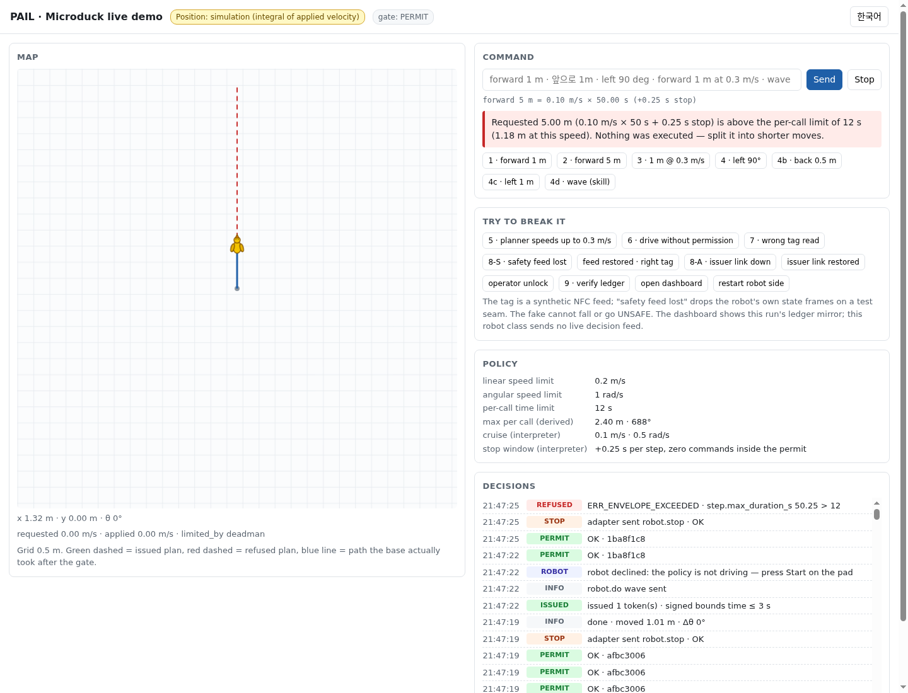
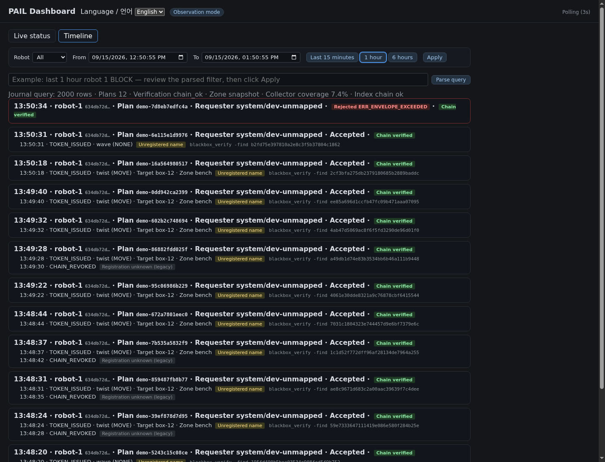

# Microduck live demo — a walkthrough

> **0.2 evaluation delivery:** first run `python3 evaluation.py load` in the evaluation directory.
> The Issuer runs from the evaluation image. The lower-level commands below run from `pail-core/` after that setup.
> Prefer the `evaluation.py` launcher for a first run.


**Type "forward 1 m". Within the policy the (simulated) duck walks; above it, nothing moves
and the screen tells you which limit was exceeded. Every decision lands in a signed ledger,
and the same ledger is what the public observation dashboard shows you.**

This is the Microduck twin of the [TurtleBot3 walkthrough](../tb3/DEMO.md). It runs on
your computer in Docker with the official upstream `robotd --fake`: no robot, no account,
no ROS. The issuer, the robot agent and the `pail-duckd` adapter (with `libpail_gate`) are
the real components. Only the robot itself is a fake, and its identity reading and safety
feed are synthetic. **No physical Microduck has been tested.**

> 한국어판: [`DEMO.ko.md`](DEMO.ko.md). The English document is canonical; if the two
> diverge, the English text governs. Reference material for this example (the preview
> runner, conformance suite, permissions, boundaries) is in [`README.md`](README.md).

## What you are looking at

```
 you ── type "forward 1 m" ──▶ console  (plays the AI requester; PAIL does not trust it)
                                  │  asks for permission (plaintext gRPC on a private network)
                                  ▼
                               issuer ── above the policy? ──▶ REFUSED, nothing moves
                                  │  within it: signs a token          │
                                  ▼                                    ▼
   planner ──robot.move──▶ pail-duckd ──▶ robotd --fake ──▶ integrated position ──▶ map
   (public socket)         PERMIT only while a matching                │
                           signed token is active; else BLOCK          ▼
                                                     signed, hash-chained ledger ──▶ dashboard
```

Three things to watch for, the same three as on the TurtleBot3:

- **The issuer refuses; it never trims.** A request above a limit is refused, and the
  refusal names each exceeded bound.
- **The adapter checks every command, not just the first one.** A planner granted 0.2 m/s
  that sends 0.3 m/s is blocked on every message and the adapter tells the robot to stop.
- **"Nothing moved" is never judged from silence.** After every refusal the same observer
  must see a permitted move.

And two that are specific to this robot:

- **A permitted skill can still be declined by the robot.** `wave` is authorized by PAIL and
  then refused by `robotd --fake` because no policy is driving. Two layers, two answers.
- **The dashboard is the ledger, not a live feed.** This robot class sends no live
  decision packets; the dashboard's timeline is built from a mirror of this run's journal.

## 1. Before you start

| Need | Notes |
|---|---|
| Docker Engine or Desktop with the compose plugin v2 or newer | Linux containers |
| Python 3.9+ | Nothing else on the host; no ROS, no Go |
| macOS, Linux or Windows with WSL2 | Native Windows PowerShell/CMD is not supported |
| Time | First build 10–20 minutes or longer (Rust, Go and the upstream Microduck source); later starts 1–2 minutes |
| Two free local ports | Console `127.0.0.1:8767`, dashboard `127.0.0.1:18092`; change with `--port` and `--dashboard-port` |

Fresh keys are generated for each run and kept in Docker volumes and in the state directory
outside the source tree. Do not share the state directory's `private/` mountpoint or any
key; share reviewed files from `evidence/`.

## 2. Start the demo

Run `build` only after explicitly confirming an isolated software build window. It uses
an owned Buildx worker capped at 2 CPUs / 3 GiB and parallelism at most 2; it never
switches the default builder. **`start` and its alias `up` never build.** Missing or
stale prepared images/native dashboard artifacts return `BUILD_REQUIRED`; run `build`
again. The default receipt is `~/.cache/pail-demo/<kind>/prepared.json`; override with
`--build-record PATH`. `up --build --build-window-confirmed` is the explicit combined
form. `--skip-build` remains a compatibility alias, not a prerequisite for reuse.


From the root of the extracted source tree:

```sh
python3 examples/microduck/demo.py build --build-window-confirmed
python3 examples/microduck/demo.py start
```

The terminal prints, in this order:

```
STATE=/tmp/pail-duck-demo-xxxxxxxx
DASHBOARD=http://127.0.0.1:18092/dashboard/?tab=timeline&preset=1h (ledger mirror of this run; no live decision feed on this robot class)
CONSOLE=http://127.0.0.1:8767/
```

The console's trust line shows `unsigned-dev`: this demo runs on development trust that is
not judged as signature trust, and bundle expiry does not apply to it. That is not a bundle
without expiry — it is no bundle at all; production startup refuses this mode. An operator
profile (`--trust-profile`) reports the same mode from your manifest.

The compose project — and so every container — is named `pail-duck-demo-<release>-<id>`: the
release the run was started from (its dots replaced by `-`, for example `0-2-0-preview-43`),
then a value unique to the run. `docker ps -a --filter "name=pail-duck-demo-<release>-"` lists
the runs of one release and nothing else, and `evidence/console.json` records the same project
beside the release id.

Open the `CONSOLE` URL in a browser on the same machine. Leave the terminal open;
**Ctrl-C stops the whole stack** and leaves the state directory on disk.

Options: `--state /absolute/new/empty/dir`; `--skip-build --image pail/microduck-preview:local-<id>`
reuses an image from an earlier run (the console then prints a note that it is not a fresh
build of your tree); `--dashboard-binary PATH` reuses a dashboard binary built earlier;
`--no-dashboard` starts the console only.

## 3. The console page



| Panel | What it shows |
|---|---|
| Header badges | `Position: simulation (integral of applied velocity)` and `gate: PERMIT` / `gate: BLOCK · reason`, the adapter's last decision. The button on the right switches to Korean. |
| **Map** | Grid 0.5 m. The duck is the robot; its beak points along the heading. Green dashed = the plan the issuer signed; red dashed = a plan it refused; blue line = the position integrated from the velocity `robotd --fake` reports as *applied*. Below it: the last `requested` and `applied` velocities and any `limited_by` name the fake reports. |
| **Command** | Free text and buttons for scenes 1–4d. Below the box: the interpretation, and a red box when a request was refused. |
| **Try to break it** | While the synthetic tag is wrong or the safety feed is being dropped, a red note stays here until you press `feed restored · right tag`; `restart robot side` also puts both inputs back. Scenes 5–9: a misbehaving planner, driving without permission, a wrong tag, the safety feed going stale, the issuer link going down, ledger verification, plus `feed restored · right tag`, `operator unlock`, `restart robot side` and `open dashboard`. |
| **Policy** | The limits in force and the derived per-call maximum. |
| **Decisions** | Newest first. `ISSUED`/`REFUSED` from the issuer; `PERMIT`/`BLOCK` from the adapter; `STOP` when the adapter itself sent `robot.stop`; `ROBOT` when the fake answered a skill call; `OK`/`INFO` are console notes. |

The command box understands `forward 1 m`, `back 0.5 m`, `left 90 deg`, `left 1 m`,
`forward 1 m at 0.3 m/s`, `wave`, `stop` and the Korean forms `앞으로 1m`, `왼쪽으로 90도`,
`손 흔들어`, `정지`. The interpreter plans at cruise speed (0.1 m/s, 0.5 rad/s) unless you
name a speed, and it never raises the speed to shorten a request.

## 4. Walkthrough, scene by scene

The demo policy allows **0.2 m/s**, **1.0 rad/s** and **12 s per call**. At the 0.1 m/s
cruise speed, "1 m" is 10 s of motion; the interpreter asks for 10.25 s because the planner
spends the last 0.25 s of every permit sending zero-velocity commands. `robotd` holds the
last command for about half a second when a planner merely goes silent (its deadman), and
that silence overshot a 90° turn to 102° before this stop window existed. A stop is a
command, not silence, and it has to happen inside the permit. PAIL judges requester,
skill, target, speed and time; distance falls out of speed × time.

### Scene 1 — forward 1 m (permitted)

Type `forward 1 m` or press **1**.

- Under the box: `forward 1 m = 0.10 m/s × 10.00 s (+0.25 s stop)`.
- Decisions: `ISSUED issued 1 token(s) · signed bounds angular ≤ 1 rad/s · linear ≤ 0.2 m/s · time ≤ 10.25 s`, then `PERMIT OK · <token id>`.
- The map's blue line grows for about ten seconds. When the position comes to rest: `INFO done · moved 1.00 m · Δθ 0°`.

The fake ramps its applied velocity up and down over a few tenths of a second; the ramp-up
loss and the ramp-down gain roughly cancel, so the integrated distance lands close to the
request.

### Scene 2 — forward 5 m (refused: too long for one call)

Press **2** (the button names a distance above the per-call maximum).

- Decisions: `REFUSED ERR_ENVELOPE_EXCEEDED · step.max_duration_s 50.25 > 12`.
- Red box: *Requested 5.00 m (0.10 m/s × 50 s + 0.25 s stop) is above the per-call limit of 12 s (1.18 m at this speed). Nothing was executed — split it into shorter moves.*
- Map: a red dashed plan. Nothing reaches the fake.

### Scene 3 — forward 1 m at 0.3 m/s (refused: too fast)

- Decisions: `REFUSED ERR_ENVELOPE_EXCEEDED · sls.linear_mps 0.3 > 0.2`.

### Scenes 4, 4b, 4c — turn, reverse, "sideways"

- `left 90 deg` (**4**): one token, `turn left 90° = 0.50 rad/s × 3.14 s (+0.25 s stop)`; turns in place. **Expect about 90° — 89–92° is what this preview measures.** That band is a description of observed runs (89.8–91.8° across three independent evaluations on macOS and Linux), not a limit anything enforces: the judge accepts `60° < Δθ < 100°`, so a PASS means "turned left by roughly a right angle", not "stayed inside the band". The plan commands exactly 90° of rotation; the zero commands of the 0.25 s stop window let `robotd --fake` ramp down inside the permit, and the planner starts its step clock at the send time of its first permitted command, so the motion ends where the plan says. The number on the page is what the fake reports as applied, not a corrected value. (Before 2026-09-16 the planner's clock started at the *reply* to that command, up to a round trip late; the turn then read 92–94°, and 102° before the stop window existed.)
- `back 0.5 m` (**4b**): one token; the adapter measures speed magnitude, so reverse has the same limit.
- `left 1 m` (**4c**): **two** tokens, a 90° turn and then 1 m forward. Microduck can step sideways (`vy`), but this demo keeps the TurtleBot3 grammar so both consoles read the same sentences. The second step's first command is sent only after the first step's deadline; the Decisions panel shows two `PERMIT` lines with two token ids.

### Scene 4d — wave: authorized by PAIL, declined by the robot

Type `wave` or press **4d**.

- Decisions: `ISSUED issued 1 token(s) …` with a token whose skill is `wave`, then `PERMIT OK · <token id>` for the `robot.do` call, then `ROBOT robot declined: the policy is not driving — press Start on the pad`.

PAIL answered the only question it asks: is this requester allowed to run this skill on
this robot now. The fake then declined for its own reason (no gait policy is loaded under
`--no-policy`). On a real Microduck with a policy driving, the same permitted call makes
it wave. A skill the registry does not know (`dance`) is refused by the adapter before the
gate is even asked: `BLOCK ERR_ACTION_UNMAPPED`.

### Scene 5 — the planner exceeds its permit

Press **5 · planner speeds up to 0.3 m/s**. The console sends `forward 1 m`; about 2.5 s
in, the planner starts sending 0.3 m/s.

- Decisions: `INFO planner now sends 0.3 m/s`, a stream of `BLOCK ERR_CONSTRAINT · <token>` with the detail `sls.linear_mps=0.3 outside [-,0.2]`, and one `STOP adapter sent robot.stop`. (The same reason with the detail `step.max_duration_s: now=… deadline=… overrun_ms=…` is a different thing: a command that arrived after the step's permit ran out. A well-behaved planner never produces it; see section 8.)
- The fake stops. The token is still valid; send any new command and it runs at the permitted speed.

### Scene 6 — driving without permission

Press **6 · drive without permission**: the planner sends 0.1 m/s for 4 s with no plan.

- Decisions: `INFO driving without a plan: 0.1 m/s × 4 s`, then `BLOCK ERR_NO_TOKEN`. Nothing reaches the fake. Follow with scene 1 to see the same observer report motion.

### Scene 7 — the wrong tag is read

Press **7 · wrong tag read**, then send `forward 0.5 m`.

- Decisions: `INFO tag read → other-box`, `ISSUED …` (the token names target `box-12`), then `BLOCK ERR_TARGET_MISMATCH` for every command.
- Press **feed restored · right tag**: the synthetic reading returns to `box-12` and the same plan continues within its token.

The identity reading is a synthetic NFC feed on the adapter's evidence socket, not a reader.

### Scene 8-S — the safety feed goes stale while moving

Send `forward 1 m`; while it moves press **8-S · safety feed lost**. A test seam between the
adapter and the fake starts dropping the robot's own state frames, so the adapter's safety
feed ages out.

- Decisions: `BLOCK ERR_SAFETY_STALE`, `STOP adapter sent robot.stop`. The fake stops.
- Press **feed restored · right tag**: frames flow again and motion resumes within the still-valid token. No operator is needed: nothing fatal was reported, the feed was merely missing.

The fake cannot fall or go UNSAFE, so this demo cannot show an emergency stop. That path
(fallen / limp / low battery → ESTOP → the running plan's authority revoked; the operator lock itself is reserved for forged-token reports) is real-robot work.

### Scene 8-A — the issuer link goes down while moving

Send `forward 1 m`; while it moves press **8-A · issuer link down**. The robot agent
container is stopped.

- Decisions: about two seconds later `BLOCK ERR_REPORT_UNAVAILABLE` (issuer-first: the adapter may not forward a command whose decision it cannot report), then `BLOCK ERR_ISSUER_UNREACHABLE`, and `STOP adapter sent robot.stop`.
- Press **issuer link restored**. The step's window has usually expired by then; send a new command and it runs on a new token.

### Scene S — Stop while moving

Send `forward 1 m` and press **Stop** while it moves.

- Decisions: `INFO stop · plan cancelled at the issuer · no permit remains`, then within about 0.1 s `BLOCK ERR_NO_TOKEN` and `STOP adapter sent robot.stop`.

The cancellation reaches the adapter through the robot agent's beacon stream, which is why
the preview issuer is `pail_cloud`. The next command runs on its own token.

In historical RC19 stop-scene measurements (not measurements of this preview), the fake's `applied` velocity reached zero about **1.5 s
after the stop acknowledgement** (external evaluation: 1.459–1.491 s over four runs). This
is the simulator's applied-velocity decay, **not a physical stopping time**, a guaranteed
bound, or the normal-move ramp estimate above. The late-request verdict uses `requested`;
`applied` is reported separately and its last observed sample must also be zero.

**Stop observations are not a physical stopping-time guarantee.** File delivery, scheduling and
log transport are not bounded by one planner period. A unique stop id ties the request, the
instruction and its acknowledgement together. Console request-to-received-ack time is measured
on the console's monotonic clock (`stop_ack_after_s`, an upper bound including log transport).
The old cross-clock subtraction remains diagnostic only (`raw_cross_clock_ack_delta_s`).

The observer records fresh `robot.state` samples, including both `requested` and `applied`
velocity. These are **state samples, not counts of RPC commands**. The judge preserves the
existing 0.1 s post-ack grace for nonzero **requested** state; it does not discard observations
that precede the issuer's cancel reply. `requested_nonzero_samples_after_ack` counts late nonzero requested states; `applied_nonzero_samples_after_ack` reports nonzero applied samples separately (the
fake may ramp down); the last requested and applied samples must both be zero (the existing 1e-8 velocity tolerance). This differs from the 1e-4 stationary-pose tolerance, so those observation times need not coincide. At least one
second of post-ack observations is required, with gaps no larger than 0.25 s and a continuous
stream/sequence. Missing samples, reconnects, invalid vectors or unknown clock domains do not
become a zero or a pass. A recorded clock step invalidates that scene's timing prerequisite;
it is not automatically an adapter authorization failure.

`ack_to_zero_requested_state_s`, `ack_to_zero_applied_state_s` and the planner's zero publication
are separate observations. A missing robot-clock publication marker leaves `publication_to_ack_s`
unmeasured, with a reason. Optional stationary-pose observations also carry a reason when absent;
they are an integral of fake velocity, not wheel odometry or a certified physical stop time.

### Scene 9 — verify the ledger, then open the dashboard

Press **9 · verify ledger**.

- Decisions: `OK ledger OK · CLASSES: legitimate=… illegitimate=… · dashboard ledger query OK`.

Then press **open dashboard**. The observation UI (`pail_telemetryd`, the same tool the
release ships for stopped E2E journals) opens on the timeline of this run, read from a
mirror of the issuer's journal that is refreshed every second and indexed every two.
The issued and refused plans you just caused are there; `verify: chain_ok` on the query
means the mirror's hash chain checked out.



The dashboard's *live* tables stay empty for this robot: `pail-duckd` sends no live
decision packets (only the ROS 2 gate does). That absence is stated on the console, not
hidden.

## 5. Let the judge run every scene

With the console up, in a second terminal:

```sh
python3 examples/microduck/demo_scenes.py            # --url http://127.0.0.1:8768 if you moved the port
```

It drives scenes 6, 1, 2, 3, 4, 4b, 4c, 4d, 5, 7, 8-S, 8-A, S, R (restart the robot side)
and 9, prints one `PASS`/`FAIL` line per scene and ends with:

```
RESULT=PASS 15/15 OUT=demo-scenes-results.json
```

Exit status `0` when every scene passed, `1` when one failed, `2` when the console was
unreachable. The results file records, per scene, what was requested, which token ids the
adapter permitted under (they must be the ones the issuer just signed), how far the
integrated position moved, and a `scope` line stating what the positions are.

## 6. Stop, and what to keep

Ctrl-C in the `demo.py` terminal. In the printed `STATE` directory:

| Path | What it is | Share? |
|---|---|---|
| `evidence/console.json`, `run.json` (state root) | Console and dashboard URLs, project name, image id, whether the image matched this source tree | Yes |
| `evidence/runtime/demo-*.jsonl` | Every observation: adapter outcomes with token ids, integrated poses, planner actions, tag feed, mirror stats | Yes |
| `evidence/demo-access.json` | The access probe: the planner uid can append its own record and cannot see the raw socket directory | Yes |
| `evidence/ledger/` | Mirror of the issuer's journal (what the dashboard read) | Yes, after review |
| `evidence/*.log`, `dashboard/` | Build, prepare, startup, service and dashboard logs; the dashboard's own index | After review |
| `private/` mountpoint, Docker volumes `<project>_private` | Private keys and the original journal | **No** |

## 7. What this demo is not

- **Positions are an integral.** `robotd --fake` is not a physics simulator; the observer integrates the velocity it reports as applied. No encoder, no floor.
- **The tag is synthetic and the safety feed is the fake's own state.** "Safety feed lost" drops frames on a test seam; the fake never falls.
- **Requester identity is not checked in the default single-robot preview.** The preview's control transport is plaintext development gRPC without a requester list; `TRY_IT.md` and the preview README state this boundary.
- **The dashboard is a ledger view.** No live decision feed exists for this robot class yet.
- **Nothing here is a Microduck validation.** Board installation, firmware, NFC access and physical motion remain separate work; do not run this demo against hardware.
- **This is one robot.** The multi-robot operations contracts — admission holds, the
  maintenance lockout register, binding probes — are a separate, opt-in integration
  guide, [`spec/ROBOT_OPERATIONS.md`](../../spec/ROBOT_OPERATIONS.md); nothing in this
  demo enables them.

## 8. If something looks wrong

| Symptom | What it means / what to do |
|---|---|
| `REFUSED: Use the public source snapshot` | Run from the extracted public source tree, not another checkout. |
| `access contract failed` | The state directory could not be shared correctly between the host and container users; use a new directory on a local Linux filesystem (not `/mnt/c` under WSL). |
| `adapter/issuer did not become ready` | Read `evidence/services.log`: a startup refusal names its gate (`S39` registry, `S27` raw socket, …). |
| Every command is `BLOCK ERR_NO_EVIDENCE` | The synthetic tag feed is not reaching the adapter; check `evidence/runtime/demo-evidence.jsonl` for `connected`. |
| `BLOCK ERR_EXPIRED` right after a plan | The token's validity ended before the gate judged the command (the gate judges `not_after` on the signed bytes). Send the command again: the gateway does not keep a window whose token has expired and fetches the current plan's token on the next read. If it keeps happening, the robot-side clock is ahead of the Issuer's, or the plan is being sent long before the command. The console cancels timed-out plans itself. |
| `BLOCK ERR_CONSTRAINT` with detail `step.max_duration_s: now=… deadline=… overrun_ms=…` | A command reached the adapter after the step's permit ran out (the number is by how much). The planner of this demo stops one period early and the restart waits for every actor, so it indicates a deadline overrun that needs its own evidence and diagnosis; if it does, read `evidence/runtime/demo-planner.jsonl` for a `reply_lag_s` above 0.1 or a reconnect during the plan. |
| The judge fails a different scene each run with `control moved 0.38 m, want 0.30 ± 0.05`, a turn that overshoots, or `requested velocity stayed nonzero after stop acknowledgement` | The host delayed a command by a few hundred milliseconds; the fake kept its last velocity meanwhile. Seen on a Docker Desktop VM that was out of swap and shared with many other containers; one `0.359 m` after a fleet restart was also reported from an otherwise idle Linux VM (2026-10-09), so an idle host lowers the odds but is not a guarantee. The observer integrates the pose over the robot's own sample clock, so a stall of the observer itself no longer changes the number. The judge's tolerances are deliberately not widened. Run the judge again and keep the failed run's output (`--out`), including its `.events.jsonl`. |
| Every scene from some point on fails with `not observed … first motion`, and the judge's summary adds `the gate refused N commands with ERR_CLOCK_DRIFT` | The adapter saw its own wall clock step. The gate refuses every command with `ERR_CLOCK_DRIFT` once the difference between wall and monotonic time has moved more than 500 ms since the adapter started — by design, and not a policy refusal. The usual cause is a VM time-synchronisation agent that **steps** the guest clock: Lima's `lima-guestagent` jumps it by about 100 ms every 20 s and crosses the bound within minutes. Once the clock is quiet, press `restart robot side` (scene R, the console button): the accumulation starts from zero. Prefer a host that slews time (chrony, systemd-timesyncd); the evaluation launcher's `doctor` warns about steps and such agents in its `clock` row. A physical robot sees the same after an NTP step — put it in the operating procedure. |
| `Console not reachable` from the judge | Start `demo.py up` first, or pass `--url` with the port you chose. |
| Dashboard shows no rows | Wait two ticks; then check `evidence/ledger/` has segment files and `evidence/dashboard.log`. |

## 9. On a real Microduck

None of the above has been run on a physical Microduck. When one is available the same
console can be pointed at the real `robotd` through the board installation described in
[`../../adapters/microduck/deploy/INSTALL.md`](../../adapters/microduck/deploy/INSTALL.md);
positions would then have to come from the robot (its odometry, or a measurement), the
skill scene would show an actual wave, and the fallen/limp/battery safety path could be
exercised. Until then every number in this walkthrough is a software result.

## Preserve each run's result

`--out` must name a **new file**. An existing file is earlier evidence: the judge refuses it with exit 2 before contacting the console. Omit `--out` to create a timestamped, uniquely identified file under the OS temporary directory's `pail-demo-results/`. The path is printed at startup and progress is saved after every scene. Handled interruptions (SIGINT/SIGTERM) or connection failures retain completed scenes in a failed result. An uncatchable termination such as SIGKILL may leave the last checkpoint incomplete; it is never a pass. A sibling `.events.jsonl` preserves the events read by the judge; the result records their count and SHA-256. These hashes bind bytes; they do not sign or authenticate the origin. For an incomplete checkpoint, that hash covers the recorded prefix count. Each scene records `scene_event_range`; the stop verdict records `observation_event_range`. These are zero-based JSONL bounds (start inclusive, end exclusive). Read run id, completion and selection together; a partial run is not a full-suite pass.

An optional stationary-pose observation requires 0.5 s of observed positions within the existing tolerance. Gaps longer than 0.25 s are not interpreted as standstill. Missing values carry reasons such as `NO_POSE_SAMPLES`, `INSUFFICIENT_POSE_SPAN`, `POSE_GAPS` or `NO_STATIONARY_INTERVAL_OBSERVED`. These describe the observation condition, not a guessed cause such as sensor noise.

## Software fleet (shared issuer)

The optional fleet path uses one issuer/journal and one read-only collector, with a
private internal network, agent key and socket volume for each robot. It requires
host Python with `PyYAML` (the same parser already used by the container fixtures).
Use the matching evaluation bundle and load its pinned runtime images. No Issuer
source overlay is supplied. The evaluation launcher bundles the host PyYAML dependency.
For a custom Core build, use the documented explicit build; fleet startup requires
an existing image and resolves it to an immutable Docker image ID. The separate
Issuer image still comes from the evaluation image lock.

```sh
python3 examples/microduck/demo.py start --fleet examples/microduck/fixtures/fleet-v2.yaml \
  --state /tmp/my-new-software-fleet --image YOUR_BUILT_IMAGE \
  --port 8777 --dashboard-port 18097
```

`YOUR_BUILT_IMAGE` is the image the explicit build prepared. Read its immutable ID from
the build receipt (the default path is shown; use your `--build-record` path if you set one):

```sh
python3 -c "import json,os;print(json.load(open(os.path.expanduser('~/.cache/pail-demo/microduck/prepared.json')))['images']['runtime'])"
```

`up` is also accepted. `--no-dashboard` omits the host dashboard listener but keeps
the read-only collector. The dashboard bridge performs bounded GETs to the collector's
container loopback; the collector has no Docker socket or command endpoint.
`--robot-id NAME` selects the same path with a single explicit robot instead of a
fleet file. With neither option the existing default single `robot-1` demo is unchanged.
Do not combine `--robot-id` with `--fleet`; a conflicting inherited `PAIL_ROBOT_ID`
is an error. `--dashboard-binary` is not used by the fleet: its collector binary
comes from the selected image.

The strict YAML has `schema_version: 1` or `2`, a deployment UUID, `profile: software-dev` or
`software-fleet-mtls`, `robots` and `budget`. Unknown/duplicate keys, YAML aliases, duplicate
IDs and invalid budgets are refused. IDs are case-sensitive. The schema accepts at most 16
rows; this is an input bound, not a validated fleet-size promise. The reference measurement
uses two robots.

Use a version 2 file (`fixtures/fleet-v2.yaml`, `fleet-v2-mtls.yaml`, `fleet-v2-push.yaml`).
The version 1 files (`fixtures/fleet.yaml`, `fleet-mtls.yaml`) remain for compatibility: their
single fixed budget of 2 CPUs for every container measurably throttles the collector, so the
examples in this document do not use them.

**Version 2** (`fixtures/fleet-v2.yaml`): `robots: [{robot_id, display_name, kind?}]` and
`budget: {shared: {cpus, memory_mib}, per_robot: {cpus, memory_mib}, parallelism}`.
The shared containers divide `shared` by weight (issuer 4, collector 2, ledger copy 1);
the robot-side containers of one robot divide `per_robot` (agent 3, adapter 3, fake, seam,
planner, observer and evidence feed 1 each). **A robot's share is the same for any number
of robots**; the total is `shared + per_robot × n`. A budget that leaves a container below
0.05 CPU or 64 MiB is refused (`BUDGET_BELOW_MINIMUM`). `kind` is `microduck` or omitted;
any other kind is refused (`KIND_UNSUPPORTED`; `tb3` is a later release).

**Version 1** is accepted as before: one fixed `budget: {cpus, memory_mib, parallelism}`
(at most 2 CPUs and 3072 MiB, parallelism at most 2) divided among every container, not
multiplied per robot. The runner prints a notice that version 2 exists.

**Capacity check.** Before the fleet makes any directory, volume or container, the runner
reads the host's CPUs and memory from `docker info` and refuses a fleet that needs more
CPUs than the host has or more than 80 % of its memory (`CAPACITY_EXCEEDED`; for a version 2
budget the message says how many robots of that budget the host holds). If Docker does not
answer, the fleet is refused (`CAPACITY_UNKNOWN`): nothing is assumed. What other projects
already use is not subtracted, because Docker does not say it: passing means the fleet is
not plainly too large, not that it is comfortable. The result is kept in `fleet-run.json`
under `capacity`.

### The observation upload

<a id="the-observation-upload"></a>

How the collector gets the robots' observation records is a version 2 field,
`observation_path`:

- `files` (the default, and what version 1 fleets do): each robot's observer writes its
  records to a file the collector reads. Robot and collector are on one machine.
- `push`: the robot uploads. Each robot's observer sends its records to the collector over a
  network (`https://collector:8443/v1/observations/push`), with mutual TLS: the observer
  presents a certificate of its own robot, the collector presents its own, and the fleet's
  temporary CA signs both at `prepare` (the CA key is not kept; `push-enrollment.json`
  lists the fingerprints, no private material). **The robot of an upload is the robot of
  the certificate**: the registry binds the observer's fingerprint to its robot, and a body
  that names another robot is refused (`ROBOT_ID_MISMATCH`). The collector shares no file
  with the robots. This is the shape of a real deployment, where the collector is not on the
  robot.

The fleet makes an `uplink` network for it. Its only members are the collector and each
robot's observer; the issuer, the agents and the adapters are never on it (the topology
check refuses a compose in which they are, `BINDING_UPLINK_NETWORK`). The observer reads
its certificate from its own robot's private volume, read-only, the certificate part only
(`PRIVATE_VOLUME_EXPOSURE` otherwise). The collector's `-push-listen`, `-push-ca`,
`-push-cert`, `-push-key` flags and the observer's `PAIL_OBSERVATION_PUSH_URL`, `_CA`,
`_CERT`, `_KEY` variables are set by the fleet; nothing in them is a threshold of
authorization or safety.

**The challenge.** A record that came over a network cannot be dated by the robot's clock,
and the collector does not try. Every answer of the collector carries a **challenge**: 16
random bytes, good for 10 s, for that robot and that producer, usable once. The observer
stamps every record it makes with the challenge of the last answer, so the record can only
have been made after the collector issued it. The collector judges such a record by its
own clock: `freshness_basis: challenge_bound`, with `age_upper_ms` = the time since it
issued that challenge. A record with a wrong challenge — used before, expired, unknown,
issued to another producer — is refused by that name and counted as a fault of the source.
A record without a challenge is taken as `receiver_only`, current or replayed as it says.
**The robot's wall time is written and ignored**: a robot whose clock is an hour off is
judged exactly as one whose clock is right.

**When the observation path is cut** (the network, the collector, a certificate), the
observer drops its challenge, keeps what it made in a bounded queue (the oldest is dropped
and counted, never sent out of order) and marks it `replayed`; when the collector answers
again the queue goes up as history, never as the current state, and a new challenge starts.
The robot's own feed records `push_failed` and `push_recovered`, once each. **The
authorization path and the robot's motion do not depend on the observation path**: while
its upload is cut, a robot is issued tokens, permitted and moves as before; the screen shows
it STALE/UNKNOWN, which is the truth of what the collector knows.

A fleet file for it: `fixtures/fleet-v2-push.yaml` (version 2 budget, `observation_path: push`). What is proven
on a real fleet, and what is not (no physical robot; the `uplink` is a Docker network, not
a radio link): the maintainers' live push measurement and its O7-01 result, which are not
part of this archive.

Choose the target explicitly on the command page. `POST /api/command` accepts only
`{robot_id, request_id, text}`; target omission is allowed only with one robot.
Retries must retain the request ID. The selected target and reserved plan ID are
committed before sending. An ambiguous response is `UNKNOWN`; retry returns that
stored result without issuing a new plan. Inspect the existing plan before any
new request. Two-robot actions are independent results, never atomic transactions.

`software-dev` uses isolated plaintext transport and synthetic registration;
it is **not** authenticated production enrollment. For the authenticated software
fixture, use `fixtures/fleet-v2-mtls.yaml` with the same `start --fleet` command and a
**new state directory**. `software-fleet-mtls` provisions a fresh test CA and distinct
robot client leaves, binds their SHA-256 fingerprints in `robot_registry.yaml` and
`requesters.yaml`, and enables mTLS on helper-to-agent and agent-to-issuer TCP.
The Rust adapter uses its own robot's permission-restricted local UDS, not mTLS.

TLS client/server keys are distinct and remain in the robot's private volume;
robots do not receive the issuer's private signing/server keys. The temporary CA
private key is discarded after provisioning. No keys are sent to the browser.
`tls-enrollment.json` and the run manifest contain public fingerprints and explicit
expiry timestamps (seven-day test credentials). Expired credentials require a
new test deployment; this path does not silently renew/adopt keys.
The agent checks the original caller before forwarding plan-only requests with
its own identity, and the issuer separately checks the resolved plan owner.
This profile remains a **software test with fresh development signing keys and
synthetic feeds**, not a production PKI, hardware validation or motion-resume policy.
Applied velocities are fake observations. An observation whose clock binding
the collector could not confirm stays `UNKNOWN`; neither zero velocity nor a cancel ACK proves physical stop.
The command page calls values **last observed**, not live safety guarantees.

The fleet observer also writes two self-reports for the collector (record version 2):
`liveness` once per second while the adapter answers the observer's `robot.health`
query, and `permit` (`RECEIVED` once per second while the adapter holds a permit,
`EXPIRED` once afterwards). **Liveness means the observer runs and the adapter
answers; it does not mean the gate judges correctly.** There is no "dead" value:
when the adapter stops answering the records stop, and the collector shows the
facet as `STALE` 3 s later. Both are `local_self_report`, not signed statements.
See `examples/common/README.md`.

The fleet also asks the collector to bind the observer's clock
(`clock_binding: shared_kernel_monotonic`). The collector compares the clock name
in each record with its own; on one computer the containers share the kernel, so
motion and pose become `FRESH` with `freshness_basis: producer_clock_bound` while
the record is younger than 1 s. If the names differ or the collector cannot read
its own, they stay `UNKNOWN` with the reason. This changes the observation view
only, not the gate, permit deadlines or token expiry.

The plan and ledger columns come from the ledger the collector itself verifies
(source kind `collector_ledger`, trust `collector_verified`), not from a robot's
report. The ledger column is `CHAIN_OK`, `CHAIN_ERROR` (with the fault code),
`VERIFYING`, `UNVERIFIED` or `ABSENT`, with the verified position and this robot's
last record. The plan column is the latest plan of the robot: `ACCEPTED` with
progress, `REJECTED` with the code, `CANCELLED`, or `COMPLETED`. **`COMPLETED`
appears only when the ledger states the number of steps and holds the completion
record of the last one; otherwise the plan stays `ACCEPTED` with its progress.**
While the chain is anything other than `CHAIN_OK`, the plan column is `UNKNOWN`.
These are states, so their freshness is the age of the last verification
(`freshness_basis: verified_frontier`, `FRESH` for 30 s), not the age of a record.
The values are computed when the collector finishes a verification pass; a request
reads them from memory and never opens the ledger.

Each robot row of `/v2/observation/robots` also carries a `summary`: one word
(`IDLE_READY`, `MOVING`, `ATTENTION` or `UNKNOWN`), the reason code, the number of
the row of the decision table that chose it (`decided_by_rule`, 1 to 11, first
match wins) and the `inputs` that row read. A record counts as fresh for the
summary only when its age is the producer's age (`producer_clock_bound`); what the
collector alone saw arrive does not count. **On a deployment whose clock binding
is not confirmed the summary is never `IDLE_READY`; it is `UNKNOWN`.**
`IDLE_READY` needs a connected source, a fresh liveness record, a fresh motion
record that says zero, no held permit, and a currently verified ledger that holds
no plan in progress for the robot. An accepted plan with no motion and no permit
becomes `ATTENTION` / `PLAN_NOT_PROGRESSING` only after 10 s, counted up to the
last ledger verification. The summary is a reading of observations:
`physical_stop_proven` is always `false`. The existing `quality` field keeps its
meaning. The collector does not know the console's `PAUSED` state.

**Observation tab (the screen).** One row for a robot. Of the sources of a robot,
the one that supplies a kind is shown in its column; a source that was not
configured for a kind is not shown. A cell has two lines, the value and how good
the observation is; reason, age, source, trust and times are behind "Evidence".
Codes are shown as they are recorded, with their explanation in front
(`Ready, idle (IDLE_READY)`). The page is in English and Korean.

- **First tab.** A tab named in the address (`?tab=`) is shown. Otherwise the
  observation tab is first where two or more robots are declared, and the status
  tab where there is one. A tab the page chose is not written into the address.
- **Tabs and columns without a source are not drawn.** The capability document
  (`/v2/observation/capabilities`) says `observation`, `signed_events`,
  `signed_permit_statements`, `management_projection`, `management_observation`
  and `clock_binding` where the source map declares the ledger source. The robot
  operations tab is drawn only with `management_projection`, the management
  column only with `management_observation`; without it the page says that no
  management source is connected. A collector that does not say is drawn the way
  it was.
- **Refresh line.** "Last refresh" is when the page last got an answer; "Data as
  of" is the moment the collector's data is of. A difference of more than 2 s
  between the two is marked. When a refresh fails the reason is shown, the earlier
  rows stay and are greyed, and no state is said in the present: the summary shows
  `UNKNOWN` with what was judged last. After more than 10 s without a refresh a
  banner across the page says that the data is old.
- **States read from the verified ledger** (plan, ledger record) are judged by the
  age of the verification (30 s), not by the 3 s limit of an event.
- The screen shows what was reported to the collector. It cannot show what a robot
  does while the robot cannot reach the server, and it never proves that a robot
  stands still.

**Decision history (Live status tab).** `/v2/observation/decisions` lists, per
robot, the decision records of the ledger the collector verified: gate decisions
(permit, block, emergency stop), issuer safe stop, chain revoked, chain
cancelled and operator actions. It is offered only where the source map declares
the ledger source; the capability document then names the endpoint and says in
`feeds` whether signed events reach this collector (in a fleet they do not: the
robot agent sends them inside the robot, and the issuer, the agents and the
adapters are not attached to the observation network).

- `ledger_verified` is `true` only while the chain is `CHAIN_OK` and the
  verification is younger than 30 s. In any other state the list is the verified
  part of the ledger, with the chain state and the verified position stated;
  nothing beyond that position is listed.
- A record of a robot the source map does not declare is in no list. A record
  that names no robot (an operator action) is listed for the deployment.
- The time of a row is the time the issuer wrote the record, not the time
  something happened on the robot.
- A robot reports the decision on a running step many times a second: a permit
  while it moves, a block while it is refused. Reports that say the same about
  the same step and follow each other are one row with their count (`repeats`)
  and the first and last ledger position. Another decision, another reason,
  another step, a completion or a fatal report starts a new row. Each robot's
  list keeps the newest 200 rows and says how many older ones it dropped.
- **What is not in the list:** a block the robot could not deliver. The agent
  sends step completions again when the link returns, but a report that changes
  nothing at the issuer (a block, for example) is not sent again after a failed
  delivery. The page states this under the table: "Blocks recorded while the
  robot and the server were disconnected may be missing from this table."
- In the permit table every row names its source: a signed statement
  ("Signature verified") or the robot's own report ("Self report"). A self
  report is never shown as evidence of a permit.
- Where no signed event reaches the collector the page draws no listen rate, no
  gap list and no status tile: they would describe a feed that does not exist.

Ctrl-C performs the same owned shutdown as `stop` below. Existing state is never
silently adopted/recreated. No physical devices, existing demos or unrelated
containers are operated by this path.

### Fleet service lifecycle (RunManifest v2)

These commands apply to an explicit `--fleet` or `--robot-id` software deployment.
The original default single-demo `up/parse/selftest` and Ctrl-C path remain unchanged.
An old standalone state without a fleet ownership manifest cannot be inferred or
silently migrated; keep it for evidence and use a new explicit fleet state.

```sh
python3 examples/microduck/demo.py status --state /tmp/my-new-software-fleet --json
python3 examples/microduck/demo.py stop --state /tmp/my-new-software-fleet
python3 examples/microduck/demo.py resume --state /tmp/my-new-software-fleet --port 8777 --dashboard-port 18097
```

`status`/`inspect` read the locally integrity-checked lifecycle record. They report
`controller_active` separately and `runtime_checked: false`: recorded STOPPED is
not a fresh physical-motion observation. A dead supervisor with a nonterminal
record is `RECOVERY_REQUIRED`, not a successful shutdown.

Only one controller may own a state directory. Stop closes command admission,
waits for in-flight work, writes idle/zero intent, reconciles known accepted and
ambiguous plans, observes fresh fake-zero evidence, flushes history and stops
exact owned services. Missing cancellation/cleanup evidence leaves
`RECOVERY_REQUIRED`. Keys, journal, command/history DBs and volumes are retained.

Resume verifies the pinned source/image/config, identities, expiry, container and
volume identities and stopped intent-history digest. It writes **idle and empty
steps before actors start**, reconciles possible old authority, then waits for new
actor connections. `run_id` is preserved; controller, producer and observation
stream generations are new. **Service resume never repeats an old motion command.**
Do not pass `--image`/build overrides or `--fleet` to resume: it uses its stored
identity. Keep the exact source snapshot available; source changes require review,
not an implicit upgrade.

After a controller crash, use `recover --state DIR` instead of `resume` only after
reviewing `inspect`. Recovery still verifies ownership, stops its own surviving
services and returns to READY_IDLE; it does not claim an uncertain cancel succeeded.
Interrupted preparation without completed identity enrollment is refused as
`MANIFEST_INCOMPLETE_RECOVERY_REQUIRED`; it needs manual investigation, not automatic
key regeneration.

A structured **stopped v1 fleet** can be explicitly migrated:

```sh
python3 examples/microduck/demo.py adopt --state OLD_DIR --fleet ORIGINAL_FLEET.yaml --confirm-stopped
python3 examples/microduck/demo.py recover --state OLD_DIR --port 8777 --no-dashboard
```

Adoption backs up the original manifest, Compose and SQLite history. The complete
runnable template must match the approved configuration; custom commands, mounts
(including developer binary overlays) and unrecognized layouts are refused.
Adoption does not upgrade the image or prove the old deployment's software quality.
An adopted v1 service-only stop still requires explicit authority reconciliation.

`MANIFEST_INTEGRITY`, `PIN_CHANGED`, `CONTROLLER_SOURCE_CHANGED`, foreign resources,
changed keys or missing/changed intent history are refusals, not empty successes.
Do not delete history, re-sign edited manifests or use `down --remove-orphans` to
force recovery. Preserve the state and investigate or create a separately reviewed
new deployment. The manifest uses a **local HMAC seal** and owner-only files, not a
public certificate signature or protection against a hostile Docker administrator.


### Removing a fleet you no longer need

`stop` keeps the stopped containers, networks and volumes so that `resume` can verify
them. Nothing removes them automatically. When a deployment is finished **and you have
copied the evidence you want to keep**, remove only that deployment by its own project
name:

```sh
python3 examples/microduck/demo.py status --state /tmp/my-new-software-fleet --json   # read "project"
docker compose -p PROJECT_NAME_FROM_STATUS down            # containers and networks
docker compose -p PROJECT_NAME_FROM_STATUS down --volumes  # also keys and the journal
```

Run this only after `status` reports `STOPPED`. `--volumes` permanently deletes that
deployment's keys and its journal; omit it to keep them. Removal is one-way: the state
directory can no longer be resumed (`CONTAINER_SET_CHANGED`) and remains only as a record.
Use the exact project name. Do not use `--remove-orphans`, `docker system prune` or a
name pattern: those can reach containers this deployment does not own.

### The console of one robot in a fleet

The fleet console has a page for each robot, and the list of robots at `/`.

| Address | What it is |
|---|---|
| `/` | The list: a card for each robot with its summary state, latest plan, last observed position and a link to its console; the quick command; the recovery button of a paused robot |
| `/robot/<robot_id>/` | The console page of that robot. It is the single-robot console page, the same file |
| `/robot/<robot_id>/api/…` | The API of that robot, in the form of the single-robot API |
| `/api/state`, `/api/command`, `/api/recovery` | The fleet API, as before |
| `/api/summary` | The summary state of every robot as the collector judged it. Read from the collector, never computed by the console |

- `<robot_id>` is a robot of the fleet configuration. Any other address below `/robot/` is
  not found.
- **The robot of a request is the robot of the address.** A request whose body names
  another robot is refused (`ROBOT_ID_MISMATCH`); it is not corrected.
- A command carries a request id the page makes. When the outcome of a command is not
  known, sending the same command again uses the same id and cannot become a second plan.
- The buttons of the page act on the robot of the page: the planner override, driving
  without a plan, the synthetic inputs, the issuer link of the robot's agent, and
  restarting the robot side. **Restarting the robot side restarts the six services of that
  robot only** (fake, seam, adapter, planner, observer, evidence feed). The issuer, the
  ledger, the collector, the robot's agent and every other robot keep running. The robot
  is paused afterwards and waits for the operator, as after any restart of its services.
- The operator unlock and the ledger verification are asked from a robot's page but
  concern the issuer, which the robots share.
- A paused robot is sent nothing that would make it try to move. Its page shows
  **Confirm recovery to idle (no motion)**; a confirmation on the page of another robot
  does not release it.
- The page of a robot shows the events its own console read or made. An event that names
  another robot is not shown on it.
- `/api/plan` and `/api/skill` of the single-robot API are not offered below a robot's
  address. The page does not use them; a skill is sent as a command (`wave`).
- The scene judge can be pointed at the console of one robot:
  `python3 examples/microduck/demo_scenes.py --url http://127.0.0.1:8777 --robot-id robot-1`
  (the fleet console port of the example above; run one judge per robot, at the same time if you like).
  On a fleet the robot is paused after its issuer link is restored (scene 8-A) and after a
  restart (scene R), until the operator confirms; in that mode the judge confirms as the
  page's button does and records it (`fleet_recovery_after_restore`, `fleet_recovery_after_restart`).
- `verify` on a robot's page asks the collector for that robot's ledger events through the
  fleet's read bridge; the answer has the single-robot form (`ok`, `output`, `dashboard`).

### Clock and transport recovery (explicit fleets)

The fleet console shows each robot's **intent**, **execution**, and **health**
separately. `CONTINUE_REQUESTED` records the user's request; `RESPONDING` means a
read-only agent-to-issuer RPC returned. Neither is permission to resume motion.
A connection failure, observed process restart, or clock discontinuity latches
`PAUSED` / `PAUSED_CLOCK`. The other robot remains independently operable, unless
both share the clock realm that stepped.

After fresh stable clock samples and connectivity return, click **Confirm recovery
to idle (no motion)** on the affected robot. The controller first reconciles/cancels
previous accepted and outcome-unknown plans. For clock incidents it waits for new
software-zero observations and reinitializes the owned adapter's clock baseline.
If any step is unconfirmed it stays paused. Confirmation submits no motion: send a
**new command** afterwards. Reusing an old request ID returns its saved outcome.
The API is `POST /api/recovery` with `{ "robot_id": "robot-1", "confirmation": true }`;
it has the same local origin restrictions as the command API: a browser request from another
origin is refused (`403 ORIGIN`); a request without an `Origin` header (a local process such as
`curl`) is accepted. The listener is bound to the loopback address only.

Diagnostics distinguish `TRANSPORT_REFUSED`, `TIMEOUT`, `TLS_VERIFY_FAILED`, `DNS`,
`REMOTE_UNAVAILABLE`, `REMOTE_RESTART`, `RESOURCE_PRESSURE`, and `UNKNOWN`.
Timeouts are not relabeled as CPU pressure. Raw TLS errors, keys, and headers are
not displayed. Clock diagnostics compare advancing wall/monotonic observations
in one clock realm; historical replay and a changed realm do not establish a step.
They are not an issuer clock measurement. Gate thresholds and host clocks are not
changed. These are software observations, never proof that a physical robot stopped.

The default policy is operator confirmation. An **explicit software-aging fixture**
may add this top-level fleet YAML field:

```yaml
recovery_policy:
  mode: software-aging
  software_only: true
  cooldown_s: 30
  max_attempts: 2
```

Only the two software profiles accept it. Cooldown is 5–300 seconds and the attempt
cap is 1–3 for the current user intent. Each retry reconciles old authority and uses
new request/plan IDs. Unknown outcomes are never retried under the old ID; policy
rejections are not automatically retried. Stop intent cancels eligibility. Restarting
the fleet service does not replay aging intent. This option is **not hardware auto-resume**.


### Resource and build operating boundary

Docker Compose and Buildx are required. The reference host is at least 8 CPUs /
16 GiB RAM; the Docker VM needs headroom for the 3 GiB builder plus its daemon and
other workloads. Limits are not proof that other projects are idle or an authorization
latency SLA. If existing rig activity is unknown, build only on a software-only host
or within a confirmed operating window. The prepared receipt's `build-*` directory
records worker identity, effective cgroup limits and samples (`builder.json`,
`resources.jsonl`). Cleanup removes only that worker; it never switches the default
builder or globally restarts/prunes Docker.

Standalone software runtime containers and native console HTTP workers (at most
32, accept backlog 8) are bounded. This does not put a native process in an OS cgroup.
Measure actual process RSS/CPU and cgroup throttling separately; an unavailable
measurement is not a successful resource check or evidence of a stopped robot.
