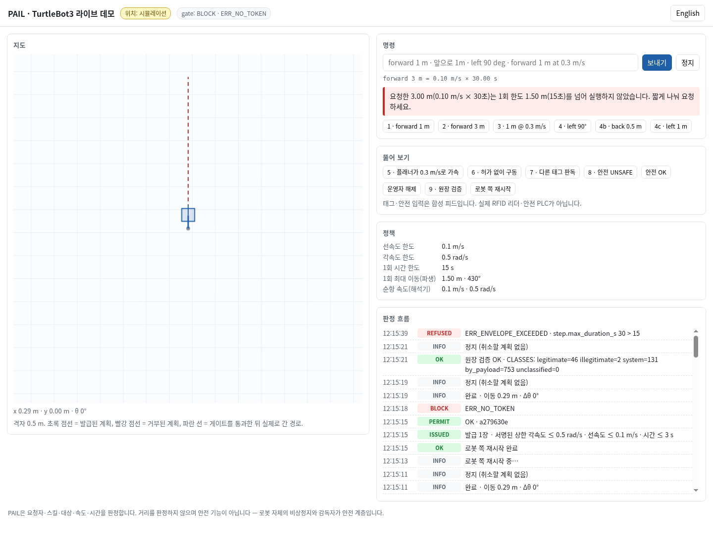

# TurtleBot3 라이브 데모 — 따라 하기 (한국어 안내)

> **0.2 평가 묶음:** 먼저 평가 디렉터리에서 `python3 evaluation.py load`를 실행합니다.
> 이슈어 소스는 포함하지 않습니다. 아래의 저수준 명령은 그 뒤 `pail-core/`에서 사용합니다.
> 처음에는 `evaluation.py` 실행 도구를 권합니다.


**「앞으로 1 m」라고 치면, 정책 안이면 로봇이 움직이고, 넘으면 아무것도 움직이지 않으면서
어느 한도를 넘었는지 화면이 알려 준다. 모든 판정은 서명된 원장에 남는다.**

PAIL이 무엇을 하는지 가장 빨리 이해하는 방법이다. 시뮬레이션 TurtleBot3 베이스를 붙여
Docker로 내 컴퓨터에서 돈다: 로봇도, 계정도, 호스트 ROS 설치도 필요 없다. 이슈어·게이트·모션
브리지는 실제 구성 요소이고, 로봇의 바퀴·태그 리더·안전 피드만 시뮬레이션이다.

> 영어 원문 [`DEMO.md`](DEMO.md)가 정본이며, 두 문서가 다르면 영어 원문을 따른다.
> 이 예제의 참조 자료(8개 검사 러너, 증거 배치, 권한, 실물 경계)는 [`README.md`](README.md)
> (한국어: [`README.ko.md`](README.ko.md))에 있다.

## 지금 보고 있는 것

```
 사용자 ── 「앞으로 1 m」 입력 ──▶ 콘솔  (AI 플래너 역할; PAIL은 콘솔을 신뢰하지 않는다)
                                    │  허가를 요청
                                    ▼
                                 이슈어 ── 정책을 넘는가? ──▶ 거부, 아무것도 움직이지 않음
                                    │  안이면: 토큰에 서명                 │
                                    ▼                                    ▼
   플래너 /cmd_vel ──▶ PAIL 게이트 ──▶ 모션 브리지 ──▶ 시뮬레이션 베이스 ──▶ 지도
                      맞는 서명 토큰이 살아 있을 때만 PERMIT,                 │
                      아니면 BLOCK                                          ▼
                                                             서명·해시 사슬 원장
```

눈여겨볼 것 셋:

- **이슈어는 거부하지, 줄여 주지 않는다.** 한도를 넘는 요청을 짧거나 느리게 고쳐 발급하지
  않는다. 거부하고, 넘은 한도를 하나씩 이름으로 돌려준다.
- **게이트는 첫 명령만이 아니라 매 명령을 본다.** 0.1 m/s를 허가받은 플래너가 0.3 m/s를 보내면
  토큰은 살아 있는 채로 모든 메시지가 막힌다.
- **「안 움직였다」를 침묵으로 판정하지 않는다.** 모든 거부 뒤에는 같은 관측자가 허가된 이동을
  봐야 한다. 그렇지 않으면 죽은 관측자가 차단 성공처럼 보인다.

## 1. 시작하기 전에

| 필요한 것 | 비고 |
|---|---|
| Docker Engine 또는 Desktop, compose 플러그인 v2 이상 | 리눅스 컨테이너, Docker 메모리 4 GB 이상 |
| Python 3, OpenSSL | macOS 기본 `openssl`(LibreSSL)도 된다 |
| macOS, Linux, 또는 Windows의 WSL2 | 네이티브 Windows PowerShell/CMD는 지원하지 않는다 |
| 시간 | 첫 빌드 10~20분 이상(ROS 2 패키지를 컴파일한다); 이후 시작은 1~2분 |
| 빈 로컬 포트 | 콘솔은 `127.0.0.1:8765`를 쓴다; `--port`로 바꾼다 |

데모는 실행마다 새 개인 키를 만들어 소스 트리 **밖**의 상태 디렉터리에 둔다. 그 디렉터리를
공유하지 말 것. 대신 그 안의 `evidence/`에서 검토한 파일만 공유한다.

## 2. 데모 띄우기

`build`는 격리된 소프트웨어 작업 창임을 명시적으로 확인한 뒤 실행합니다. 전용 Buildx 빌더는
2 CPU·3 GiB, 빌드 병렬 상한 2를 사용하고 기존 기본 builder를 바꾸지 않습니다.
`start`와 별칭 `up`은 **빌드하지 않습니다**. 준비된 이미지 digest/대시보드 산출물이 없거나
소스가 바뀌면 `BUILD_REQUIRED`로 끝납니다. 다시 `build`하세요. 준비 기록은 기본적으로
`~/.cache/pail-demo/<종류>/prepared.json`이며 `--build-record PATH`로 지정할 수 있습니다.
`up --build --build-window-confirmed`는 명시적으로 빌드한 뒤 시작하는 단축형입니다.
`--skip-build`는 호환 별칭이며 더 이상 빌드 생략을 위해 필수는 아닙니다.


압축을 푼 소스 트리의 루트에서:

```sh
python3 examples/tb3/demo.py build --build-window-confirmed
python3 examples/tb3/demo.py start
```

터미널에 이 순서로 찍힌다:

```
STATE=/tmp/pail-tb3-demo-xxxxxxxx           # 이 실행의 키·설정·원장·증거
CONSOLE=http://127.0.0.1:8765/               # 같은 컴퓨터의 브라우저로 연다
```

빌드와 콘솔 사이에 러너는 키를 만들고, mTLS와 SROS2 신원을 준비하고, 별도 루트 키로 키링에
서명하고, 사설 Docker 네트워크에 이슈어와 로봇 쪽을 띄운 뒤 이슈어가 응답할 때까지 기다린다.
터미널은 열어 둔다. **Ctrl-C가 스택 전체를 내리고** 상태 디렉터리는 디스크에 남긴다.

옵션: `--state /절대경로/새/빈/디렉터리`로 실행 위치를 고른다; `--port 8766`으로 콘솔 포트를
옮긴다; `--skip-build --cloud-image TAG --gate-image TAG`는 이전 실행이 빌드한 이미지를 다시
쓴다(태그는 `pail/tb3-cloud:pail-tb3-demo-<release>-<id>`, `pail/tb3-gate:pail-tb3-demo-<release>-<id>`이고
`docker images`로 본다). 재사용한 이미지는 지금 가진 트리의 새 빌드가 아니다 — 결과를 보고할
때 그렇게 적는다.

콘솔의 신뢰 줄은 `bundle`을 보인다: 이 데모는 시작 때 자기가 만든 서명 keyring 번들(8시간
유효) 위에서 돌고, 그 줄은 루트 지문(앞 8자)·번들 버전·만료·호스트 시계 기준 남은 시간을
적으며 이 콘솔이 서명을 검증하지 않는다고 말한다 — 검증은 게이트와 발급자가 적재 때 한다.
운영자 프로파일(`--trust-profile`)을 주면 도우미가 검증한 메타데이터로 바뀐다. 어느 쪽도 운전
준비 상태를 말하지 않는다.

묶음(compose 프로젝트)과 컨테이너 이름은 `pail-tb3-demo-<release>-<id>` 다 — 실행을 시작한
릴리스(점을 `-`로 바꾼 것, 예 `0-2-0-preview-43`)와 실행마다 다른 값. `docker ps -a --filter
"name=pail-tb3-demo-<release>-"`로 한 릴리스의 실행만 거를 수 있고, `evidence/console.json`에
같은 프로젝트와 릴리스 ID 원문이 적힌다.

## 3. 콘솔 화면



| 패널 | 보여 주는 것 |
|---|---|
| 상단 배지 | `위치: 시뮬레이션`(위치의 출처)과 `gate: PERMIT` / `gate: BLOCK · 사유`(마지막 게이트 판정). 오른쪽 버튼으로 영어/한국어를 바꾼다. |
| **지도** | 격자 0.5 m. 초록 점선 = 이슈어가 서명한 계획; 빨강 점선 = 거부한 계획; 파란 선 = 게이트를 지난 뒤 베이스가 실제로 간 경로. 네모가 로봇, 선이 진행 방향이다. |
| **명령** | 자유 입력 칸과 장면 1~4c 버튼. 칸 아래에 명령이 어떻게 해석됐는지, 거부됐으면 빨간 상자가 뜬다. |
| **뚫어 보기** | 장면 5~9: 어긋나는 플래너, 허가 없는 구동, 다른 태그, 안전 정지, 원장 검증, 그리고 `안전 OK`, `운영자 해제`, `로봇 쪽 재시작`. |
| **정책** | 이 실행에 적용된 한도와 파생된 1회 최대치. |
| **판정 흐름** | 실시간 로그. `ISSUED`·`REFUSED`는 이슈어, `PERMIT`·`BLOCK`·`ESTOP`은 로봇 쪽 게이트, `OK`/`INFO`는 콘솔의 메모. 최신이 위. |

명령 칸은 영어와 한국어를 알아듣는다. 예: `forward 1 m`, `back 0.5 m`, `left 90 deg`,
`left 1 m`, `forward 1 m at 0.3 m/s`, `stop`, `앞으로 1m`, `뒤로 50cm`, `왼쪽으로 90도`,
`정지`. 해석기는 속도를 지정하지 않으면 항상 순항 속도(0.1 m/s, 0.5 rad/s)로 계획하고,
요청을 줄이려고 속도를 올리지 않는다.

## 4. 장면별 따라 하기

데모 정책은 **0.1 m/s**, **0.5 rad/s**, **1회 15 s**를 허용하므로 한 번의 호출로 최대 1.5 m를
간다. PAIL은 거리를 판정하지 않는다: 요청자·스킬·대상·속도·시간을 판정하고, 거리 상한은
속도 × 시간에서 생긴다.

### 장면 1 — 앞으로 1 m (허가)

`forward 1 m`(또는 `앞으로 1m`)를 치거나 **1**을 누른다.

- 칸 아래: `forward 1 m = 0.10 m/s × 10.00 s`.
- 판정 흐름: `ISSUED 발급 1장 · 서명된 상한 각속도 ≤ 0.5 rad/s · 선속도 ≤ 0.1 m/s · 시간 ≤ 10 s`, 이어서 `PERMIT OK · <토큰 id>`.
- 지도: 초록 점선 계획이 그려지고, 약 10초 동안 파란 선이 그 위를 따라간다.
- 베이스가 정지하면: `INFO 완료 · 이동 1.00 m · Δθ 0°`(시뮬레이션은 보통 0.99~1.00 m를 기록한다).

토큰의 상한은 이슈어가 서명한 값이다. 게이트는 스텝 시간이 끝날 때까지 매 명령에 그 상한을
집행하고, 끝나면 토큰이 소비되어 전달이 멈춘다.

### 장면 2 — 앞으로 3 m (거부: 한 번에 너무 길다)

`forward 3 m`를 치거나 **2**를 누른다.

- 판정 흐름: `REFUSED ERR_ENVELOPE_EXCEEDED · step.max_duration_s 30 > 15`.
- 빨간 상자: *요청한 3.00 m(0.10 m/s × 30초)는 1회 한도 1.50 m(15초)를 넘어 실행하지 않았습니다. 짧게 나눠 요청하세요.*
- 지도: 빨강 점선 계획. 파란 선은 늘어나지 않는다.

이슈어는 앞의 1.5 m만큼 15 s 토큰을 만들어 주지 않았다. 요청을 직접 나눈다(`forward 1 m`
두 번). 각 요청은 따로 판정되고 따로 기록된다.

### 장면 3 — 0.3 m/s로 1 m (거부: 너무 빠르다)

`forward 1 m at 0.3 m/s`를 치거나 **3**을 누른다.

- 판정 흐름: `REFUSED ERR_ENVELOPE_EXCEEDED · sls.linear_mps 0.3 > 0.1`.
- 빨간 상자: *요청한 sls.linear_mps 0.3 m/s는 한도 0.1 m/s를 넘어 실행하지 않았습니다.*

### 장면 4, 4b, 4c — 회전, 후진, 옆으로

- `left 90 deg`(**4**): 토큰 한 장, `turn left 90° = 0.50 rad/s × 3.14 s`; 제자리 회전; `완료 · 이동 0.00 m · Δθ 90°`(시뮬레이션은 89~90°를 기록한다).
- `back 0.5 m`(**4b**): 토큰 한 장, `-0.10 m/s × 5.00 s`; 게이트는 속도의 크기를 재므로 후진 한도는 전진과 같다.
- `left 1 m`(**4c**): 토큰 **두 장**. 차동 구동 베이스는 옆으로 못 가므로 해석기가 90° 회전 뒤 1 m 전진으로 계획한다. 두 스텝은 함께 발급되고 차례로 실행되며, 판정 흐름에 토큰 id가 다른 `PERMIT` 두 줄이 보인다.

### 장면 5 — 플래너가 허가를 넘어선다

**5 · 플래너가 0.3 m/s로 가속**을 누른다. 콘솔이 `forward 1 m`를 보내고, 이동 약 2.5초
뒤부터 플래너가 0.1 m/s 대신 0.3 m/s를 내보낸다.

- 판정 흐름: `INFO 플래너가 허가와 다른 속도로 보냄: 0.3 m/s`, 이어서 `BLOCK ERR_CONSTRAINT · <토큰 id>`가 연속으로.
- 베이스가 멈춘다. 플래너가 한도를 넘는 동안 파란 선은 늘어나지 않는다.
- 토큰은 아직 유효하다: 게이트가 막은 것은 명령이지 허가가 아니다. 새 명령을 아무거나 보내면 허가된 속도로 돈다.

「발급 시점에 검사」와 「매 명령마다 검사」의 차이가 이것이다.

### 장면 6 — 허가 없이 구동

**6 · 허가 없이 구동**을 누른다. 계획이 발급되지 않은 채 플래너가 0.1 m/s를 4초 동안 내보낸다.

- 판정 흐름: `INFO 허가 없이 구동 시도: 0.1 m/s × 4 s`, 이어서 `BLOCK ERR_NO_TOKEN`.
- 베이스는 움직이지 않는다. 이어서 허가된 이동(장면 1)을 보내 같은 베이스가 여전히 움직이는지 본다.

### 장면 7 — 다른 태그가 읽힌다

**7 · 다른 태그 판독**을 누르고 `forward 1 m`를 보낸다.

- 판정 흐름: `INFO 판독 태그 → other-box`, `ISSUED …`(이슈어는 대상 `sample-box`용 토큰에 서명했다), 이어서 매 명령마다 `BLOCK ERR_TARGET_MISMATCH`.
- **안전 OK**를 눌러 합성 태그를 `sample-box`로 되돌린다(이 버튼은 합성 피드 둘을 함께 되돌린다). 첫 토큰의 시간 창이 남아 있으면 이동이 이어지고, 아니면 명령을 다시 보낸다.

이슈어는 무엇을 허가했는지 알고, 게이트는 다른 것을 가리키는 증거 위에서 행동하기를 거부한다.

### 장면 8 — 주행 중 안전 UNSAFE

`forward 1 m`를 보내고, 베이스가 움직이는 동안 **8 · 안전 UNSAFE**를 누른다.

- 판정 흐름: `ESTOP safety UNSAFE`. 베이스가 즉시 멈춘다. 게이트가 치명 사건을 보고하고 이슈어가 로봇의 현재 체인을 철회한다(원장 `CHAIN_REVOKED`).
- **안전 OK**를 눌러도 여전히 `BLOCK`. OK로 돌아와도 끊긴 계획은 **재개되지 않는다**; 그 권한은 영구히 사라졌다.
- **새** 명령을 보낸다: 새 토큰으로 발급되어 돈다. 안전 정지는 달리던 계획의 권한을 철회하는 것이지 이슈어를 잠그는 것이 아니다.
- **운영자 해제**는 여기서 `unlocked: issuer state NORMAL` 이라고 답한다: 잠긴 것이 없었다. 운영자 잠금(`SAFE_STOP`, `Unlock` 전까지 모든 새 계획 거부)은 게이트가 위조·변조 토큰을 보고했을 때만 걸리고, 안전 사건에는 걸리지 않는다.

합성 안전 피드는 안전 컨트롤러가 아니다. 이 장면이 보여 주는 것은 안전 사건이 계획의 권한을
즉시 끝내고 그 계획은 스스로 재개될 수 없다는 것이다. 다음 계획을 사람이 시작할지 로봇의
자체 안전 시스템이 시작할지는 PAIL 밖의 배치 결정이다.

### 장면 S — 주행 중 정지

`forward 1 m`를 보내고 베이스가 움직이는 동안 **정지**를 누른다.

- 판정 흐름: `INFO 정지 · 이슈어가 계획을 취소함 · 남은 허가 없음`.
- 플래너는 멈추고 콘솔이 이슈어에서 계획을 취소한다(`CancelPlan`, 원장에 `CHAIN_CANCELLED`). 다음 명령은 자기 토큰으로만 돌고, 취소된 계획의 남은 시간 창으로는 절대 돌지 않는다.
- **정지 관측이며 물리 정지시간 보장이 아닙니다.** SSH 전달과 스케줄 지연은 플래너 주기 0.1 s로 제한되지 않습니다. 정지별 id로 정확한 플래너 확인을 찾고, 같은 로봇 단조 시계에서 확인 + 0.15 s 뒤의 비영 구동 명령을 셉니다. 관측 스트림이 계속 도착해야 하며 침묵은 정지로 세지 않습니다. `stop_ack_after_s`는 콘솔 시계로 요청부터 확인 로그 수신까지 잰 상한(로그 전달 포함)이고 로봇 자체 반응시간이 아닙니다. 로봇 안에서 지시 게시→확인 구간, 0속도 명령, 오도메트리 정지 확인을 별도로 기록합니다. 서로 다른 장비의 벽시계 차이는 진단용입니다. 수신 기준 명령 수를 송신 시점으로 읽지 마세요. 물리 정지거리·인증 반응시간을 주장하지 않습니다.

### 장면 9 — 원장 검증

**9 · 원장 검증**을 누른다.

- 판정 흐름: `OK 원장 검증 OK · CLASSES: legitimate=… illegitimate=… system=… by_payload=… unclassified=0`.

이슈어의 저널은 해시 사슬로 묶이고 서명된다. 검증기는 사슬과 서명을 이슈어 공개키로 확인하고
모든 기록을 분류한다. 방금 일으킨 거부가 허가 옆에 나란히 들어 있다. 발급됐는데 기록이 없는
허가는 존재할 수 없다 — 기록이 발급 응답보다 먼저 쓰이기 때문이다.

### `로봇 쪽 재시작`

로봇 쪽 시계가 튀었다는 메시지가 콘솔에 뜰 때만 쓴다. 게이트는 벽시계가 계단처럼 튀면
(macOS용 Docker Desktop에서 +1.96 s 한 번 관측됨) 모든 명령을 `ERR_CLOCK_DRIFT`로 거부하고,
설계상 튄 시계를 다시 기준 잡지 않는다. 로봇 쪽을 재시작하면 지도는 원점으로 돌아간다. 이것은
정책 거부가 아니며, 데모라고 드리프트 한도를 완화하지도 않는다.

시계 점프에 필요한 것은 게이트 프로세스의 재시작이다. 이 버튼은 데모가 싣는 유일한 재시작
경로라서 로봇 쪽 전체(게이트와 데모 액터)를 다시 띄우고, 그래서 지도가 원점으로 돌아간다. Mac 이
절전에서 깨어난 뒤 이 메시지가 뜨는 것은 정상이다: Docker Desktop 의 시계가 복귀 때 튄다.

## 5. 판정기로 모든 장면 돌리기

콘솔을 띄운 채 두 번째 터미널에서:

```sh
python3 examples/tb3/demo_scenes.py            # 포트를 옮겼으면 --url http://127.0.0.1:8766
```

같은 콘솔을 장면 6, 1, 2, 3, 4, 4b, 4c, 5, 7, 8, S, R(재시작), 9 순서로 몰고, 장면마다
`PASS`/`FAIL` 한 줄을 찍은 뒤 이렇게 끝난다:

```
RESULT=PASS 13/13 OUT=demo-scenes-results.json
```

종료 코드는 전 장면 통과 `0`, 하나라도 실패 `1`, 콘솔에 닿지 못했거나 장면 중 로봇 쪽 시계가
튀면 `2`(`CLOCK_PREREQUISITE_FAILED` — 로봇 쪽을 재시작하고 다시 돌린다; 통과를 위해 임계값을
느슨하게 하지 않는다). `--only 1,2,9`로 일부만 돌린다. 결과 파일에는 장면마다 무엇을
요청했는지, 베이스에 몇 개의 명령이 닿았는지, 시뮬레이션 베이스가 얼마나 움직였는지, 그리고
위치가 시뮬레이션임을 밝히는 `scope` 줄이 남는다.

판정기는 데모 자신의 규칙을 따른다: 모든 「안 움직였다」 뒤에는 같은 관측자가 봐야 하는 허가된
이동이 따른다.

## 6. 내리기, 그리고 무엇을 남길지

`demo.py`를 돌리는 터미널에서 Ctrl-C. 자기 Compose 프로젝트만 내린다. 찍힌 `STATE`
디렉터리 안:

| 경로 | 무엇인가 | 공유? |
|---|---|---|
| `evidence/console.json` | 콘솔 URL, 프로젝트 이름, 사용한 이미지 태그 | 예 |
| `evidence/runtime/demo-*.jsonl` | 로봇 쪽의 모든 관측: 게이트 판정, 위치, 플래너 동작 | 예 |
| `evidence/*.log` | 빌드·키 생성·프로비저닝·기동 로그 | 검토 후 예 |
| `blackbox/` | 이 실행의 이슈어 서명 저널 | 검토 후 예 |
| `runtime/config/`, `root-keys/` | 이 실행을 위해 만든 개인 키와 루트 서명 키 | **아니오** |

결과를 보고할 때는 정확한 소스 ZIP 해시, 호스트 OS·CPU, Docker·Python 버전, 실행한 명령,
`STATE` 경로, 장면 결과 파일을 함께 남긴다. 데모가 빌드한 이미지는 `docker images`에 찍히는
태그로 디스크에 남는다; 더 필요 없으면 `docker rmi`로 지운다.

## 7. 이 데모가 아닌 것

- **위치는 시뮬레이션이다.** 베이스는 게이트를 통과한 명령을 적분한다. 엔코더가 아니고, 지도는 로봇의 측정값이 아니다.
- **태그와 안전 피드는 합성이다.** 화면에서 바꿔 볼 수 있도록 신원 리더와 안전 컨트롤러를 대신할 뿐이다.
- **PAIL은 안전 기능이 아니다.** 로봇 자체의 비상정지와 감독하는 사람이 안전 계층이다. 데모의 ESTOP은 허가가 거둬졌음을 보여 주지, 기계가 안전해졌음을 보여 주지 않는다.
- **정책 값은 데모용 값이다.** 0.1 m/s와 15 s는 장면이 화면에 들어오도록 고른 값이지 권장값이 아니다.
- **콘솔은 로컬 요청자이지 운영 대시보드가 아니다.** 루프백 인터페이스에서만 듣는다.
- **장면 통과는 실물 시험이 아니다.** 9절을 본다.
- **이것은 로봇 한 대다.** 다중 로봇 운영 계약 — 인가 보류, 정비 잠금 대장, 결속 프로브 — 은 별도의
  선택 활성화 통합 안내 [`spec/ROBOT_OPERATIONS.md`](../../spec/ROBOT_OPERATIONS.ko.md) 에 있고, 이
  데모의 어떤 것도 그것을 켜지 않는다.

## 8. 이상해 보일 때

| 증상 | 뜻 / 조치 |
|---|---|
| 빨간 상자 *로봇 쪽 시계가 … 튀었습니다*, 모든 명령이 `BLOCK ERR_CLOCK_DRIFT` | 로봇 쪽 벽시계가 튀었다. `로봇 쪽 재시작`을 누른다. 정책 거부가 아니다. |
| `state must be empty` | `--state` 디렉터리에 이미 파일이 있다. 새 빈 디렉터리를 고른다; 옛 실행은 지우지 않는다. |
| `demo_scenes.py`가 `Console not reachable at …` | 먼저 `demo.py up`을 띄우거나, 고른 포트를 `--url`로 준다. |
| 빌드가 실패하거나 죽는다 | Docker에 메모리 4 GB 이상과 여유 디스크를 준다; 첫 빌드는 ROS 2 패키지를 컴파일한다. |
| 8765 포트가 사용 중 | `--port 8766`으로 띄우고 그 URL을 연다. |
| `Missing prerequisite: docker` / `openssl` | 설치하고, 시작 전에 `docker info`가 성공하는지 본다. |
| 명령 뒤에 판정 흐름에 아무것도 안 뜬다 | `demo.py`를 돌리는 터미널의 오류를 본다; 상태 디렉터리의 `evidence/*.log`가 어느 단계가 실패했는지 보여 준다. |

## 9. 실제 TurtleBot3에서는

위 장면들은 관리자가 실제 TurtleBot3(공식 ROS 2 Humble waffle_pi 드라이버, OpenCR, 바퀴
엔코더)에서도 2026-09-14·15에 돌렸다: 먼저 바퀴를 띄운 채, 이어서 1.5 m 바닥에서 직진·회전·
주행 중 정지·주행 중 UNSAFE를, 신원·안전 입력은 합성으로. 그 과정에서 소프트웨어 결함 셋을
찾아 고쳤고, 상세는 [`README.md`](README.md#hardware-observation-and-remaining-limits)에 있다.

**절차는 [`HARDWARE.ko.md`](HARDWARE.ko.md)** 에 있다: 로봇 쪽 리그 스크립트, 하드웨어 콘솔,
바닥 러너, 게이트 이미지에 벤더 드라이버를 더하는 Dockerfile 이 [`hardware/`](hardware/) 에 있고,
설정 분리(로봇이 받는 것과 운영자 PC 에 남는 것), 배치 진술, 장면의 차이, 관리자의 실측 결과가
적혀 있다. 베이스 연결은 여전히 별도로 검토하는 통합 단계이며
[`README.md`](README.md#connecting-an-actual-turtlebot3-base--a-separate-integration-step)에
적혀 있다. 이 데모가 만드는 올인원 개발 설정을 로봇에 복사하면 안 된다: 이슈어·운영자 개인 키는
이슈어·운영자 호스트에 두고, 로봇에는 자기 신원과 신뢰 검증 재료만 준다. 로봇의 하드웨어 안전과
비상정지는 독립된 책임으로 남고, 여기의 어떤 바닥 결과도 제동 성능이나 안전 인증이 아니다.

## 실행별 결과 보존

판정기의 `--out`은 **새 파일**이어야 합니다. 기존 파일은 첫 실패의 증거이므로 덮어쓰지 않고, 네트워크 요청 전에 rc 2로 거부합니다. `--out`을 생략하면 OS 임시 디렉터리의 `pail-demo-results/`에 시각과 고유 run id를 붙여 생성합니다. 시작할 때 경로를 출력하고, 장면마다 중간 결과를 저장합니다. 처리 가능한 중단(SIGINT/SIGTERM)·연결 실패는 이미 확인한 장면을 보존한 실패 결과로 남습니다. 강제 종료(SIGKILL 등) 때는 마지막 중간 결과가 미완료 상태로 남을 수 있으며 통과로 세지 않습니다. 옆의 `.events.jsonl`에는 판정기가 읽은 사건을 보존하고 결과에 사건 수·SHA-256을 기록합니다. 해시는 파일을 연결하는 것이며 발행자 서명이나 출처 인증은 아닙니다. 미완료 체크포인트의 해시는 기록된 사건 수만큼의 접두부에 대한 것입니다. 각 장면의 `scene_event_range`, 정지 판정의 `observation_event_range`는 JSONL의 0부터 시작하는 인덱스 구간(시작 포함·끝 제외)을 가리킵니다. 실행 id·완료 여부·선택한 장면을 함께 읽으세요. 부분 실행이나 미완료 결과를 전체 통과로 세지 마세요.

정지 자세 관측은 0.5초 동안 관측된 변위가 기존 허용값 안에 있어야 하며, 표본 사이 0.25초보다 긴 공백을 정지로 추론하지 않습니다. 값이 없으면 `NO_POSE_SAMPLES`, `INSUFFICIENT_POSE_SPAN`, `POSE_GAPS`, `NO_STATIONARY_INTERVAL_OBSERVED` 등의 사유를 기록합니다. 사유는 관측 조건을 말하며 센서 잡음 같은 근본 원인을 추정하지 않습니다.


### 자원·빌드 운영 범위

Docker Compose와 Buildx가 필요합니다. 기준 환경은 host 8 CPU / 16 GiB 이상이며,
Docker VM 자체의 메모리는 builder 3 GiB와 daemon·다른 작업의 여유를 포함해야 합니다.
자원 제한은 다른 프로젝트가 정지했다는 확인이나 인가 지연 SLA가 아닙니다.
기존 리그가 실제로 가동 중인지 모르면 소프트웨어 전용 호스트 또는 확인한 운영 작업 창에서만
`build --build-window-confirmed`를 사용하세요. builder 이름·실효 cgroup 제한·사용량은 준비
기록 옆 `build-*/builder.json`, `resources.jsonl`에 남습니다. 종료 시 해당 builder만 제거하며
기본 builder 전환·전체 Docker restart/prune는 하지 않습니다.

단독 소프트웨어 runtime의 컨테이너와 native 콘솔 HTTP worker(최대 32개, 대기열 8개)는
상한이 있습니다. native 프로세스에 OS cgroup이 있다는 뜻은 아닙니다. 실제 RSS/CPU와
cgroup throttling을 별도로 측정해야 하며, 관측 불가는 정상/정지/성능 통과가 아닙니다.
