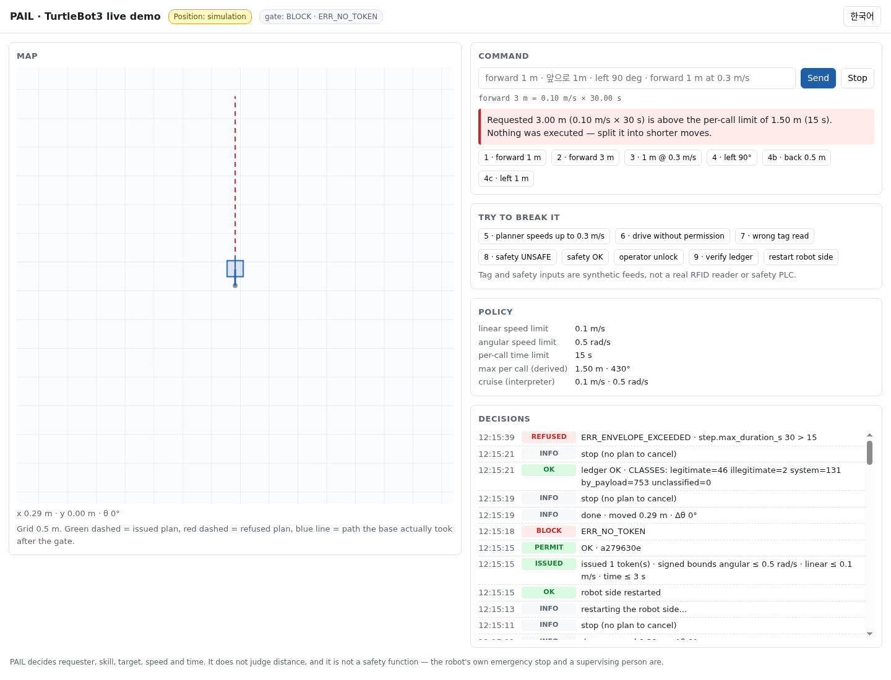

# TurtleBot3 live demo — a walkthrough

> **0.2 evaluation delivery:** first run `python3 evaluation.py load` in the evaluation directory.
> The Issuer runs from the evaluation image. The lower-level commands below run from `pail-core/` after that setup.
> Prefer the `evaluation.py` launcher for a first run.


**Type "forward 1 m". Within the policy the robot moves; above it, nothing moves and
the screen tells you which limit was exceeded. Every decision lands in a signed ledger.**

This is the quickest way to understand what PAIL does. It runs on your computer in
Docker with a simulated TurtleBot3 base: no robot, no account, no ROS installation on
the host. The issuer, the gate and the motion bridge are the real components; only the
robot's wheels, its tag reader and its safety feed are simulated.

> 한국어판: [`DEMO.ko.md`](DEMO.ko.md). The English document is canonical; if the two
> diverge, the English text governs. Reference material for this example (the
> eight-check runner, evidence layout, permissions, hardware boundary) is in
> [`README.md`](README.md).

## What you are looking at

```
 you ── type "forward 1 m" ──▶ console  (plays the AI planner; PAIL does not trust it)
                                  │  asks for permission
                                  ▼
                               issuer ── above the policy? ──▶ REFUSED, nothing moves
                                  │  within it: signs a token          │
                                  ▼                                    ▼
   planner /cmd_vel ──▶ PAIL gate ──▶ motion bridge ──▶ simulated base ──▶ map
                        PERMIT only while a matching                   │
                        signed token is active; otherwise BLOCK        ▼
                                                              signed, hash-chained ledger
```

Three things to watch for:

- **The issuer refuses; it never trims.** A request above a limit is not shortened or
  slowed to fit. It is refused, and the refusal names each exceeded bound.
- **The gate checks every command, not just the first one.** A planner that was granted
  0.1 m/s and then sends 0.3 m/s is blocked on every message, while its token stays valid.
- **"Nothing moved" is never judged from silence.** After every refusal the same observer
  must see a permitted move, otherwise a dead observer would look like a successful block.

## 1. Before you start

| Need | Notes |
|---|---|
| Docker Engine or Desktop with the compose plugin v2 or newer | Linux containers, at least 4 GB of memory for Docker |
| Python 3 and OpenSSL | The macOS system `openssl` (LibreSSL) works |
| macOS, Linux or Windows with WSL2 | Native Windows PowerShell/CMD is not supported |
| Time | First build 10–20 minutes or longer (it compiles ROS 2 packages); later starts 1–2 minutes |
| A free local port | The console uses `127.0.0.1:8765`; change it with `--port` |

The demo generates fresh private keys for each run and keeps them in a state directory
**outside** the source tree. Do not share that directory. Share reviewed files from its
`evidence/` folder instead.

## 2. Start the demo

Run `build` only after explicitly confirming an isolated software build window. It uses
an owned Buildx worker capped at 2 CPUs / 3 GiB and parallelism at most 2; it never
switches the default builder. **`start` and its alias `up` never build.** Missing or
stale prepared images/native dashboard artifacts return `BUILD_REQUIRED`; run `build`
again. The default receipt is `~/.cache/pail-demo/<kind>/prepared.json`; override with
`--build-record PATH`. `up --build --build-window-confirmed` is the explicit combined
form. `--skip-build` remains a compatibility alias, not a prerequisite for reuse.


From the root of the extracted source tree:

```sh
python3 examples/tb3/demo.py build --build-window-confirmed
python3 examples/tb3/demo.py start
```

The terminal prints, in this order:

```
STATE=/tmp/pail-tb3-demo-xxxxxxxx           # keys, config, ledger and evidence for this run
CONSOLE=http://127.0.0.1:8765/               # open this in a browser on the same machine
```

Between the build and the console the runner generates keys, provisions mTLS and SROS2
identities, signs the keyring with a separate root key, starts the issuer and the robot
side on a private Docker network, and waits until the issuer answers. Leave the terminal
open. **Ctrl-C stops the whole stack** and leaves the state directory on disk.

Options: `--state /absolute/new/empty/dir` chooses where the run lives; `--port 8766`
moves the console; `--skip-build --cloud-image TAG --gate-image TAG` reuses images built
by an earlier run (the tags are `pail/tb3-cloud:pail-tb3-demo-<release>-<id>` and
`pail/tb3-gate:pail-tb3-demo-<release>-<id>`, listed by `docker images`). A reused image is not a
fresh build of the tree you have; say so if you report results from it.

The console's trust line shows `bundle`: this demo runs on a signed keyring bundle it generated
at start (valid 8 h), and the line names the root fingerprint (first 8 hex), the bundle version,
the expiry and the time left by the host clock, and says that this console does not verify the
signature — the gate and the Issuer do, at load. An operator profile (`--trust-profile`)
replaces that line with helper-verified metadata. Neither says anything about readiness to
operate.

The compose project — and so every container — is named `pail-tb3-demo-<release>-<id>`: the
release the run was started from (its dots replaced by `-`, for example `0-2-0-preview-43`),
then a value unique to the run. `docker ps -a --filter "name=pail-tb3-demo-<release>-"` lists
the runs of one release and nothing else, and `evidence/console.json` records the same project
beside the release id.

## 3. The console page



| Panel | What it shows |
|---|---|
| Header badges | `Position: simulation` (where positions come from) and `gate: PERMIT` / `gate: BLOCK · reason` (the last gate decision). The button on the right switches the page to Korean and back. |
| **Map** | Grid 0.5 m. Green dashed = the plan the issuer signed; red dashed = a plan it refused; blue line = the path the base actually took after the gate. The square is the robot; the tick is its heading. |
| **Command** | Free-text command box and buttons for scenes 1–4c. Below the box: how the command was interpreted, and a red box when it was refused. |
| **Try to break it** | Scenes 5–9: a misbehaving planner, driving without permission, a wrong tag, a safety stop, ledger verification, plus `safety OK`, `operator unlock` and `restart robot side`. |
| **Policy** | The limits in force for this run and the derived per-call maximum. |
| **Decisions** | A live log. `ISSUED` and `REFUSED` come from the issuer; `PERMIT`, `BLOCK` and `ESTOP` from the gate on the robot side; `OK`/`INFO` are console notes. Newest first. |

The command box understands English and Korean, for example `forward 1 m`, `back 0.5 m`,
`left 90 deg`, `left 1 m`, `forward 1 m at 0.3 m/s`, `stop`, `앞으로 1m`, `왼쪽으로 90도`.
The interpreter always plans at cruise speed (0.1 m/s, 0.5 rad/s) unless you name a speed;
it never raises the speed to shorten a request.

## 4. Walkthrough, scene by scene

The demo policy allows **0.1 m/s**, **0.5 rad/s** and **15 s per call**, so one call can
cover at most 1.5 m. PAIL does not judge distance: it judges requester, skill, target,
speed and time, and the distance bound falls out of speed × time.

### Scene 1 — forward 1 m (permitted)

Type `forward 1 m` or press **1**.

- Under the box: `forward 1 m = 0.10 m/s × 10.00 s`.
- Decisions: `ISSUED issued 1 token(s) · signed bounds angular ≤ 0.5 rad/s · linear ≤ 0.1 m/s · time ≤ 10 s`, then `PERMIT OK · <token id>`.
- Map: a green dashed plan, then the blue line follows it for about ten seconds.
- When the base comes to rest: `INFO done · moved 1.00 m · Δθ 0°` (the simulation typically records 0.99–1.00 m).

The token's bounds are what the issuer signed; the gate enforces them on every command
until the step's time is up, then the token is consumed and forwarding stops.

### Scene 2 — forward 3 m (refused: too long for one call)

Type `forward 3 m` or press **2**.

- Decisions: `REFUSED ERR_ENVELOPE_EXCEEDED · step.max_duration_s 30 > 15`.
- Red box: *Requested 3.00 m (0.10 m/s × 30 s) is above the per-call limit of 1.50 m (15 s). Nothing was executed — split it into shorter moves.*
- Map: a red dashed plan. The blue line does not grow.

The issuer did not issue a 15 s token for the first 1.5 m. Split the request yourself
(`forward 1 m` twice); each request is judged and recorded on its own.

### Scene 3 — forward 1 m at 0.3 m/s (refused: too fast)

Type `forward 1 m at 0.3 m/s` or press **3**.

- Decisions: `REFUSED ERR_ENVELOPE_EXCEEDED · sls.linear_mps 0.3 > 0.1`.
- Red box: *Requested sls.linear_mps 0.3 m/s is above the limit of 0.1 m/s. Nothing was executed.*

### Scenes 4, 4b, 4c — turn, reverse, sideways

- `left 90 deg` (**4**): one token, `turn left 90° = 0.50 rad/s × 3.14 s`; the robot turns in place; `done · moved 0.00 m · Δθ 90°` (the simulation records 89–90°).
- `back 0.5 m` (**4b**): one token, `-0.10 m/s × 5.00 s`; the gate measures speed magnitude, so reverse has the same limit as forward.
- `left 1 m` (**4c**): **two** tokens. A differential-drive base cannot move sideways, so the interpreter plans a 90° turn and then 1 m forward. Both steps are issued together and executed one after the other; the Decisions panel shows two `PERMIT` lines with two token ids.

### Scene 5 — the planner exceeds its permit

Press **5 · planner speeds up to 0.3 m/s**. The console sends `forward 1 m`; about
2.5 s into the move the planner starts publishing 0.3 m/s instead of 0.1 m/s.

- Decisions: `INFO planner now sends 0.3 m/s`, then a stream of `BLOCK ERR_CONSTRAINT · <token id>`.
- The base stops. The blue line stops growing while the planner is over the limit.
- The token is still valid: the gate blocked the commands, not the authorization. Send any new command; it runs at the permitted speed.

This is the difference between "checked at issue time" and "checked at every command".

### Scene 6 — driving without permission

Press **6 · drive without permission**. The planner publishes 0.1 m/s for 4 s without
any plan having been issued.

- Decisions: `INFO driving without a plan: 0.1 m/s × 4 s`, then `BLOCK ERR_NO_TOKEN`.
- The base does not move. Follow with a permitted move (scene 1) to see that the same base still moves.

### Scene 7 — the wrong tag is read

Press **7 · wrong tag read**, then send `forward 1 m`.

- Decisions: `INFO tag read → other-box`, `ISSUED …` (the issuer signed a token for target `sample-box`), then `BLOCK ERR_TARGET_MISMATCH` for every command.
- Press **safety OK** to restore the synthetic tag to `sample-box` (that button resets both synthetic feeds). If the first token is still within its time window the move continues; otherwise send the command again.

The issuer knows what it authorized; the gate refuses to act on evidence that names
something else.

### Scene 8 — safety goes UNSAFE while moving

Send `forward 1 m`, and while the base is moving press **8 · safety UNSAFE**.

- Decisions: `ESTOP safety UNSAFE`. The base stops at once. The gate reports the fatal event and the issuer revokes the robot's current chain (`CHAIN_REVOKED` in the ledger).
- Press **safety OK**: still `BLOCK`. Returning to OK does **not** resume the interrupted plan; that authority is gone for good.
- Send a **new** command: it is issued on a new token and runs. A safety stop revokes the running plan's authority; it does not lock the issuer.
- **operator unlock** answers `unlocked: issuer state NORMAL` here: nothing was locked. The operator lock (`SAFE_STOP`, which refuses every new plan until `Unlock`) is entered only when a gate reports a forged or tampered token, not on a safety event.

The synthetic safety feed is not a safety controller. What the scene shows is that a
safety event ends the plan's authority immediately and that the plan can never resume on
its own; whether people or the robot's own safety system may start the next plan is a
deployment decision outside PAIL.

### Scene S — Stop while moving

Send `forward 1 m` and press **Stop** while the base is moving.

- Decisions: `INFO stop · plan cancelled at the issuer · no permit remains`.
- The planner goes idle and the console cancels the plan at the issuer (`CancelPlan`, recorded as `CHAIN_CANCELLED`). The next command runs on its own token, never on the cancelled plan's remaining time window.
- **Stop observations, not a physical stopping-time guarantee.** SSH delivery and scheduling are not bounded by the 0.1 s planner period. Each stop has an id, and the judge matches its exact planner acknowledgement. Nonzero drive commands are counted after acknowledgement + 0.15 s on the same robot monotonic clock, with a continuing drive-observer stream required. `stop_ack_after_s` is now the console-clock interval from request to received acknowledgement: an upper bound including log transport, not the robot's reaction time. Robot-side publication-to-acknowledgement intervals, zero-command observations and stationary odometry confirmation are reported separately when available. Cross-host wall-clock differences are diagnostic only. Received-message counts are explicitly named; they do not establish when those commands were sent. No field claims a physical stop distance or certified response time.

### Scene 9 — verify the ledger

Press **9 · verify ledger**.

- Decisions: `OK ledger OK · CLASSES: legitimate=… illegitimate=… system=… by_payload=… unclassified=0`.

The issuer's journal is hash-chained and signed. The verifier checks the chain and the
signatures against the issuer's public key and classifies every record. The refusals you
caused are in it, next to the grants: an authorization that was issued but not recorded
cannot exist, because the record is written before the issuance response is returned.

### `restart robot side`

Use this only when the console shows the message that the robot-side clock jumped.
The gate refuses every command with `ERR_CLOCK_DRIFT` after a wall-clock step (observed
on Docker Desktop for macOS as a single +1.96 s step) and, by design, does not re-anchor
its clock. Restarting the robot side resets the map to the origin. This is not a policy
refusal, and the drift limit is not relaxed for the demo.

What the clock jump needs is a restart of the gate process; this button restarts the
whole robot side (the gate and the demo actors) because that is the one restart path the
demo ships, and that is why the map returns to the origin. On a Mac that wakes from sleep
this message is expected: Docker Desktop's clock steps on wake.

## 5. Let the judge run every scene

With the console up, in a second terminal:

```sh
python3 examples/tb3/demo_scenes.py            # --url http://127.0.0.1:8766 if you moved the port
```

It drives the same console through scenes 6, 1, 2, 3, 4, 4b, 4c, 5, 7, 8, S, R (restart)
and 9, prints one `PASS`/`FAIL` line per scene and ends with:

```
RESULT=PASS 13/13 OUT=demo-scenes-results.json
```

Exit status is `0` when every scene passed, `1` when one failed, `2` when the console
was unreachable or the robot-side clock jumped during a scene
(`CLOCK_PREREQUISITE_FAILED` — restart the robot side and run again; the demo does not
loosen any threshold to get a pass). `--only 1,2,9` runs a subset. The results file
records, per scene, what was requested, how many commands reached the base, how far the
simulated base moved, and the `scope` line stating that positions are a simulation.

The judge follows the demo's own rule: every "nothing moved" is followed by a permitted
move that the same observer must see.

## 6. Stop, and what to keep

Press Ctrl-C in the terminal running `demo.py`. It stops its own Compose project only.
In the printed `STATE` directory:

| Path | What it is | Share? |
|---|---|---|
| `evidence/console.json` | Console URL, project name and the image tags used | Yes |
| `evidence/runtime/demo-*.jsonl` | Every observation from the robot side: gate decisions, poses, planner actions | Yes |
| `evidence/*.log` | Build, key generation, provisioning and startup logs | Yes, after review |
| `blackbox/` | The issuer's signed journal for this run | Yes, after review |
| `runtime/config/` and `root-keys/` | Private keys and the root signing key generated for this run | **No** |

When reporting a result, keep the exact source ZIP hash, host OS and CPU, Docker and
Python versions, the command you ran, the `STATE` path and the scene results file.
Images built by the demo stay on disk under the tags printed by `docker images`; remove
them with `docker rmi` when you no longer need them.

## 7. What this demo is not

- **Positions are simulated.** The base integrates the command that passed the gate. It is not an encoder, and the map is not a measurement of a robot.
- **The tag and the safety feed are synthetic.** They stand in for an identity reader and a safety controller so that you can flip them from the page.
- **PAIL is not a safety function.** The robot's own emergency stop and a supervising person remain the safety layer. The demo's ESTOP shows that authorization is withdrawn, not that a machine was made safe.
- **The policy values are demo values.** 0.1 m/s and 15 s were chosen so that a scene fits on a screen; they are not a recommendation.
- **The console is a local requester, not an operations dashboard.** It listens on the loopback interface only.
- **A passing scene is not a hardware test.** See section 9.
- **This is one robot.** The multi-robot operations contracts — admission holds, the
  maintenance lockout register, binding probes — are a separate, opt-in integration
  guide, [`spec/ROBOT_OPERATIONS.md`](../../spec/ROBOT_OPERATIONS.md); nothing in this
  demo enables them.

## 8. If something looks wrong

| Symptom | What it means / what to do |
|---|---|
| Red box: *The robot-side clock jumped…* and every command is `BLOCK ERR_CLOCK_DRIFT` | A wall-clock step on the robot side. Press `restart robot side`. Not a policy refusal. |
| `state must be empty` | The `--state` directory already has files. Choose a new empty directory; old runs are never erased. |
| `Console not reachable at …` from `demo_scenes.py` | Start `demo.py up` first, or pass the port you chose with `--url`. |
| The build fails or is killed | Give Docker at least 4 GB of memory and free disk; a cold build compiles ROS 2 packages. |
| Port 8765 is in use | Start with `--port 8766` and open that URL. |
| `Missing prerequisite: docker` / `openssl` | Install it and make sure `docker info` succeeds before starting. |
| Nothing appears in Decisions after a command | Check the terminal running `demo.py` for an error; the state directory's `evidence/*.log` files show which step failed. |

## 9. On a real TurtleBot3

The scenes above were also exercised by the maintainers on a real TurtleBot3 (official
ROS 2 Humble waffle_pi driver, OpenCR and wheel encoders) on 2026-09-14 and 2026-09-15:
first with the wheels raised, then straight moves, turns, stop while moving and UNSAFE
while moving on 1.5 m of floor, with synthetic identity and safety inputs. Those runs
found and fixed three software defects along the way; the details are in
[`README.md`](README.md#hardware-observation-and-remaining-limits).

**[`HARDWARE.md`](HARDWARE.md) is the procedure**: the robot-side rig script, the
hardware console, the floor runner and a Dockerfile that adds the vendor driver to the gate
image are in [`hardware/`](hardware/), with the configuration split (what the robot gets,
what stays on the operator PC), the placement statement, the scene differences and the
maintainers' measured results. Connecting a base remains a separate, reviewed integration
step, described in
[`README.md`](README.md#connecting-an-actual-turtlebot3-base--a-separate-integration-step).
The all-in-one development configuration that this demo generates must not be copied to
a robot: issuer and operator private keys belong on the issuer and operator hosts, and the
robot gets only its own identity and trusted verification material. The robot's
hardware safety and emergency stop remain independent responsibilities, and no floor
result here is a braking-performance or safety certification.

## Preserve each run's result

`--out` must name a **new file**. An existing file is earlier evidence: the judge refuses it with exit 2 before contacting the console. Omit `--out` to create a timestamped, uniquely identified file under the OS temporary directory's `pail-demo-results/`. The path is printed at startup and progress is saved after every scene. Handled interruptions (SIGINT/SIGTERM) or connection failures retain completed scenes in a failed result. An uncatchable termination such as SIGKILL may leave the last checkpoint incomplete; it is never a pass. A sibling `.events.jsonl` preserves the events read by the judge; the result records their count and SHA-256. These hashes bind bytes; they do not sign or authenticate the origin. For an incomplete checkpoint, that hash covers the recorded prefix count. Each scene records `scene_event_range`; the stop verdict records `observation_event_range`. These are zero-based JSONL bounds (start inclusive, end exclusive). Read run id, completion and selection together; a partial run is not a full-suite pass.

An optional stationary-pose observation requires 0.5 s of observed positions within the existing tolerance. Gaps longer than 0.25 s are not interpreted as standstill. Missing values carry reasons such as `NO_POSE_SAMPLES`, `INSUFFICIENT_POSE_SPAN`, `POSE_GAPS` or `NO_STATIONARY_INTERVAL_OBSERVED`. These describe the observation condition, not a guessed cause such as sensor noise.


### Resource and build operating boundary

Docker Compose and Buildx are required. The reference host is at least 8 CPUs /
16 GiB RAM; the Docker VM needs headroom for the 3 GiB builder plus its daemon and
other workloads. Limits are not proof that other projects are idle or an authorization
latency SLA. If existing rig activity is unknown, build only on a software-only host
or within a confirmed operating window. The prepared receipt's `build-*` directory
records worker identity, effective cgroup limits and samples (`builder.json`,
`resources.jsonl`). Cleanup removes only that worker; it never switches the default
builder or globally restarts/prunes Docker.

Standalone software runtime containers and native console HTTP workers (at most
32, accept backlog 8) are bounded. This does not put a native process in an OS cgroup.
Measure actual process RSS/CPU and cgroup throttling separately; an unavailable
measurement is not a successful resource check or evidence of a stopped robot.
